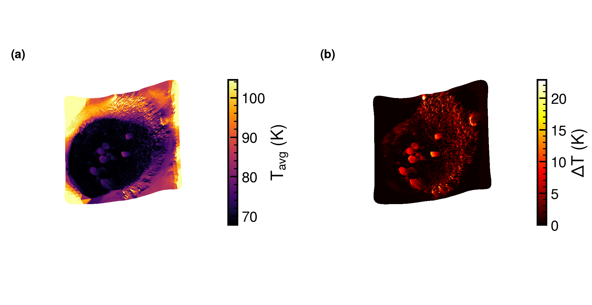
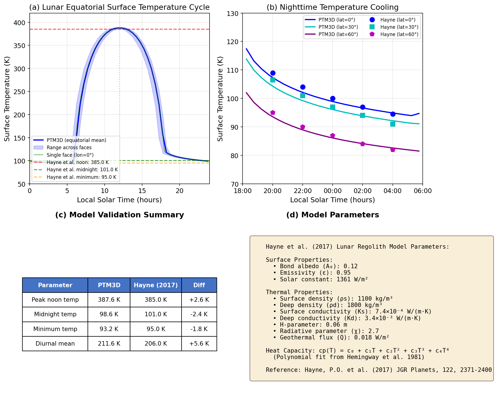

```
    ╔═══════════════════════════════════════════════════════════════╗
    ║    *      .    *     \   ||    //      * .   .      *         ║
    ║       .      *     \  \  ||   //    //       .             .  ║
    ║  *      .       \   \  \  ☀  //    //      .      *           ║
    ║     .         *  \   ...-'''''-...//    *         .           ║
    ║           _ ... .-'''''   PTM3D     ``''-.....,__      .      ║
    ║   __,.-''    Planetary Thermophysical Model 3D     `'-..., _  ║
    ║  ═══════════════════════════════════════════════════════════  ║
    ║      Coupled Thermal-Illumination for Planetary Bodies        ║
    ╚═══════════════════════════════════════════════════════════════╝
```

[](LICENSE)
[](https://isocpp.org/std/the-standard)

**PTM3D** predicts surface and subsurface temperatures on planetary bodies by
coupling ray-traced illumination (Intel Embree + NASA SPICE ephemerides) with a
1D Crank-Nicolson thermal solver and full inter-face thermal radiation exchange
on arbitrary 3D terrain. It is built for physical accuracy and computational speed across a range of planetary thermal environments, from permanently shadowed craters to icy satellite surfaces and asteroids.


*A lunar south-polar crater in PTM3D: (a) diurnal-mean surface temperature on
the native terrain mesh; (b) the warming contributed by inter-face radiation
exchange (two-band radiosity) — crater walls and floors heated by scattered
sunlight and thermal emission from surrounding terrain.*

## What it does

- **Bodies**: Moon, Mercury, Europa — plus any
  body via Keplerian elements, SPICE kernels, or JPL Horizons
- **Illumination**: Embree ray-traced shadows with finite solar disk penumbra,
  eclipses, and primary-body reflected + IR flux (e.g. Earthshine, Jupiter-shine)
- **Thermal**: Crank-Nicolson conduction with T-dependent k(T), cp(T), adaptive
  depth grids, and FFT spectral equilibration for fast spin-up
- **Radiation exchange**: face-to-face view factors, stored sparsely or in
  hierarchically compressed ("H-matrix") form to stay affordable at large face
  counts, driving a two-band (solar/IR) radiosity solver coupled to the
  thermal model
- **Ice**: subsurface ice-stability depth (vapor diffusion), and a full Europa
  exosphere/ice-evolution research module
- **Meshes**: built-in icosphere generator, PLY/OBJ/VTK import, DEM-to-mesh and
  synthetic crater tools; ParaView-compatible outputs
- **Performance**: threaded CPU core everywhere; optional OpenCL GPU
  acceleration for the thermal, radiosity, and ray-tracing stages

## Validation

- **Ingersoll et al. (1992)** analytic bowl-crater radiation: `test_bowl_crater`
  passes with <0.5% view-factor error (the automated build-and-test checks run
  this same test on every code change)
- **Lunar Diviner** radiometer: RMS <4 K against measured bolometric temperatures
- **Hayne et al. (2017)** 1D thermophysical model: reproduces the lunar
  equatorial diurnal cycle (noon ~388 K, night ~99 K) —
  

## Quickstart

Works on a stock 16 GB laptop, CPU-only. Dependencies (CMake, Embree 4, CSPICE,
Eigen3, CFITSIO, yaml-cpp, OpenMP): see [INSTALL.md](INSTALL.md).

```bash
# 1. Build the portable CPU core:
cmake -S . -B build -DCMAKE_BUILD_TYPE=Release -DPTM_ENABLE_GPU=OFF \
      -DPTM_ARCH_NATIVE=OFF -DCSPICE_ROOT="$CSPICE_ROOT"
cmake --build build --target ptm_thermal_sim -j

# 2. Verify with the analytic radiation gate:
cmake --build build --target test_bowl_crater -j && ./build/bin/test_bowl_crater

# 3. Fetch SPICE kernels from NASA NAIF (~45 MB, one time):
python3 scripts/fetch_kernels.py

# 4. Run a global Moon diurnal simulation (1280 faces, seconds to minutes):
./build/bin/ptm_thermal_sim --config examples/quickstart_moon_diurnal.yaml
```

Expected: `output/quickstart_moon_diurnal/statistics/` with per-face
temperature extremes — equatorial noon ~388 K, lunar night ~92 K. Walk through
the outputs in [TUTORIAL.md](TUTORIAL.md) and [docs/tutorials/](docs/tutorials/).

## Documentation

| Where | What |
|-------|------|
| [INSTALL.md](INSTALL.md) | Dependencies, build options, SPICE kernel data, verification |
| [TUTORIAL.md](TUTORIAL.md) | 10-minute laptop walkthrough |
| [docs/tutorials/](docs/tutorials/) | Numbered tutorials: diurnal runs, crater radiosity, interpreting outputs |
| [docs/USER_GUIDE.md](docs/USER_GUIDE.md) | CLI reference, YAML schema, output formats, architecture, Python tools |
| [docs/ENVIRONMENT.md](docs/ENVIRONMENT.md) | Every `PTM_*` environment variable, with status tags |
| [docs/configuration.md](docs/configuration.md) | Complete YAML configuration reference |
| [docs/thermal-model.md](docs/thermal-model.md) · [docs/illumination-model.md](docs/illumination-model.md) · [docs/radiation-exchange.md](docs/radiation-exchange.md) | Physics and numerics of each stage |
| [docs/KNOWN_LIMITATIONS.md](docs/KNOWN_LIMITATIONS.md) · [docs/PORTABILITY-AUDIT.md](docs/PORTABILITY-AUDIT.md) | What to watch out for |

## Hardware guidance

The dominant memory cost is the stored illumination time series:
`faces × timesteps × 3 flux components × 8 bytes` (plus the view-factor matrix
when radiation is on). Estimate any run with
`python3 scripts/ptm_mem_estimate.py --faces N --steps M`.

| Mesh size | Steps | Resident memory | Runs on |
|----------:|------:|----------------:|---------|
| 1k–10k faces | 360 | ≤ 90 MB | any laptop |
| 100k faces | 360 | ~0.9 GB | 16 GB laptop |
| 100k faces | 1440 | ~3.5 GB | 16 GB laptop (borderline — stream) |
| 500k faces | 1440 | ~17 GB | workstation / cluster |
| 1M faces (high-res DEM site) | 360 | ~8.6 GB (+ sparse VF, ~8 GB†) | workstation; GPU recommended |

† Size of the sparse view-factor matrix when radiation exchange is on: about
8 bytes per stored matrix entry, and the number of radiatively coupled partner
faces per face is **terrain-dependent** — measured ~1,040 partners per face
(20 GB at 2.4M faces) on one polar site vs. 4.8 GB at 140k faces on a site
where each face couples to more of its surroundings. The ~8 GB figure scales
the former; budget from your own mesh with a small test build.

GPU (OpenCL) acceleration is optional: build with `-DPTM_ENABLE_GPU=ON` and
profile the host once with `./build/bin/ptm_thermal_sim --calibrate-gpu`.

## GUI

A PyQt6 GUI for configuring runs and visualizing results in 3D:
`cd gui && pip install -r requirements.txt && python run_gui.py`
(details in [gui/README.md](gui/README.md)).

## Citation

If you use PTM3D in your research, please cite it (machine-readable metadata in
[CITATION.cff](CITATION.cff)):

```bibtex
@software{ptm3d,
  author = {Hayne, Paul O.},
  title = {PTM3D: Planetary Thermophysical Model 3D},
  year = {2026},
  institution = {University of Colorado Boulder},
  url = {https://github.com/phayne/ptm3d}
}
```

The supporting science datasets (fetched by `scripts/fetch_data.py`) are
archived on Zenodo: concept DOI
[10.5281/zenodo.21693403](https://doi.org/10.5281/zenodo.21693403)
(v1: [10.5281/zenodo.21693404](https://doi.org/10.5281/zenodo.21693404), CC-BY-4.0).

Heritage methods: Hayne et al. (2017, [10.1002/2017JE005387](https://doi.org/10.1002/2017JE005387));
Hayne & Aharonson (2015, [10.1002/2015JE004887](https://doi.org/10.1002/2015JE004887));
Vasavada et al. (2012, [10.1029/2011JE003987](https://doi.org/10.1029/2011JE003987));
Paige et al. (2010, [10.1126/science.1187726](https://doi.org/10.1126/science.1187726)).
H-matrix view factors: Potter et al. (2023, [10.1016/j.jcpx.2023.100130](https://doi.org/10.1016/j.jcpx.2023.100130)).

## License

MIT — see [LICENSE](LICENSE).

## Acknowledgments

[Sam Potter](https://github.com/sampotter) (H-matrix algorithms,
[fluxpy](https://github.com/sampotter/fluxpy)); NASA NAIF (SPICE); Intel
(Embree); the LRO Diviner team; NASA Lunar-VISE, Europa Clipper, and PSIE.

## Support

Questions or problems? Open a GitHub issue, or contact Paul Hayne
(paul.hayne@colorado.edu).
