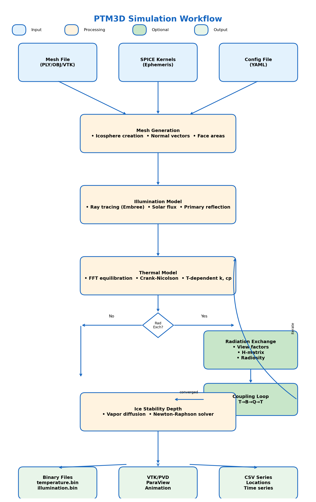
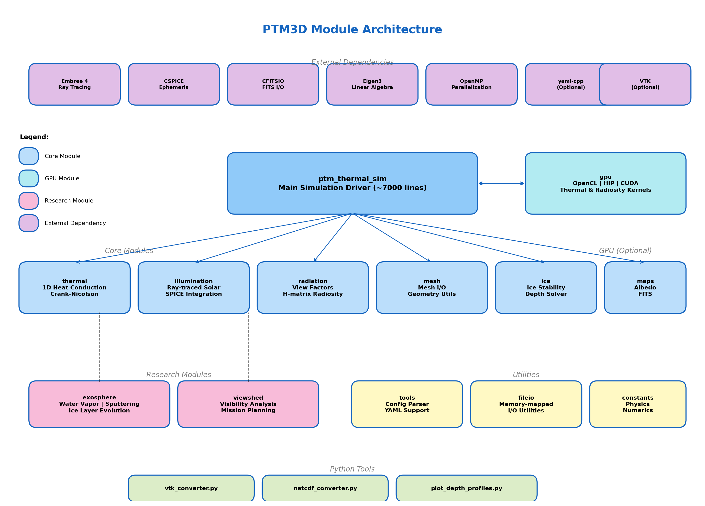
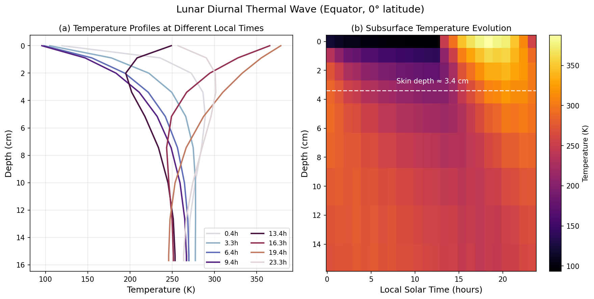

# PTM3D - Planetary Thermophysical Model 3D

[](LICENSE)
[](https://isocpp.org/std/the-standard)

**PTM3D** is a high-performance computational framework for simulating surface and subsurface temperatures on planetary bodies. It combines ray-traced illumination modeling with SPICE ephemeris data and advanced thermophysical calculations to predict accurate thermal regimes on the Moon, Mercury, Europa, and other solar system objects.


*Figure 1: PTM3D simulation workflow showing coupled illumination-thermal-radiation modeling.*

## Key Features

- **Multi-body support**: Moon, Mercury, and Europa with pre-defined thermophysical properties
- **Ray-traced illumination**: Intel Embree 4 with SIMD optimization (AVX-512/AVX2)
- **SPICE ephemeris integration**: Accurate planetary positions via NASA NAIF kernels
- **1D thermal conduction**: Crank-Nicolson solver with temperature-dependent properties
- **Radiation exchange**: View factors with H-matrix compression for large meshes
- **GPU acceleration**: OpenCL backend for thermal solver and radiosity (macOS/Linux)
- **Ice stability depth**: Newton-Raphson solver for subsurface ice table location
- **Flexible mesh input**: PLY, OBJ, VTK formats with resolution control
- **ParaView-compatible output**: VTK/PVD time series for visualization

## Applications

- Lunar Permanently Shadowed Regions (PSRs) thermal mapping
- Water ice stability modeling on Europa and icy moons
- Mercury extreme temperature variations
- Mission thermal environment planning
- Crater thermal regime analysis

---

## Table of Contents

- [Installation](#installation)
- [Quick Start](#quick-start)
- [Architecture](#architecture)
- [Command-Line Reference](#command-line-reference)
- [Output Formats](#output-formats)
- [Python Tools](#python-tools)
- [Examples](#examples)
- [Documentation](#documentation)
- [Contributing](#contributing)
- [Citation](#citation)
- [License](#license)

---

## Installation

### Prerequisites

| Dependency | Version | Required | Purpose |
|------------|---------|----------|---------|
| CMake | 3.10+ | Yes | Build system |
| C++ Compiler | C++17 | Yes | GCC 8+, Clang 10+, or Apple Clang |
| Embree | 4.0+ | Yes | Ray tracing |
| CFITSIO | Any | Yes | FITS file I/O |
| Eigen3 | 3.0+ | Yes | Linear algebra |
| CSPICE | Latest | Yes | NASA ephemeris |
| OpenMP | Built-in | Yes | Parallelization |
| yaml-cpp | 0.6+ | Optional | YAML config files |
| VTK | 8.0+ | Optional | Mesh I/O |
| OpenCL | 1.2+ | Optional | GPU acceleration |

### macOS

```bash
# Install Homebrew dependencies
brew install cmake libomp eigen embree cfitsio yaml-cpp

# Optional: VTK for mesh I/O
brew install vtk

# Download CSPICE from https://naif.jpl.nasa.gov/naif/toolkit_C.html
# Extract to ~/software/cspice/
```

### Linux (Ubuntu/Debian)

```bash
# Core dependencies
sudo apt-get install -y cmake build-essential libomp-dev libeigen3-dev \
    libcfitsio-dev libyaml-cpp-dev

# Embree (may need to build from source on older distros)
sudo apt-get install -y libembree-dev

# Optional: VTK
sudo apt-get install -y libvtk9-dev

# Download CSPICE from https://naif.jpl.nasa.gov/naif/toolkit_C.html
```

### Building from Source

```bash
git clone https://github.com/phayne/ptm3d.git
cd ptm3d
mkdir -p build && cd build

# Configure (adjust CSPICE_ROOT as needed)
cmake .. -DCMAKE_BUILD_TYPE=Release \
         -DCSPICE_ROOT=/path/to/cspice

# Build
cmake --build . -j$(nproc)

# Executables are in build/bin/
ls bin/
# ptm_thermal_sim  albedo_map_generator  crater_mesh_generator  ...
```

**GPU Support (Optional)**:
```bash
# Enable OpenCL GPU acceleration (currently the only fully implemented backend)
cmake .. -DENABLE_GPU=ON -DGPU_BACKEND=OPENCL
```
Note: OpenCL is the recommended GPU backend and works on macOS (AMD GPUs) and Linux. HIP and CUDA backends have framework support but are not fully implemented.

---

## Quick Start

### 1. Minimal Test (~30 seconds)

```bash
cd ptm3d/build
./bin/ptm_thermal_sim \
    --body Moon \
    --resolution 4 \
    --duration 0.5 \
    --timesteps 24 \
    --thermal-mesh \
    --output ../output/quick_test
```

### 2. Using a Configuration File

```bash
./bin/ptm_thermal_sim --config ../examples/quick_test.yaml
```

Example `quick_test.yaml`:
```yaml
simulation:
  body: "Moon"
  start_time: "2025-01-01T00:00:00"
  duration_days: 0.5
  timesteps: 24

mesh:
  resolution: 4

thermal:
  run_thermal_mesh: true
  threads: 0  # Auto-detect
  equilibration_orbits: 5

output:
  directory: "output/quick_test"
  format: "binary"
```

### 3. Full Europa Simulation

```bash
./bin/ptm_thermal_sim \
    --body Europa \
    --resolution 5 \
    --duration 3.55 \
    --timesteps 144 \
    --thermal-mesh \
    --thermal-threads 8 \
    --equilibration-orbits 20 \
    --radiation-exchange \
    --rad-hmatrix \
    --output ../output/europa_full \
    --verbose
```

### 4. Visualize Results

```bash
# Convert binary output to ParaView format
python src/python/vtk_converter.py output/europa_full output/paraview

# Open in ParaView
# File → Open → output/paraview/statistics.pvd
```


*Figure 2: Surface temperature distribution on a lunar mesh at local noon.*

---

## Architecture

PTM3D uses a modular architecture with coupled physics engines:


*Figure 3: PTM3D module architecture and data flow.*

### Core Modules

| Module | Location | Description |
|--------|----------|-------------|
| **thermal** | `src/cpp/thermal/` | 1D heat conduction with Crank-Nicolson solver |
| **illumination** | `src/cpp/illumination/` | Ray-traced solar flux with SPICE ephemeris |
| **radiation** | `src/cpp/radiation/` | View factors, H-matrix compression, radiosity |
| **gpu** | `src/cpp/gpu/` | GPU acceleration (OpenCL) |
| **mesh** | `src/cpp/mesh/` | Mesh I/O and utilities |
| **ice** | `src/cpp/ice/` | Ice stability depth calculation |

### Research Modules

| Module | Location | Description |
|--------|----------|-------------|
| **exosphere** | `src/cpp/exosphere/` | Water vapor sublimation and sputtering |
| **viewshed** | `src/cpp/viewshed/` | Visibility analysis for mission planning |

### Physics Overview

**Thermal Model**:
- Temperature-dependent thermal conductivity: `k(T) = k_c + k_r·T³`
- Heat capacity polynomial: `cp(T) = c₀ + c₁T + c₂T² + ...`
- Adaptive depth grid with logarithmic spacing
- Validated against Lunar Diviner data (RMS error <4K)


*Figure 4: (a) Subsurface temperature profiles at different local solar times showing the diurnal thermal wave. (b) Temperature evolution with depth and time; the white dashed line indicates the thermal skin depth (~3.4 cm).*

**Radiation Exchange**:
- Sparse view factor matrix with CSR storage
- H-matrix hierarchical compression (O(N log N) storage)
- Adaptive thermal-radiation coupling iterations

---

## Command-Line Reference

### Essential Options

```
--body, -b <name>         Body name (Moon, Mercury, or Europa)
--config <file>           Load YAML configuration file
--resolution <n>          Global mesh resolution (default: 5)
--duration <days>         Simulation duration in days
--timesteps <n>           Number of output timesteps
--output <dir>            Output directory
--verbose                 Enable detailed logging
```

### Thermal Options

```
--thermal-mesh            Run thermal model for all faces
--thermal-threads <n>     Number of parallel threads (0 = auto)
--equilibration-orbits <n> Diurnal cycles for equilibration (default: 10)
--use-gpu-thermal         Use GPU thermal solver (requires OpenCL)
```

### Radiation Exchange

```
--radiation-exchange      Enable inter-face radiation
--rad-hmatrix            Use H-matrix compression (recommended for >50K faces)
--rad-view-factor-file <f> Save/load view factors
--rad-coupling-iter <n>   Max coupling iterations (default: 10)
--rad-coupling-temp-tol <K> Convergence threshold (default: 0.5 K)
```

### Illumination

```
--albedo-map <file>       Custom albedo FITS map
--no-primary-reflection   Disable reflected light from primary body
--positions <file>        Export body positions to CSV
```

Run `./bin/ptm_thermal_sim --help` for the complete reference.

---

## Output Formats

PTM3D generates several output types:

```
output/
├── mesh.ply                    # Mesh geometry
├── statistics/
│   ├── temperature_avg.bin     # Mean temperature per face
│   ├── temperature_max.bin     # Maximum temperature
│   ├── temperature_min.bin     # Minimum temperature
│   ├── illumination_avg.bin    # Mean solar flux
│   └── ice_depth.bin           # Ice stability depth
├── temperature/
│   ├── temperature_00001.bin   # Per-timestep temperatures
│   └── ...
└── illumination_series.csv     # Location time series (if --locations)
```

**Binary format**: Single-precision float arrays, one value per face.

**VTK conversion**: Use `python src/python/vtk_converter.py` to create ParaView-compatible files.

**NetCDF export**: Use `python src/python/netcdf_converter.py` for cross-platform analysis.

---

## Python Tools

| Script | Purpose |
|--------|---------|
| `vtk_converter.py` | Convert binary output to VTK/PVD format |
| `netcdf_converter.py` | Export to NetCDF for cross-platform analysis |
| `plot_depth_profiles.py` | Visualize temperature vs depth from CSV output |
| `plot_thermal_debug.py` | Plot diurnal thermal wave profiles from debug output |
| `extract_timeseries.py` | Extract data for specific lat/lon locations |
| `lunar_validation_figure.py` | Generate validation plots comparing to Hayne et al. (2017) |

### Example: Convert and Visualize

```bash
# Convert to ParaView format
python src/python/vtk_converter.py output/simulation output/paraview

# Generate depth profile plots
python src/python/plot_depth_profiles.py output/simulation/thermal_debug.txt

# Export to NetCDF
python src/python/netcdf_converter.py \
    --input output/paraview/statistics.pvd \
    --output output/statistics.nc \
    --format pvd
```

---

## Examples

### Crater Thermal Analysis

```bash
# Generate a bowl crater mesh
./bin/crater_mesh_generator --diameter 10 --depth 1.25 \
    --output data/meshes/crater.ply

# Run simulation with radiation exchange
./bin/ptm_thermal_sim \
    --mesh-file data/meshes/crater.ply \
    --body Moon \
    --duration 29.5 \
    --timesteps 354 \
    --thermal-mesh \
    --radiation-exchange \
    --rad-hmatrix \
    --output output/crater_sim
```

### Extract Time Series for Specific Locations

```bash
# Create locations file
cat > locations.txt << EOF
0.0 0.0 SubsolarPoint
45.0 0.0 MidLatitude
85.0 0.0 NearPole
EOF

./bin/ptm_thermal_sim \
    --config examples/quick_test.yaml \
    --locations locations.txt \
    --series-output illumination_series.csv
```

---

## Validation

PTM3D has been validated against:

- **Lunar Diviner** radiometer measurements (RMS <4K)
- **Hayne et al. (2017)** grid optimization methodology
- **Potter et al. (2023)** H-matrix implementation


*Figure 5: PTM3D validation against Hayne et al. (2017) analytical model for the lunar equator. (a) Temperature vs. local solar time. (b) Maximum and minimum temperatures vs. latitude. PTM3D reproduces the expected diurnal cycle with noon temperatures of ~388 K and nighttime temperatures of ~99 K.*

---

## Documentation

For more detailed information, see the documentation in [`docs/`](docs/):

| Document | Description |
|----------|-------------|
| [Thermal Model](docs/thermal-model.md) | Physics and algorithms for 1D heat conduction |
| [Radiation Exchange](docs/radiation-exchange.md) | View factors, H-matrix compression, radiosity solver |
| [GPU Acceleration](docs/gpu-implementation-plan.md) | GPU backend architecture and performance |
| [API Reference](docs/api-reference.md) | C++ class and function documentation |
| [Configuration Guide](docs/configuration.md) | Complete YAML configuration reference |

---

## Contributing

Contributions are welcome! Please:

1. Fork the repository
2. Create a feature branch (`git checkout -b feature/new-feature`)
3. Make your changes with tests
4. Submit a pull request

See [CONTRIBUTING.md](CONTRIBUTING.md) for detailed guidelines.

---

## Citation

If you use PTM3D in your research, please cite:

```bibtex
@software{ptm3d,
  author = {Hayne, Paul O.},
  title = {PTM3D: Planetary Thermophysical Model 3D},
  year = {2025},
  institution = {University of Colorado Boulder},
  url = {https://github.com/phayne/ptm3d}
}
```

---

## License

This project is licensed under the MIT License - see [LICENSE](LICENSE) for details.

---

## Acknowledgments

- NASA NAIF for SPICE toolkit and ephemeris data
- Intel for Embree ray tracing library
- Lunar Reconnaissance Orbiter Diviner team for validation data
- NASA Lunar Vulkan Imaging and Spectroscopy Explorer (Lunar-VISE)
- NASA Europa Clipper mission
- NASA Precursor Science Investigations for Europa (PSIE)

---

**Questions?** Open an issue on GitHub or contact Paul Hayne (paul.hayne@colorado.edu).
