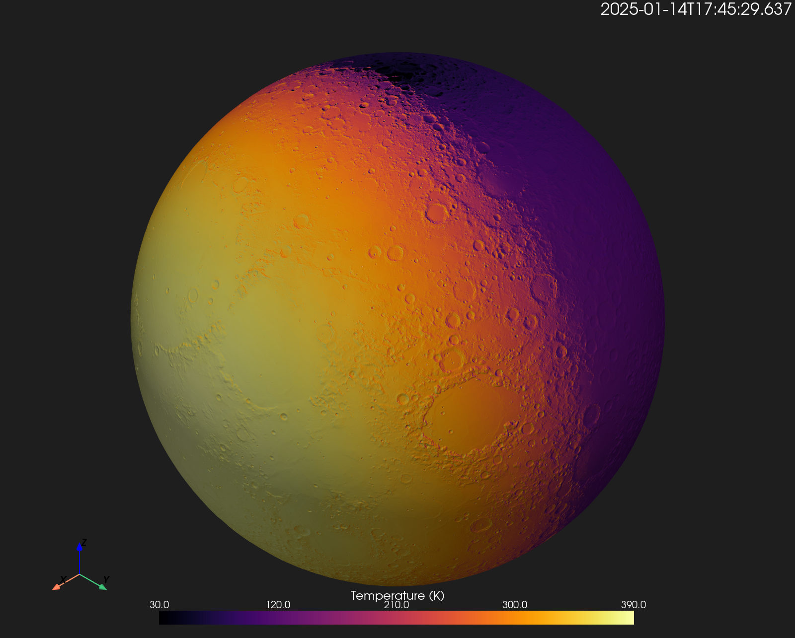
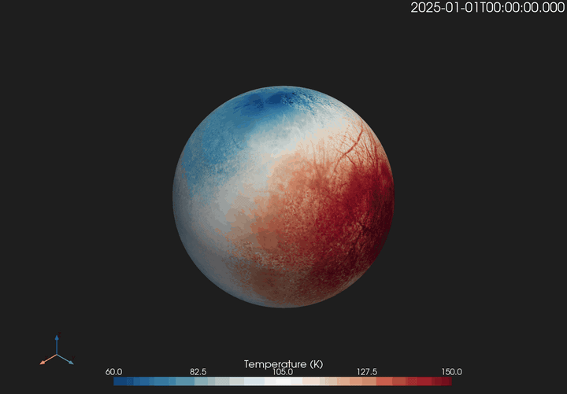
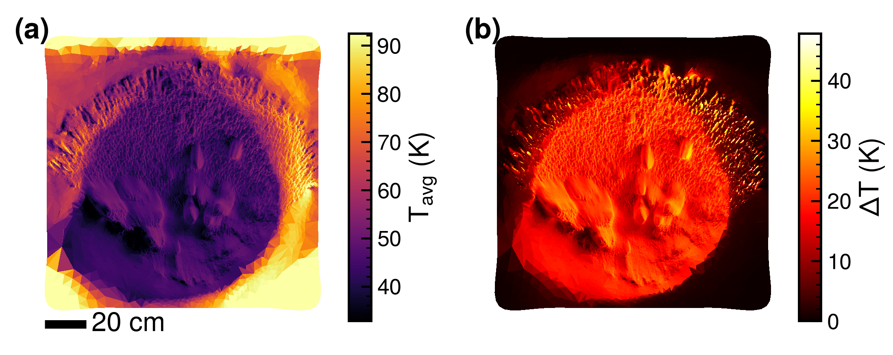

# PTM3D: Planetary Thermophysical Model 3D

[](LICENSE)

PTM3D computes surface and subsurface temperatures of airless bodies on 3D terrain.
It couples ray-traced illumination (Intel Embree, NASA SPICE geometry), a 1D heat-conduction
column under every mesh face, and face-to-face exchange of scattered sunlight and thermal
infrared. It runs on ordinary CPUs; an OpenCL GPU is optional.

<table>
<tr>
<td width="60%">



</td>
<td width="40%">

*Global lunar surface temperatures on a 5.2-million-face icosphere
(resolution 9), one snapshot from a full-lunation PTM3D run with topographic
shadowing and SPICE solar geometry.*

</td>
</tr>
<tr>
<td width="60%">



</td>
<td width="40%">

*Global Europa surface temperatures over one Europan day (3.55 Earth days),
computed with SPICE geometry, per-face albedo, and Jupiter's reflected light
and thermal emission included.*

</td>
</tr>
</table>



*Moon3D testbed crater scan (509,337 faces, mean facet edge about 2.5 mm, domain 1.33 m on a side) placed at the IM-2 landing
site (84.79°S), seen from directly above (east to the right, north up; the scale bar applies to both panels):
(a) time-averaged surface temperature over one synodic month with
face-to-face radiation exchange; (b) the warming that radiation exchange adds relative to an
otherwise identical run without it. (Same data as Fig. 12 of Hayne et al., JGR Planets, in revision, which shows an oblique view.)*

## Install

CPU build on macOS or Linux (Windows: use WSL2 and the Linux steps). Full details, including
CSPICE, which is not in any package manager: [INSTALL.md](INSTALL.md).

```bash
brew install cmake embree eigen cfitsio yaml-cpp libomp pkg-config        # or the apt line in INSTALL.md
export CSPICE_ROOT=/path/to/cspice                                         # NAIF CSPICE, see INSTALL.md
cmake -S . -B build -DCMAKE_BUILD_TYPE=Release -DPTM_ENABLE_GPU=OFF -DPTM_ARCH_NATIVE=OFF \
      -DCSPICE_ROOT="$CSPICE_ROOT"
cmake --build build --target ptm_thermal_sim -j
```

## First run

From the repository root:

```bash
python3 scripts/fetch_kernels.py --bodies moon                  # SPICE kernels, about 44 MB
./build/bin/ptm_thermal_sim --config examples/quickstart_moon_diurnal.yaml
```

One lunation of a 1,280-face global Moon, after an 80-cycle spin-up: about 30 s on four
cores. The per-face results land in `output/quickstart_moon_diurnal/statistics/`, and the
hottest face reaches 385.0 K (equatorial noon). The first tutorial reads these files and
explains every line of the run log: [docs/tutorials/01_quickstart.md](docs/tutorials/01_quickstart.md).

## Documentation

Read in this order:

| Page | What it covers |
|---|---|
| [INSTALL.md](INSTALL.md) | Dependencies, build options, SPICE kernels, science data, verification |
| [docs/tutorials/](docs/tutorials/README.md) | Quickstart, crater radiation exchange, output files, GUI, and four Jupyter notebooks (Moon, Europa, asteroids) |
| [docs/USER_GUIDE.md](docs/USER_GUIDE.md) | Command line, output formats, Python package |
| [docs/configuration.md](docs/configuration.md) | Every configuration key and its default |
| [docs/KNOWN_LIMITATIONS.md](docs/KNOWN_LIMITATIONS.md) | What the model does not do; read before a production run |
| [docs/VALIDATION.md](docs/VALIDATION.md) | Comparisons with analytic solutions, Diviner and Apollo data |
| [docs/thermal-model.md](docs/thermal-model.md), [docs/illumination-model.md](docs/illumination-model.md), [docs/radiation-exchange.md](docs/radiation-exchange.md) | Physics and numerics of each stage |
| [docs/ENVIRONMENT.md](docs/ENVIRONMENT.md) | Environment variables, including the opt-in fine-mesh illumination settings |
| [data/README.md](data/README.md) | Science datasets, provenance and licenses |
| [gui/README.md](gui/README.md) | The desktop GUI |
| [CHANGELOG.md](CHANGELOG.md) | Changes between releases |

## Capabilities

PTM3D has built-in properties for the Moon, Mercury and Europa, and handles any other body
through orbital elements, SPICE kernels or JPL Horizons. Illumination is ray traced, with a
finite solar disk, eclipses, and reflected light and thermal emission from a primary body
(Earthshine, Jupiter-shine). Heat conduction is solved in Crank-Nicolson columns with
temperature-dependent conductivity and heat capacity and depth-dependent density. Radiation
exchange uses face-to-face view factors (sparse or hierarchically compressed) and two-band
(visible and infrared) radiosity coupled to the thermal solution, with optional sub-facet
roughness (beaming). The products are per-face temperature and flux statistics, per-step
frames, subsurface depth maps and the ice-stability depth; a Python package and a desktop GUI
read them.

## Validation summary

Details and figures are in [docs/VALIDATION.md](docs/VALIDATION.md).

- Bowl crater (Ingersoll et al. 1992): the shadowed-floor temperature is within 0.1 K (≤0.26%)
  of the analytic solution and the shadow flux within 1.2%, at 15,840 faces.
- Diviner equatorial diurnal cycle and Apollo 15/17 heat-flow probes: every reference point
  that carries an uncertainty lies within its ±5 K bar (largest residual 4.91 K). The reference
  values come from the Hayne et al. (2017) compilation, which shares an author with PTM3D.
- Diviner seasonal temperatures at a Haworth cold-trap site (240 m cells): on the cold-trap
  floor (n = 2,970) the median summer-maximum bias is −0.80 K (IQR 11.19 K) with sub-facet
  roughness, and −10.30 K (IQR 10.38 K) without it.

## Citation

Please cite the software ([CITATION.cff](CITATION.cff)) and the supporting datasets on Zenodo:
concept DOI [10.5281/zenodo.21693403](https://doi.org/10.5281/zenodo.21693403) (CC-BY-4.0).
Heritage methods: Hayne et al. (2017, [10.1002/2017JE005387](https://doi.org/10.1002/2017JE005387));
Hayne & Aharonson (2015, [10.1002/2015JE004887](https://doi.org/10.1002/2015JE004887));
Paige et al. (2010, [10.1126/science.1187726](https://doi.org/10.1126/science.1187726)).
H-matrix view factors: Potter et al. (2023, [10.1016/j.jcpx.2023.100130](https://doi.org/10.1016/j.jcpx.2023.100130)).

## License and support

MIT ([LICENSE](LICENSE)). Questions and bug reports: the repository's Issues tab. For a build or
run problem, include your OS and compiler, the CMake configure summary, and the first 40 lines
of the run log. Contact: Paul Hayne (paul.hayne@colorado.edu).

Acknowledgments: Sam Potter (H-matrix algorithms, [fluxpy](https://github.com/sampotter/fluxpy));
NASA NAIF (SPICE); Intel (Embree); the LRO Diviner team; NASA Lunar-VISE, Europa Clipper, PSIE
and the Moon3D project.
