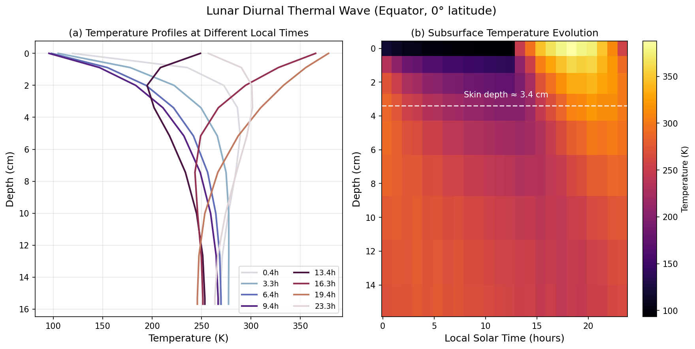

# PTM3D User Guide

The working reference for running PTM3D: the simulation workflow, code
architecture, complete command-line reference, YAML configuration schema,
output formats, GUIs, and the Python post-processing tools. For installation
see [../INSTALL.md](../INSTALL.md); for a first run see
[../README.md](../README.md) and [../TUTORIAL.md](../TUTORIAL.md); for the
`PTM_*` environment variables see [ENVIRONMENT.md](ENVIRONMENT.md).

---

## Simulation Workflow

```
                              ┌─────────────────┐
                              │     INPUTS       │
                              └────────┬─────────┘
                                       │
              ┌────────────────────────┼────────────────────────┐
              │                        │                        │
              v                        v                        v
     ┌────────────────┐      ┌────────────────┐      ┌────────────────┐
     │  Mesh File     │      │ SPICE Kernels  │      │  Config File   │
     │ (PLY/OBJ/VTK)  │      │  (Ephemeris)   │      │    (YAML)      │
     └───────┬────────┘      └───────┬────────┘      └───────┬────────┘
             │                       │                        │
             └───────────────────────┼────────────────────────┘
                                     │
                                     v
                        ┌────────────────────────┐
                        │    MESH GENERATION      │
                        │  Icosphere / DEM import │
                        │  Normals, areas, coords │
                        └───────────┬─────────────┘
                                    │
                                    v
                        ┌────────────────────────┐
                        │   ILLUMINATION MODEL    │
                        │  Ray tracing (Embree)   │
                        │  Direct solar flux      │
                        │  Primary reflection     │
                        │  Primary IR emission    │
                        │  Eclipse computation    │
                        └───────────┬─────────────┘
                                    │
                                    v
                        ┌────────────────────────┐
                        │     THERMAL MODEL       │
                        │  Spectral equilibration │
                        │  Crank-Nicolson solver  │
                        │  T-dependent k(T), cp(T)│
                        └───────────┬─────────────┘
                                    │
                    ┌───────────────┴───────────────┐
                    │                               │
                    v                               v
        ┌───────────────────┐           ┌───────────────────┐
        │ RADIATION EXCHANGE│           │   (no coupling)   │
        │  View factors     │           └─────────┬─────────┘
        │  H-matrix / CSR   │                     │
        │  Radiosity solver │                     │
        └─────────┬─────────┘                     │
                  │                               │
                  v                               │
        ┌───────────────────┐                     │
        │  COUPLING LOOP    │                     │
        │  T -> B -> Q_ind  │                     │
        │  Selective re-run │                     │
        │  Convergence check│                     │
        └────┬────┬─────────┘                     │
             │    │                               │
             │    └── iterate ──> back to         │
             │        Thermal Model               │
             │                                    │
             └────────────────┬───────────────────┘
                              │
                              v
                   ┌───────────────────┐
                   │  ICE STABILITY    │
                   │  Vapor diffusion  │
                   │  Newton-Raphson   │
                   │  Ice table depth  │
                   └────────┬──────────┘
                            │
                            v
                   ┌────────────────────┐
                   │      OUTPUTS       │
                   └────────┬───────────┘
                            │
           ┌────────────────┼────────────────┐
           │                │                │
           v                v                v
  ┌────────────────┐ ┌──────────────┐ ┌──────────────┐
  │  Binary Files  │ │   VTK/PVD    │ │ CSV Series   │
  │  temperature   │ │  ParaView    │ │ Locations    │
  │  illumination  │ │  compatible  │ │ Time series  │
  │  statistics    │ │  animation   │ │ Depth data   │
  └────────────────┘ └──────────────┘ └──────────────┘
```

---

## Architecture

### Source Layout

```
src/cpp/
├── main/             Main driver (ptm_thermal_sim.cpp)
├── thermal/          1D heat conduction, spectral equilibration
├── illumination/     Ray-traced solar flux with SPICE ephemeris
├── radiation/        View factors, H-matrix compression, radiosity
├── gpu/              OpenCL/HIP/CUDA acceleration
├── mesh/             Mesh I/O and geometry utilities
├── orbital/          Kepler propagation, body-fixed frames
├── maps/             Albedo/property FITS maps, spatial interpolation
├── constants/        Physical and planetary constants
├── ice/              Ice stability depth solver
├── tools/            Config parser, crater/DEM mesh generators
├── fileio/           Memory-mapped binary I/O
├── exosphere/        Sublimation, sputtering, ice evolution
└── viewshed/         Line-of-sight visibility analysis
```

### Core Modules

| Module | Key Classes | Description |
|--------|-------------|-------------|
| **thermal** | `thermal::Model`, `thermal::Profile`, `thermal::Config` | 1D Crank-Nicolson heat conduction with temperature-dependent properties, adaptive depth grids, and FFT-based spectral equilibration for fast spin-up |
| **illumination** | `IlluminationModel` | Shadow ray tracing (Embree), finite solar disk integration, primary-body reflected and thermal IR flux, eclipse geometry via SPICE |
| **radiation** | `RadiationExchangeManager`, `RadiositySolver`, `ViewFactorMatrix`, `HMatrixViewFactor` | Face-to-face view factors stored as a sparse matrix (compressed sparse row, "CSR", format) or in hierarchically compressed ("H-matrix") form; Jacobi/Gauss-Seidel radiosity iteration; adaptive thermal-radiation coupling |
| **gpu** | `ThermalOpenCLSolver`, `RadiosityOpenCLSolver`, `BVHRayTracer` | GPU-accelerated thermal solver (tridiagonal Thomas-algorithm solve), radiosity (sparse matrix–vector Jacobi iteration), and shadow ray tracing |
| **orbital** | `GenericBody`, `KeplerPropagator` | Keplerian orbit propagation, SPICE/Horizons ephemeris, body-fixed coordinate frames, spin state |
| **mesh** | `ptm::Mesh` | Icosphere generation, PLY/OBJ/VTK import, face normals/areas/centers, VTK export |
| **ice** | Ice stability solver | Vapor diffusion and Newton-Raphson ice table depth |

### Research Modules

| Module | Key Classes | Description |
|--------|-------------|-------------|
| **exosphere** | `ExospherePhysics`, `SputteringModel`, `IceLayerModel`, `IceCrystallizationModel` | Water vapor sublimation rates, ion sputtering yields, amorphous-to-crystalline ice phase transitions, regolith lag formation, composition-albedo feedback, multi-timescale epoch evolution |
| **viewshed** | Viewshed analyzer | Line-of-sight visibility from surface waypoints, terrain occlusion, mission traverse planning |

### Physics Highlights

**Thermal Model**:
- Temperature-dependent thermal conductivity: $k(T) = k_c \cdot (1 + \chi \cdot (T/350)^3)$
- Heat capacity: polynomial for lunar regolith; linear $c_p(T) = 7.49 \cdot T$ for water ice (Europa)
- Adaptive depth grid with logarithmic spacing
- Spectral equilibration: FFT decomposition of the diurnal flux into Fourier harmonics, each solved analytically with skin-depth scaling $\delta_n = \delta_1/\sqrt{n}$, converging in 3-5 iterations vs. thousands of time-stepping cycles
- Validated against Lunar Diviner data (RMS error <4 K)

**Radiation Exchange**:
- Radiosity equation: $B_i = \varepsilon_i \sigma T_i^4 + \rho_i \sum_j F_{ij} B_j + \rho_i Q_{\text{solar},i}$
- View factor methods: centroid (far field) and subdivision (near field), selected adaptively by dimensionless separation $N_s = r/\sqrt{A}$
- Hierarchical-matrix ("H-matrix") compression with octree spatial partitioning, low-rank block compression by adaptive cross approximation (ACA), and $O(N \log N)$ matrix–vector multiplication cost
- Adaptive thermal-radiation coupling: selective face re-run, warm-start solver, convergence on temperature and flux criteria

**Exosphere Model**:
- Sublimation-driven water vapor loss with Hertz-Knudsen kinetics
- Ion sputtering yields (magnetospheric bombardment)
- Amorphous-to-crystalline ice transition (Arrhenius kinetics)
- Composition-albedo feedback: non-ice lag concentration lowers albedo, increasing temperature (positive feedback for thermal segregation)
- Multi-timescale operator splitting: diurnal, seasonal, and geological epochs


*Subsurface temperature profiles at different local solar times showing the diurnal thermal wave. Temperature evolution with depth and time; the white dashed line indicates the thermal skin depth (~3.4 cm).*

---

## Command-Line Reference

### Simulation Setup

```
--config <file>               Load YAML configuration file
--body, -b <name>             Body name (Moon, Mercury, Europa, Mars, Ceres, ...)
--start <time>                Start time (ISO 8601, default: 2025-01-01T00:00:00)
--resolution <n>              Global icosphere resolution (default: 5)
--duration <days>             Simulation duration in days
--timesteps <n>               Number of output timesteps
--output <dir>                Output directory
--verbose                     Enable detailed logging
```

### Mesh

```
--mesh-file <file>            Import mesh (PLY, OBJ, VTK)
--mesh-scale <factor>         Scale imported mesh (default: 1.0)
--export-basic-mesh           Export basic mesh to VTK
```

### Thermal

```
--thermal-mesh                Run thermal model for all faces
--thermal-threads <n>         Number of parallel threads (0 = auto)
--equilibration-orbits <n>    Diurnal cycles for equilibration (default: 1)
--use-gpu-thermal             Use GPU thermal solver (OpenCL)
--geothermal-heat-flow <Q>    Bottom boundary heat flow (W/m^2)
--thermal-m <n>               Layers in upper skin depth (default: 10)
--thermal-n <n>               Layer growth factor (default: 15)
--thermal-b <n>               Skin depths to bottom (default: 8)
```

### Radiation Exchange

```
--radiation-exchange          Enable inter-face radiation exchange
--rad-hmatrix                 Use H-matrix compression (recommended for >50K faces)
--rad-use-gpu                 Use GPU radiosity solver (OpenCL)
--rad-view-factor-file <f>    Save/load pre-computed view factors
--rad-coupling-iter <n>       Max coupling iterations (default: 10)
--rad-coupling-temp-tol <K>   Temperature convergence threshold (default: 2.0 K)
--rad-coupling-flux-tol <W>   Flux change threshold (default: 0.1 W/m^2)
--rad-coupling-face-frac <f>  Face fraction still changing (default: 0.01)
--rad-aca-tolerance <t>       ACA compression tolerance (default: 1e-3)
--rad-hmatrix-threads <n>     H-matrix build threads (0 = auto)
```

### Illumination

```
--albedo-map <file>           Custom albedo FITS map
--no-primary-reflection       Disable reflected light from primary body
--shadow-flux                 Enable shadow/crater scattered flux
--positions <file>            Export body positions to CSV
```

### Output

```
--output-format <fmt>         Output format: "binary" or "vtk" (default: binary)
--vtk-mode <mode>             VTK mode: "thermal", "complete", "both"
--include-primary-ir          Include primary IR in VTK output
--locations <file>            Extract illumination for lat/lon locations
--depths <file>               Export subsurface temperature profiles
--series-output <file>        Time series output file
```

Run `./build/bin/ptm_thermal_sim --help` for the complete reference.

---

## Configuration File

PTM3D accepts YAML configuration files via `--config`. Command-line flags override config file values. The top-level sections are:

```yaml
simulation:
  body: "Europa"
  start_time: "2025-01-01T00:00:00"
  duration_days: 3.55
  timesteps: 144

mesh:
  resolution: 5
  import_file: ""           # PLY/OBJ/VTK path (overrides icosphere)
  use_topographic: false    # Use topographic DEM

thermal:
  run_thermal_mesh: true
  threads: 0                # 0 = auto-detect
  equilibration_orbits: 10
  geothermal_heat_flow: -1  # -1 = planet default

illumination:
  include_primary_reflection: true
  use_batch_processing: true
  albedo_maps_directory: "data/albedo_maps"

radiation:
  enabled: false
  use_hmatrix: false
  max_coupling_iterations: 10
  coupling_temp_threshold: 2.0   # K
  coupling_flux_threshold: 0.1   # W/m^2

output:
  directory: "output/simulation"
  format: "binary"

generic_body:                # For arbitrary bodies
  name: "MyAsteroid"
  radius_km: 50.0
  semi_major_axis_au: 2.5
  spin_period_hours: 6.0
  albedo: 0.1
  emissivity: 0.95
  # ... (see configuration.md for full reference)
```

See [`../examples/`](../examples/) for runnable configurations (relative paths
only; start with `quickstart_moon_diurnal.yaml`). The configs under
`examples/campaigns/` are internal production-campaign artifacts with
machine-specific paths and are **not** runnable from a clone.

---

## Output Formats

PTM3D generates several output types:

```
output/
├── mesh.ply                    # Mesh geometry
├── statistics/
│   ├── temperature_avg.bin     # Mean temperature per face
│   ├── temperature_max.bin     # Maximum temperature
│   ├── temperature_min.bin     # Minimum temperature
│   ├── illumination_avg.bin    # Mean solar flux
│   └── ice_depth.bin           # Ice stability depth
├── temperature/
│   ├── temperature_00001.bin   # Per-timestep temperatures
│   └── ...
└── illumination_series.csv     # Location time series (if --locations)
```

**Binary format**: each statistics file is a 4-byte little-endian int32 face
count followed by one single-precision float per mesh face (see the tutorial
`tutorials/06_interpreting_outputs.md` for a reader snippet).

**VTK/PVD export**: Use `python src/python/vtk_converter.py` to create ParaView-compatible time series.

**Additional exports**: NetCDF (`netcdf_converter.py`), HDF5 (`ptm_hdf5.py`), GeoTIFF (`ptm_geotiff.py`).

---

## Graphical User Interface

PTM3D includes three PyQt6-based GUIs for configuring simulations and visualizing results:

| GUI | Script | Purpose |
|-----|--------|---------|
| **PTM3D Main** | `gui/run_gui.py` | Thermal simulation configuration and 3D visualization |
| **Exosphere** | `gui/exosphere_gui.py` | Exosphere sublimation/sputtering modeling |
| **Viewshed** | `gui/viewshed_gui.py` | Line-of-sight visibility analysis |

### Quick Start

```bash
cd gui/
pip install -r requirements.txt
python run_gui.py
```

### Features

- **Tabbed configuration**: Simulation, mesh, thermal, radiation, illumination, and output settings
- **3D visualization**: Interactive PyVista-based mesh rendering with temperature colormap
- **2D analysis**: Histograms, latitude plots, and time series
- **Live preview**: Real-time YAML configuration preview
- **Console output**: Color-coded simulation progress and logging

See [../gui/README.md](../gui/README.md) for detailed GUI documentation.

---

## Python Tools

### Post-Processing Scripts (`src/python/`)

| Script | Purpose |
|--------|---------|
| `vtk_converter.py` | Convert binary output to VTK/PVD for ParaView |
| `vtk_converter_exosphere.py` | Convert exosphere output to VTK |
| `netcdf_converter.py` | Export to NetCDF |
| `ptm_hdf5.py` | Export to HDF5 |
| `ptm_geotiff.py` | Export to GeoTIFF (geospatial) |
| `plot_depth_profiles.py` | Subsurface temperature-depth profiles |
| `extract_timeseries.py` | Extract data for specific lat/lon locations |
| `lunar_validation_figure.py` | Validation plots vs. Hayne et al. (2017) |
| `europa_visualization.py` | Europa-specific visualization |
| `exosphere_analysis.py` | Exosphere output analysis |
| `thermal_vis.py` | Thermal field visualization |
| `viewshed_pv_animator.py` | Animated viewshed in ParaView |
| `ptm_paraview_converter.py` | ParaView format conversion |

### Analysis Scripts (`scripts/`)

Research analysis scripts for ice shell modeling, polar wander, ALMA data comparison, and seasonal thermal surveys.

### Python Packages (`src/python/`)

| Package | Purpose |
|---------|---------|
| `ojakangas_stevenson/` | Equilibrium ice shell thickness model (O&S 1989) |
| `ptm_ice/` | Ice shell thermal analysis |
| `horizons/` | JPL Horizons ephemeris API wrapper |
| `damit/` | DAMIT asteroid shape model database |

### Example: Convert and Visualize

```bash
# Convert to ParaView format
python src/python/vtk_converter.py output/simulation output/paraview

# Export to NetCDF
python src/python/netcdf_converter.py \
    --input output/paraview/statistics.pvd \
    --output output/statistics.nc \
    --format pvd
```

### Extract Time Series for Specific Locations

```bash
# Create locations file (latitude longitude name)
cat > locations.txt << EOF
0.0 0.0 SubsolarPoint
45.0 0.0 MidLatitude
85.0 0.0 NearPole
EOF

./build/bin/ptm_thermal_sim \
    --config examples/quickstart_moon_diurnal.yaml \
    --locations locations.txt \
    --series-output illumination_series.csv
```
