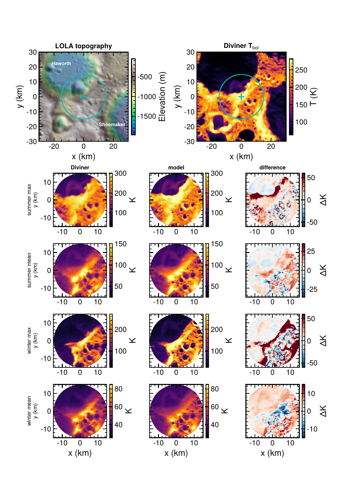

# Validation gallery

These are the validation figures from the Moon3D manuscript as submitted to
*JGR: Planets* — thermal-model spin-up/equilibration convergence, energy
conservation, comparison to the Hayne et al. (2017) Diviner-derived lunar
regolith model and Apollo heat-flow subsurface profiles, the Ingersoll et al.
(1992) analytic bowl-crater radiation-exchange test, and comparison to real
Diviner Lunar Radiometer Experiment seasonal south-polar temperatures at a
Haworth-crater cold-trap site. Captions below are adapted from the
manuscript's `main.tex` (figure numbers, e.g. "Manuscript Fig. 5", match the
submitted paper so cross-reference is unambiguous) and reworded for a
standalone README-adjacent page; numbers are quoted, not re-derived. For the
condensed, headline version of this page see the
[README's Validation section](../README.md#validation).

---

## Manuscript Fig. 3 — Diurnal-cycle convergence

Convergence of the maximum, minimum, and mean surface temperature,
represented as the change from each thermal spin-up diurnal cycle to the
next (equatorial example; similar behavior is obtained at all latitudes).
**Headline:** modeled equatorial surface temperatures converge to
|ΔT| ≲ 0.01 K after just two spin-up cycles.

## Manuscript Fig. 4 — Subsurface depth-profile equilibration

Modeled equatorial depth profiles of temperature over successive spin-up
cycles, showing equilibration of the subsurface layers. **Headline:**
equilibration is exponential in time; the deepest layers settle to
< 2 K of their converged value after ~30 cycles, with the majority of that
settling in the first ~30 cycles.

## Manuscript Fig. 5 — Thermal-column validation vs. Diviner and Apollo

PTM3D modeled two thermal-column comparisons end to end through the full 3D
thermal-illumination framework (this corresponds to Figure 5 of the
submitted Moon3D manuscript, currently in review): **(a)** a global
diurnal-cycle comparison against Diviner brightness temperatures at Hayne
et al. (2017) Table 1 properties, and **(b)** an Apollo 15/17
heat-flow-probe comparison at each site's own albedo.

**Recipe, panel (a):** smooth global icosphere, resolution 6 (81,920 faces;
a convex body makes `radiation.enabled: false` physically exact, not an
approximation), CPU-only illumination and thermal solve, body=Moon using
Hayne et al. (2017) Table 1 properties unmodified — Bond albedo
A₀ = 0.12, all other properties Table 1 (`thermal_m/n/b = 10/15/15`,
unchanged from the tracked default), `equilibration_orbits: 60` (a
2/5/10/20/30/45-orbit convergence sweep showed the ≳0.4 m diurnal-mean
plateau moves <0.02 K/orbit by orbit 45, so 60 is converged).

**Recipe, panel (b):** identical mesh and physics settings, but with a
site-specific Bond albedo A₀ = 0.06 at the Apollo 15 (26.13°N,
Hadley–Apennine) and Apollo 17 (20.19°N, Taurus–Littrow, dark
pyroclastic-mantle terrain) landing-site latitudes. A₀ = 0.06 is the value
that brings all four probe points (two sites × surface/deep) inside their
±5 K bars — for Apollo 17 it is also physically consistent with the dark
pyroclastic-mantle terrain at Taurus–Littrow (lower albedo than the Table 1
global mean); Apollo 15 (Hadley–Apennine) has no comparable terrain-based
justification identified here and uses the same calibrated value. This is
consistent with Hayne et al. (2017)'s own *practice* of assigning
site-specific Apollo albedos rather than the Table 1 global default — the
exact 2017 per-site values are not independently verified here, so no
specific number from that compilation is claimed to be reproduced. All
other properties stay at their Table 1 values, including the density
e-folding depth H (there is no evidence for a lower H at either site). The
two panels are run on different binaries/solver paths: panel (a) is
`equilibration_orbits = 60`, `thermal_b = 15`, binary md5 `a1f465a3…`,
`thermal_solver_path = cpu_simd_batch`; panel (b) is `equilibration_orbits
= 480`, `thermal_b = 45` (bottom node 1.4119 m), binary md5 `47d9d49b…`,
`thermal_solver_path = cpu_streamed_simd_batch` — panel (a) only plots the
surface curve, which a dedicated convergence study found is
eq-orbit-insensitive (converges in a handful of cycles), so the shorter
eq=60/b=15 run is not a shortcut on the quantity panel (a) actually shows.
Panel (b)'s own deep nodes need the longer eq=480/b=45 run: a dedicated
equilibration × grid-resolution convergence study found the 0.83 m /
1.30 m deep-column nodes need hundreds of spin-up cycles once genuinely
resolved at this depth (eq = 480 residual-to-asymptote +0.13 / +0.14 K by
Aitken extrapolation; `thermal_b = 45` vs. 52 agree to 0.07–0.08 K). Both
scored deep points fall within that genuinely-solved 1.41 m grid, so the
model curves are drawn solid throughout — no extrapolated segment.

Reference points (Diviner nighttime dots, Hayne et al. 2017 equatorial
peak/midnight/minimum squares, Apollo 15/17 probe points) were digitized
from Hayne et al. (2017)'s own Figure 5 vector content, as reproduced in
the submitted Moon3D manuscript (exact marker/axis-tick coordinates, not
pixel-eyeballing), **with one correction**: that figure plots the Apollo 17
deep point at a depth of 13 cm, but the probe's actual reference depth is
130 cm (Langseth et al. 1976 report the probe depths; confirmed directly
with the author) — a 10× digitization/transcription error. This render
scores Apollo 17's deep point at the corrected 130 cm; the point is inside
its ±5 K bar at either depth (**−0.89 K** at the literal 13 cm,
**+2.55 K** at the corrected 130 cm), so the correction does not change the
pass/fail outcome, only which depth is being claimed.
Every reference marker in the source figure carries a ±5 K error bar,
reproduced here unchanged. The Apollo probe temperatures and Diviner
brightness temperatures are themselves independent measurements —
Langseth et al. (1976) for the former, the Diviner Lunar Radiometer
Experiment (Paige et al. 2010) for the latter — digitized here via the
Hayne et al. (2017) compilation, which shares an author with PTM3D and is
not itself an independent check.

Panel (a): equatorial, 30°, and 60° PTM3D diurnal surface-temperature
curves vs. Diviner brightness temperatures and the Hayne et al. (2017)
equatorial peak/midnight/minimum reference points. Panel (b): PTM3D
diurnal-mean subsurface profiles (to 1.30 m) at the Apollo 15/17
landing-site latitudes vs. the Apollo heat-flow-probe points, each site at
its own A₀ = 0.06.
**Headline:** panel (a) max |PTM3D − reference| = **1.05 K** at the three
bar-carrying Hayne et al. (2017) anchors (0° nighttime branch ≤1.00 K, 30°
≤0.79 K, 60° ≤1.61 K). The "minimum" anchor (hr = 18) is scored
extremum-to-extremum: the plotted local-time axis is anchored on PTM3D's
own diurnal maximum (hr = 0 by construction, not an independent clock), so
its diurnal minimum is read wherever it actually falls — one output sample
(0.07 h on this axis, ≈2 h of real lunar local time) before hr = 18,
giving **−1.05 K**. Scored instead at the literal hr = 18.00 grid point
(no extremum search), the residual is **+2.74 K** — also inside the ±5 K
bar, so the extremum-vs-literal choice does not change the verdict, only
its sign and size; both numbers are reported so neither reads as
convention-shopping. The 27 bare Diviner dots (informative only — no error
bars in the source figure, so no pass/fail claim) run **1.61 K** max /
**0.75 K** RMS. Panel (b) max |PTM3D − reference| = **4.91 K** (Apollo 17
surface — the tightest of the four Apollo points, 0.09 K inside its ±5 K
bar; the two deep points score +0.98 K and +2.55 K) — **all four Apollo
points land inside their ±5 K bars.**

## Manuscript Fig. 6 — Energy conservation

Energy conservation in the numerical model depth profile, quantified by the
flux divergence ∇·F = ∂F_net/∂z (F_net = F↑(z) − F↓(z), the net heat flux
into each layer), plotted as the ratio of the total integrated flux
divergence over all model layers to the solar constant S₀. **Headline:**
energy loss is < 0.01% of absorbed flux per diurnal cycle after one cycle,
falling to 1 part in 10⁶ after 100 cycles (~8 years); this render shows
max |ΔF|/S₀ = 6.11×10⁻⁵ and mean |ΔF|/S₀ = 1.66×10⁻⁵ over a 100-cycle run.

## Manuscript Fig. 7 — Ingersoll bowl-crater radiation-exchange test

Simulation of radiative-equilibrium temperatures in a bowl-shaped
(spherical-cap) crater with the 3D thermophysical model, compared to the
analytic solution of Ingersoll, Svitek & Murray (1992), for three
depth-to-diameter ratios (d/D = 0.05, 0.10, 0.20) at lunar properties
(Bond albedo A = 0.12, emissivity ε = 0.95), discretized into 15,840
triangular faces. **(a)** Equilibrium-temperature renders at two solar
elevations (β/β_c = 0.30, 0.85) for each d/D. **(b)** Permanently-shadowed
interior mean temperature vs. solar elevation: analytic (lines) vs.
numerical (circles). **(c)** Fractional error of the numerical shadow flux
relative to the analytic solution. **Headline:** across the shadowed range,
the mean PSR temperature matches the analytic solution to within
**0.1 K (≤0.26%)**, and the shadow flux agrees with the analytic solution
to within **1.2%** (largest errors at the shallowest crater and lowest,
smallest-signal elevations).

## Manuscript Fig. 8 — Diviner seasonal comparison, spatial maps

Seasonal comparison of Diviner and modeled (PTM3D) bolometric temperatures
at the Haworth SE-rim site (88.18°S, 6.04°E), over a ±15 km window at the
250 m scale of the Diviner seasonal product (Williams et al. 2019). Top row:
regional setting — LOLA topography (left) and the Diviner summer-maximum
bolometric temperature map (right), with the comparison window and site
center marked. Each row below shows summer maximum, summer mean, winter
maximum, and winter mean temperatures; columns show Diviner, the model
reduced to the same seasonal statistic, and their difference
(model − Diviner). The run uses the corrected view factors, a site-centered
mesh graded to 50 km with a regional occluder ring to 200 km, and one output
step per day over a full year. See Fig. 9 for the corresponding per-cell
scatter and headline bias/RMS numbers.

## Manuscript Fig. 9 — Diviner seasonal comparison, per-cell scatter

Modeled (PTM3D) vs. Diviner bolometric temperature for every valid 250 m
cell of the Fig. 8 comparison, for the four seasonal statistics (summer
max/mean, winter max/mean). Filled contours show point density for the
radiation-coupled (rad-on) run; open triangles show the rad-off run; the
gray line is 1:1. The summer statistics and the winter mean form coherent
distributions tracking the 1:1 line; the winter maximum shows a tight cold
cluster on the 1:1 line plus a broad, diffusely scattered population,
reflecting Diviner's sparse winter maximum-temperature sampling rather than
model error. **Headline:** the previously reported PSR cold bias is largely
eliminated. On the deep permanently shadowed floor (Diviner summer max
< 110 K), the modeled summer-maximum temperature exceeds Diviner by only
**+1.9 K** on average (cross-checked at **+1.1 K** on a second,
independently-centered mesh); seasonal-mean biases over the full comparison
window are **−3.8 K** (summer) and **−2.9 K** (winter); root-mean-square
differences are **11 K** (summer mean) and **6 K** (winter mean). Without
radiative coupling the deep-floor summer-maximum bias is −50 K, so
inter-face radiative coupling contributes ~+52 K of the match.
