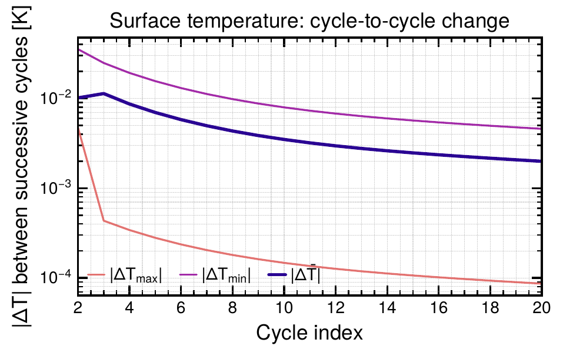
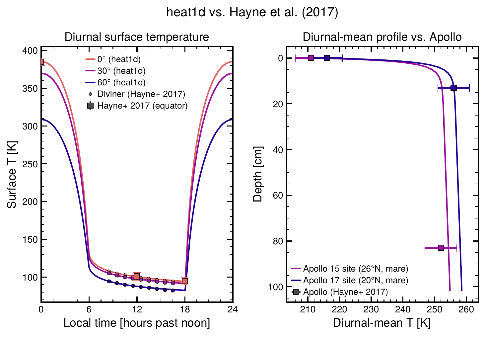
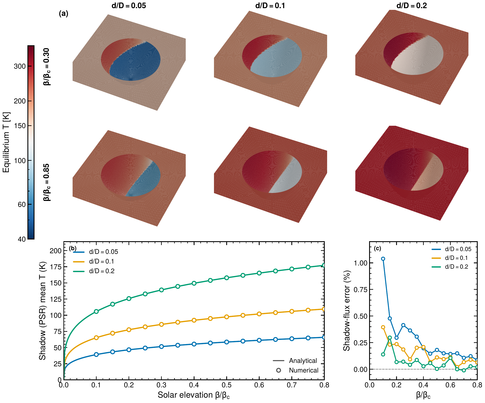
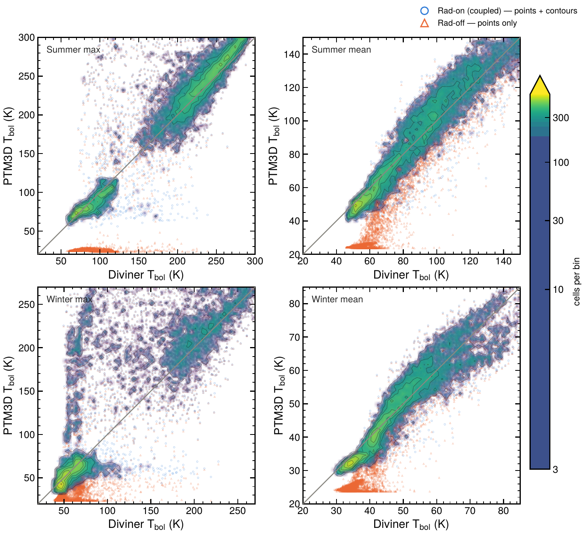

# Validation gallery

These are the validation figures from the Moon3D manuscript as submitted to
*JGR: Planets* — thermal-model spin-up/equilibration convergence, energy
conservation, comparison to the Hayne et al. (2017) Diviner-derived lunar
regolith model and Apollo heat-flow subsurface profiles, the Ingersoll et al.
(1992) analytic bowl-crater radiation-exchange test, and comparison to real
Diviner Lunar Radiometer Experiment seasonal south-polar temperatures at a
Haworth-crater cold-trap site. Captions below are adapted from the
manuscript's `main.tex` (figure numbers, e.g. "Manuscript Fig. 5", match the
submitted paper so cross-reference is unambiguous) and reworded for a
standalone README-adjacent page; numbers are quoted, not re-derived. For the
condensed, headline version of this page see the
[README's Validation section](../README.md#validation).

---

## Manuscript Fig. 3 — Diurnal-cycle convergence

Convergence of the maximum, minimum, and mean surface temperature,
represented as the change from each thermal spin-up diurnal cycle to the
next (equatorial example; similar behavior is obtained at all latitudes).
**Headline:** modeled equatorial surface temperatures converge to
|ΔT| ≲ 0.01 K after just two spin-up cycles.

## Manuscript Fig. 4 — Subsurface depth-profile equilibration

Modeled equatorial depth profiles of temperature over successive spin-up
cycles, showing equilibration of the subsurface layers. **Headline:**
equilibration is exponential in time; the deepest layers settle to
< 2 K of their converged value after ~30 cycles, with the majority of that
settling in the first ~30 cycles.

## Manuscript Fig. 5 — Thermal-column validation vs. Diviner and Apollo

Manuscript caption: "Validation of the 3D thermophysical model with
comparison to Diviner data (left panel) and Apollo heat flow probe data
(right panel)." **Read literally, the plotted model curves in this figure
are heat1d** — PTM3D's 1D thermal-column reference implementation (same
author, same Crank–Nicolson conduction physics as PTM3D's own column
solver) — labeled "(heat1d)" in the left-panel legend and titled "heat1d vs.
Hayne et al. (2017)" on the figure itself. The manuscript presents this
heat1d-vs-reference-data match as validating the 3D model's thermal-column
physics, since that physics is shared between the two codes; it is not a
run of the 3D radiative-illumination framework end to end. Left panel:
equatorial, 30°, and 60° diurnal surface-temperature curves vs. Diviner
brightness temperatures and the Hayne et al. (2017) equatorial peak/night
reference points. Right panel: diurnal-mean subsurface profiles vs. the
Apollo 15 and 17 heat-flow-probe sites (Hayne et al. 2017 compilation).
**Headline:** "surface temperatures during the lunar daytime and nighttime
from Diviner and subsurface temperatures from Apollo were fit
simultaneously to within the measurement errors" (no single RMS/bias number
is given in the manuscript text for this figure).

## Manuscript Fig. 6 — Energy conservation

Energy conservation in the numerical model depth profile, quantified by the
flux divergence ∇·F = ∂F_net/∂z (F_net = F↑(z) − F↓(z), the net heat flux
into each layer), plotted as the ratio of the total integrated flux
divergence over all model layers to the solar constant S₀. **Headline:**
energy loss is < 0.01% of absorbed flux per diurnal cycle after one cycle,
falling to 1 part in 10⁶ after 100 cycles (~8 years); this render shows
max |ΔF|/S₀ = 6.11×10⁻⁵ and mean |ΔF|/S₀ = 1.66×10⁻⁵ over a 100-cycle run.

## Manuscript Fig. 7 — Ingersoll bowl-crater radiation-exchange test

Simulation of radiative-equilibrium temperatures in a bowl-shaped
(spherical-cap) crater with the 3D thermophysical model, compared to the
analytic solution of Ingersoll, Svitek & Murray (1992), for three
depth-to-diameter ratios (d/D = 0.05, 0.10, 0.20) at lunar properties
(Bond albedo A = 0.12, emissivity ε = 0.95), discretized into 15,840
triangular faces. **(a)** Equilibrium-temperature renders at two solar
elevations (β/β_c = 0.30, 0.85) for each d/D. **(b)** Permanently-shadowed
interior mean temperature vs. solar elevation: analytic (lines) vs.
numerical (circles). **(c)** Fractional error of the numerical shadow flux
relative to the analytic solution. **Headline:** across the shadowed range,
the mean PSR temperature matches the analytic solution to within
**0.1 K (≤0.26%)**, and the shadow flux agrees with the analytic solution
to within **1.2%** (largest errors at the shallowest crater and lowest,
smallest-signal elevations).

## Manuscript Fig. 8 — Diviner seasonal comparison, spatial maps

Seasonal comparison of Diviner and modeled (PTM3D) bolometric temperatures
at the Haworth SE-rim site (88.18°S, 6.04°E), over a ±15 km window at the
250 m scale of the Diviner seasonal product (Williams et al. 2019). Top row:
regional setting — LOLA topography (left) and the Diviner summer-maximum
bolometric temperature map (right), with the comparison window and site
center marked. Each row below shows summer maximum, summer mean, winter
maximum, and winter mean temperatures; columns show Diviner, the model
reduced to the same seasonal statistic, and their difference
(model − Diviner). The run uses the corrected view factors, a site-centered
mesh graded to 50 km with a regional occluder ring to 200 km, and one output
step per day over a full year. See Fig. 9 for the corresponding per-cell
scatter and headline bias/RMS numbers.

## Manuscript Fig. 9 — Diviner seasonal comparison, per-cell scatter

Modeled (PTM3D) vs. Diviner bolometric temperature for every valid 250 m
cell of the Fig. 8 comparison, for the four seasonal statistics (summer
max/mean, winter max/mean). Filled contours show point density for the
radiation-coupled (rad-on) run; open triangles show the rad-off run; the
gray line is 1:1. The summer statistics and the winter mean form coherent
distributions tracking the 1:1 line; the winter maximum shows a tight cold
cluster on the 1:1 line plus a broad, diffusely scattered population,
reflecting Diviner's sparse winter maximum-temperature sampling rather than
model error. **Headline:** the previously reported PSR cold bias is largely
eliminated. On the deep permanently shadowed floor (Diviner summer max
< 110 K), the modeled summer-maximum temperature exceeds Diviner by only
**+1.9 K** on average (cross-checked at **+1.1 K** on a second,
independently-centered mesh); seasonal-mean biases over the full comparison
window are **−3.8 K** (summer) and **−2.9 K** (winter); root-mean-square
differences are **11 K** (summer mean) and **6 K** (winter mean). Without
radiative coupling the deep-floor summer-maximum bias is −50 K, so
inter-face radiative coupling contributes ~+52 K of the match.
