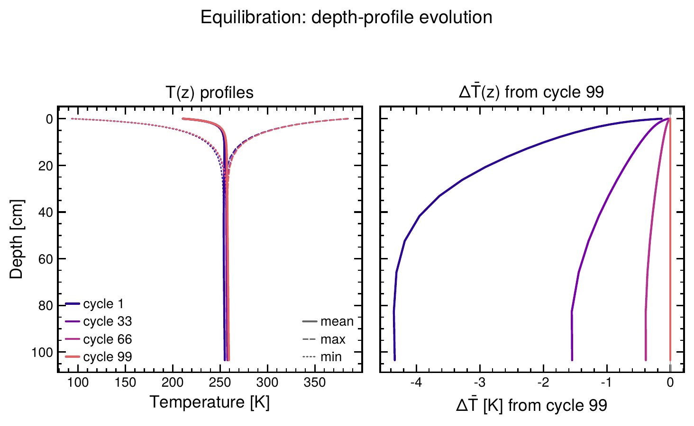
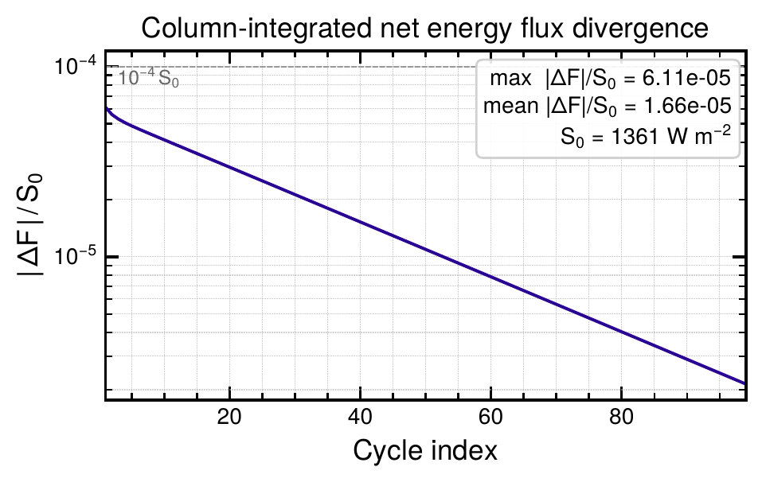

# Validation

This page reproduces the validation figures of the Moon3D paper (Hayne et al., JGR Planets,
revised version), with captions adapted from the paper. Figure numbers match the paper. Numbers are quoted from it,
not re-derived here.

The revision's Diviner comparison (Figs. 8 and 9) and its polar results were produced with the
engine in this release, on the CPU solver, with the opt-in fine-mesh illumination settings (see
[ENVIRONMENT.md](ENVIRONMENT.md)); Figs. 3 to 7 come from earlier builds of the same model.

## Manuscript Fig. 3: diurnal-cycle convergence

Change in the maximum, minimum and mean equatorial surface temperature from each spin-up cycle
to the next. Surface temperatures converge to |ΔT| ≲ 0.01 K after two cycles.

## Manuscript Fig. 4: subsurface equilibration

Equatorial temperature profiles over successive spin-up cycles. The deepest layers settle to
within 2 K of their converged value after about 30 cycles; the approach is exponential.

## Manuscript Fig. 5: diurnal cycle and subsurface temperatures vs. Diviner and Apollo

**(a)** Modeled surface temperature at the equator, 30°N and 60°N over one lunation (global
resolution-6 icosphere, Hayne et al. 2017 Table 1 properties, Bond albedo 0.12) against Diviner
nighttime brightness temperatures and the Hayne et al. (2017) noon, midnight and minimum
reference points. **(b)** Diurnal-mean subsurface temperature at the Apollo 15 (26.13°N) and
Apollo 17 (20.19°N) latitudes, each with a site Bond albedo of 0.06, against the heat-flow-probe
measurements (Langseth et al. 1976).

All reference points that carry an uncertainty lie inside their ±5 K bars: in (a) the largest
residual at the three Hayne et al. (2017) anchors is 1.05 K; the 27 Diviner nighttime points,
which carry no error bars, differ by at most 1.61 K (RMS 0.75 K). In (b) the largest residual is
4.91 K (Apollo 17 surface). The reference points were digitized from the Hayne et al. (2017)
compilation, which shares an author with PTM3D; the Apollo 17 deep point is scored at the
probe's 130 cm depth (the compilation plots it at 13 cm).

## Manuscript Fig. 6: energy conservation

Column-integrated net flux divergence relative to the solar constant. The energy residual is
below 0.01% of the absorbed flux per diurnal cycle after one cycle and about one part in a
million after 100 cycles (max |ΔF|/S₀ = 6.11×10⁻⁵, mean 1.66×10⁻⁵ over a 100-cycle run).

## Manuscript Fig. 7: Ingersoll bowl-crater test

Radiative-equilibrium temperatures in a spherical-cap crater (15,840 faces; d/D = 0.05, 0.10,
0.20; Bond albedo 0.12, emissivity 0.95) computed with the production view-factor module, against
the analytic solution of Ingersoll, Svitek & Murray (1992). **(a)** Renders at two solar
elevations. **(b)** Mean temperature of the permanently shadowed interior against solar
elevation. **(c)** Error of the shadow flux. The shadowed-interior temperature matches within
0.1 K (≤0.26%) and the shadow flux within 1.2%.

The quick check `build/bin/test_bowl_crater` (run in INSTALL and CI) is a different, smaller
test: it compares a 1,404-face crater's analytic centroid view factors with the closed form
(0.49%) and checks reciprocity. It does not exercise the production view-factor code; Fig. 7
does (`bowl_crater_ptm`).

## Manuscript Fig. 8: Diviner seasonal comparison, maps

Seasonal comparison of Diviner and modeled (with sub-facet roughness beaming) bolometric
temperatures at the Haworth SE-rim site (88.18°S, 6.04°E), over a ±15 km window at the 240 m
native resolution of the Diviner seasonal product (Williams et al. 2019). Top row: the LOLA
topography and the Diviner summer-maximum map, with the comparison window marked. Each row
below shows summer maximum, summer mean, winter maximum and winter mean; columns show Diviner,
the model reduced to the same seasonal statistic, and their difference (model minus Diviner).
The run uses the Monte Carlo view factors, a site-centered mesh graded to 50 km with an occluder
ring to 200 km, and one output step per day over a full year.

## Manuscript Fig. 9: Diviner seasonal comparison, per-cell scatter

Modeled versus Diviner bolometric temperature for every valid 240 m cell of Fig. 8, for the
four seasonal statistics, with roughness beaming (colored density) and without it (gray
contours), radiation coupling on in both.

The comparison is stratified by Diviner's annual maximum temperature into cold
traps (below 110 K; n = 2,970 cells), a shadow-boundary margin (110 to 200 K; n = 2,251) and
sunlit terrain (200 K and above; n = 7,044), and reported as the median and interquartile range
(IQR) of model minus Diviner. On the cold-trap floor the median summer-maximum bias is
−0.80 K (IQR 11.19 K) with roughness beaming and −10.30 K (IQR 10.38 K) without it; with
beaming, the summer-mean, winter-maximum and winter-mean medians are −1.88, −0.85 and +2.81 K.
Radiation exchange itself accounts for nearly all of the floor warmth: the per-cell median of
the no-beaming minus radiation-disabled difference on the cold-trap floor is +40.5 K (summer
maximum). Caveats: the daily output cadence undersamples instantaneous maxima by about 1.6 K;
the view-factor estimator's near-coplanar rejection discards a few tenths of a kelvin of nearby
exchange on the deepest floor cells; and Diviner bolometric temperatures carry several-kelvin
uncertainties at the lowest cold-trap temperatures.
