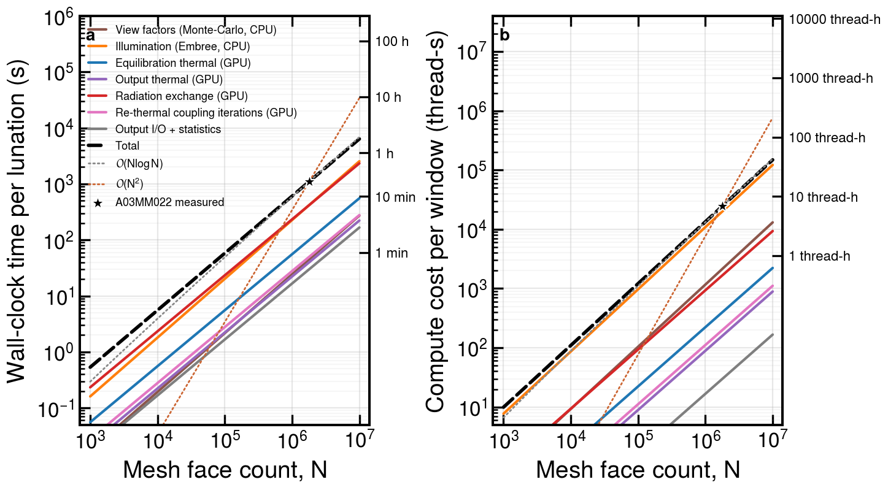

# Thermal equilibration in PTM3D

*Draft section for the PTM3D framework paper (PSJ / JGR-Planets).*

## 1. Why equilibration is required

The thermal evolution of a planetary surface is governed by the
one-dimensional heat-conduction equation

$$
\rho(z)\thinspace c_p(T)\thinspace \frac{\partial T}{\partial t}
    =  \frac{\partial}{\partial z}\negthinspace\left[k(T)\thinspace\frac{\partial T}{\partial z}\right],
\qquad 0 \leq z \leq z_b,
\tag{1}
$$

solved at each mesh face $i$ with a Neumann-type radiative surface
condition at $z=0$ (Eq. 1 of §"Inter-face thermal radiation exchange")
and a fixed-flux geothermal condition $-k\,\partial T/\partial z =
Q_b$ at the lower boundary $z_b$.  Even when the forcing is strictly
periodic (a single repeating diurnal/seasonal cycle), the solution
of (1) starting from an arbitrary initial profile $T(z,0)$ approaches
the periodic steady state only on the multi-orbit timescale set by
the deepest active layer's thermal time constant.  Reporting science
quantities (peak temperature, mean temperature, ice-stability depth)
on a non-equilibrated profile contaminates them with the transient
toward the periodic attractor.

The numerical strategy in PTM3D is therefore to spin up the model
for a number of pre-science orbits at coarse cadence, discard the
spin-up output, and only sample the periodic-steady-state thermal
trajectory in a separate science window.  This section describes
how the spin-up is parameterized, why a body-independent
"samples-per-diurnal-cycle" accuracy target is preferable to
either a fixed timestep or a fixed step count, and what numerical
error budget the production defaults achieve.

## 2. Skin-depth scaling and domain depth

For sinusoidal surface forcing at period $P$, the linear diffusion
equation (1) admits a self-similar attenuated traveling-wave
solution.  The characteristic penetration depth is the *thermal skin
depth*

$$
\delta(P)  =  \sqrt{\frac{k\thinspaceP}{\pi\thinspace\rho\thinspacec_p}},
\tag{2}
$$

so that the diurnal skin depth on the Moon (regolith $k_s \approx
7.4\times 10^{-4}\,\mathrm{W\,m^{-1}\,K^{-1}}$, $\rho_s = 1100\,
\mathrm{kg\,m^{-3}}$, $c_p \sim 800\,\mathrm{J\,kg^{-1}\,K^{-1}}$,
$P_{\mathrm{lun}} = 29.5\thinspace\mathrm{d}$) is $\delta_1 \approx 3$ cm.
The seasonal skin depth at terrestrial-planet rotational obliquity
is larger by $\sqrt{P_{\mathrm{seas}}/P_{\mathrm{diur}}}$; for the
$\sim$18-yr lunar nodal cycle this is $\sim 23\times$ deeper.

PTM3D places the lower boundary at $z_b = b\thinspace\delta_1$, where $b$ is
a depth scaling factor configurable per run.  The radiative
enhancement of solid conductivity ($\chi(T/350)^{3}$ in the
Vasavada–Hayne parameterization) deepens the effective skin depth
at high $T$, and we adopt $b=15$ as a production default, placing
the bottom Neumann condition at $\sim 9$ effective $e$-folds of
damping in the high-temperature limit and fully attenuating the
diurnal amplitude at $z_b$ to $<0.1\thinspace\mathrm{K}$ for any planetary
application of interest.

The vertical grid uses $m$ logarithmically spaced surface layers
filling the first skin depth (default $m=10$) and a geometric
expansion ratio $\eta = 1 + 1/n$ (default $n=15$) beyond, terminating
at $z_b$.  At the production parameters this gives 30 layers spanning
the full $b$-skin-depth domain, with the surface layer thickness
$\Delta z_0 \approx 0.03\thinspace\delta_1$ resolving the steep gradient
near the radiative boundary.

## 3. Time integration

Equation (1) is discretized in time by the Crank–Nicolson scheme,
which is implicit and unconditionally stable for the linear
diffusion operator at all $\Delta t$.  Material properties are
re-evaluated at the layer temperatures every timestep ($k(T)$
includes the $T^3$ radiative term and $c_p(T)$ is a low-order
polynomial fitted to laboratory regolith data), so the resulting
tridiagonal system is mildly nonlinear; we solve it with a Picard
loop that typically converges in two passes against a
fixed-point tolerance of $10^{-3}\thinspace\mathrm{K}$.  The radiative
surface boundary condition is closed by Newton–Raphson on $T_0$
at each timestep (typically 3-5 iterations to $10^{-4}\thinspace\mathrm{K}$
on the equilibrium residual).

The Crank–Nicolson scheme has truncation error $\mathcal{O}(\Delta
t^{2})$.  Stability does not constrain $\Delta t$ but accuracy
does: a too-coarse cadence under-samples the diurnal forcing
itself.  This sets the rationale for the cadence target in §4.

## 4. Decoupled equilibration cadence

Conventionally one would simply choose a single $\Delta t$ such that
the diurnal cycle is well resolved (e.g.\ 144 or 240 samples per
diurnal period) and use it for both spin-up and science output.
The science window on PTM3D, however, often requires very fine
output cadence — e.g.\ one-minute sampling for camera-simulation
applications requires $\sim 4\times 10^{4}$ samples per lunar
synodic month.  Spinning up over many lunations at that cadence is
prohibitive (memory and wall-time both scale linearly with
$N_{\mathrm{eq}}$).

The key observation is that the *accuracy of the equilibration
phase need not match the accuracy of the output phase*.  Equilibration
needs only to relax the depth profile $T(z,t)$ to the periodic
attractor; it does not need to resolve sub-diurnal events such as
eclipses, crater-rim shadow ingress, or spacecraft fly-by geometry.
We therefore decouple the two cadences, parameterizing the
equilibration timestep $\Delta t_{\mathrm{eq}}$ by a body-independent
target $N_{\mathrm{s}}$ samples per diurnal cycle on the body under
study:

$$
\Delta t_{\mathrm{eq}}  =  P_{\mathrm{diur}}\big/\thinspaceN_{\mathrm{s}}.
\tag{3}
$$

The default is $N_{\mathrm{s}}=120$ samples per cycle, motivated by
the calibration study summarized in §5.  This is independent of the
target body (the diurnal period $P_{\mathrm{diur}}$ is fed from the
illumination model's ephemeris) and independent of the output
cadence.

We integrate for $N_{\mathrm{orb}}$ full diurnal cycles in the
equilibration phase (production default: 2 lunar synodic months), then
hand the post-equilibration profile $T(z, t = N_{\mathrm{orb}}\thinspace P_{\mathrm{diur}})$
to the output phase, which then runs at the science cadence
$\Delta t_{\mathrm{out}}$ over one further full diurnal cycle.  Only
the output phase is saved to disk.

On a representative large-mesh production case (4.8 M-face lunar
polar mesh, one-minute output cadence over a 30-day window) the
decoupled cadence reduces the equilibration phase from
$8.5\times 10^{4}$ to $1.4\times 10^{3}$ timesteps and the peak
in-RAM thermal-state footprint from $227\thinspace\mathrm{GB}$ to $13\thinspace\mathrm{GB}$,
while keeping the surface temperature error at the first output
timestep below $2\thinspace\mathrm{K}$.

## 5. Initial profile

The equilibration phase needs an initial subsurface temperature
profile.  We use an exponential blend between a near-surface
target and a deep-soil target,

$$
T(z, t=0)  =  T_{\mathrm{deep}}
    + \bigl(T_{\mathrm{avg}} - T_{\mathrm{deep}}\bigr)\thinspace\exp(-z/\delta_1),
\tag{4}
$$

with

$$
T_{\mathrm{avg}}  =  \frac{T_{\mathrm{ss}}}{\sqrt{2}}, \qquad
T_{\mathrm{ss}}  =  \biggl[\frac{(1-\alpha_i)\thinspaceS}{\varepsilon_i\thinspace\sigma}\biggr]^{1/4},
\qquad
T_{\mathrm{deep}}  =  T_{\mathrm{avg}}  +  \min\negthinspace\bigl(Q_b\thinspacez_b/k,\thinspace50\thinspace\mathrm{K}\bigr),
\tag{5}
$$

where $S$ is the body-averaged solar constant at the target's
orbital distance.  $T_{\mathrm{ss}}$ is the substellar radiative
equilibrium temperature in the absence of conduction, $T_{\mathrm{avg}}
\approx T_{\mathrm{ss}}/\sqrt{2}$ is the energy-conserving
hemispherical mean for slow-rotator polar latitudes, and the cap on
the geothermal contribution prevents an unphysically large excursion
on faces with anomalous $Q_b$.

The initial profile is *not* the periodic attractor; the
equilibration phase relaxes it toward the attractor by integrating
forward $N_{\mathrm{orb}}$ diurnal cycles.  Because Crank–Nicolson
strongly damps high spatial frequencies, the relaxation timescale
is governed by the lowest-frequency mode, which is the diurnal
forcing itself.  Numerical experiments (§6 below) show that two
diurnal cycles suffice to reach the periodic attractor to
sub-Kelvin accuracy at all latitudes, including polar PSR floors
where the radiative damping is weakest.

## 6. Validation

We characterize the equilibration accuracy with a controlled
sensitivity study.  At each of four latitudes ($0°, 30°, 60°, 85°$)
on the Moon we run the thermal solver for 24 diurnal cycles at
$N_{\mathrm{s}} \in \lbrace24, 48, 96, 192, 384, 768\rbrace$ samples per
diurnal cycle, comparing per-layer temperatures against a
Fourier-stable reference solution at $\sim 5000$ samples per cycle.
At the production cadence $N_{\mathrm{s}}=192$ the worst-case
per-layer error across latitudes is $0.99\thinspace\mathrm{K}$, occurring
at the $85°$ polar slope where the radiative forcing is most
strongly modulated by the diurnal cycle.  At $N_{\mathrm{s}}=24$ the
worst-case error grows to $11.9\thinspace\mathrm{K}$; at $N_{\mathrm{s}}=768$
it drops to $0.21\thinspace\mathrm{K}$.  The error scales as $\mathcal{O}
(\Delta t^{2})$, consistent with the second-order temporal accuracy
of Crank–Nicolson.

We additionally validate the full equilibration-plus-output pipeline
against the Diviner-derived lunar regolith model of Hayne et al.\
(2017) on a global ico7 icosphere mesh, using six equilibration
orbits and the Hayne et al.\ (2017) Table A1 thermophysical
defaults.  PTM3D matches the Hayne et al.\ (2017) surface
temperatures to within $1.4\thinspace\mathrm{K}$ at peak (local noon),
$1.7\thinspace\mathrm{K}$ at midnight, and $1.1\thinspace\mathrm{K}$ at the
post-dawn minimum, with $1.27\thinspace\mathrm{K}$ RMS across fifteen
nighttime reference points spanning three latitudes.  Per-face
energy balance, integrated over a full synodic month after spin-up,
closes to $2.0$% of absorbed solar flux; the residual reflects the
combination of finite-time-of-flight thermal lag between absorbed
solar input and re-radiated thermal emission, and Jensen's
inequality applied to the nonlinear $\sigma T^{4}$ emission when
comparing time-averaged temperatures.

## 7. Discussion

Three remarks on the equilibration approach in PTM3D.

**Choice of $N_{\mathrm{orb}}$.**  Two diurnal cycles of equilibration
suffice for the diurnal-period periodic solution on
near-isothermal regolith.  Workflows that probe subsurface seasonal
or year-scale modulation (e.g.\ the 18-yr lunar nodal cycle, or
sub-meter ice-stability depths whose thermal-wave penetration
extends well below the diurnal skin depth) require the longer
equilibration period.  The framework allows
$N_{\mathrm{orb}}$ to be configured per-run; large-mesh applications
(>1 M faces) typically use 2-6 orbits.

**Polar slope sensitivity.**  At high latitudes the diurnal forcing
becomes both weaker (low time-average flux) and more impulsive
(brief mid-day illumination separated by long shadow periods).  The
linearization that motivates the constant-$N_{\mathrm{s}}$ cadence
target underestimates the peak-T error in this regime.  Production
runs on polar terrain therefore use a slightly higher
$N_{\mathrm{s}}$ than the equatorial-default $96$, increasing to
the present default of $120$ samples per cycle without measurable
impact on wall-clock cost relative to ray-traced illumination.

**Coupling to inter-face radiation.**  When the inter-face thermal
radiation exchange module is enabled (see companion section),
$T(z,t)$ at the end of the equilibration phase is the natural
starting point for the radiation-coupling Picard iteration.  In
that scheme the same post-equilibration profile is reused as the
initial condition for *every* radiation-coupling iteration, so the
equilibration is performed exactly once per face per run rather
than once per coupling iteration.  This preserves the
post-equilibration profile's role as the "ground truth" from which
the radiation coupling is a small physical perturbation.

## 8. Computational performance

Figure B.6 reports the computational cost of a complete 1-lunation
PTM3D run on lunar polar terrain, broken down by component, as a
function of mesh face count.  The model is anchored on the
a Mons Mouton production run: a
$1.8\times 10^{6}$-face linear-density mesh with 2 equilibration
orbits at the body-independent cadence of §4 and a 30-day output
window at 1-hour cadence, with full inter-face radiation coupling
enabled, executed on a workstation with two AMD W6800X Duo cards
(4 dies total) and 48 CPU threads.  Each component is annotated by
the back-end it actually uses: view-factor Monte-Carlo (CPU OpenMP),
illumination shadow ray tracing (CPU OpenMP Embree), 1-D Crank-Nicolson
thermal solver split into the equilibration phase and the output
phase (multi-GPU OpenCL on 4 dies), inter-face radiation exchange
(sparse SpMV radiosity plus selective re-thermal Picard iterations,
multi-GPU OpenCL on 4 dies), and per-window output I/O.

Panel (a) shows wall-clock time and panel (b) shows total compute
cost (thread-seconds, where CPU components are weighted by the
48-thread OpenMP pool and GPU components by the 4-die count).  All
components scale approximately linearly in face count $N$ for the
fixed timestep counts of the production workload (240 equilibration
steps + 720 output steps), because the sparse view-factor matrix
has bounded average neighbor count $K \sim 100$ after the adaptive
top-$K$ compaction, the Embree BVH shadow-ray query amortizes to
near-linear in face count, and the GPU thermal kernel is embarrassingly
parallel in face index.  A complete 1-lunation, $1\times 10^{6}$-face
run with full radiation coupling completes in 10 wall-clock minutes
on this workstation, and a $1\times 10^{7}$-face run in approximately
1 hour 45 minutes.  At the small-mesh extreme ($N \lesssim 10^{4}$),
output I/O and equilibration thermal account for a substantial
fraction of the cost; at production polar-terrain scale
($N \sim 10^{6}$) the radiosity solver, illumination ray tracing,
and equilibration are co-dominant and together account for
$\sim 90$% of the wall time.

**Figure B.6.** Wall-clock time (a) and total compute cost (b)
per 1-lunation PTM3D run with full inter-face radiation coupling,
broken down by component, as a function of mesh face count.
Curves are power-law fits anchored on the measured
production batch (star, $N=1.80\times 10^{6}$); the diagonal
dashed line is the sum of all components.  Dotted reference
curves show the asymptotic scalings $\mathcal{O}(N \log N)$ (gray,
naive view-factor enumeration with BVH ray casting) and
$\mathcal{O}(N^{2})$ (orange, dense radiosity without sparse top-K
compaction), each anchored at the same point as the measured
total — at $N = 10^{7}$ the $\mathcal{O}(N^{2})$ alternative would
consume roughly 9 wall-clock hours per window, $\sim 5\times$
the actual time.  Right-axis tick labels give wall-clock time in
human units (a) and thread-time in thread-hours (b).  The 4-die
multi-GPU back-end is used for all thermal and radiation
components; the CPU OpenMP pool (48 threads) is used for the
Monte-Carlo view-factor construction and the Embree-based
illumination shadow rays.

## 9. References

- Hayne, P.O., et al.\ (2017), Global regolith thermophysical
  properties of the Moon from the Diviner Lunar Radiometer
  Experiment, *J. Geophys. Res. Planets*, 122, 2371–2400.
- Mitchell, D.L., de Pater, I.\ (1994), Microwave imaging of
  Mercury's thermal emission at wavelengths from 0.3 to 20.5 cm,
  *Icarus*, 110, 2–32.
- Spencer, J.R., Lebofsky, L.A., Sykes, M.V.\ (1989), Systematic
  biases in radiometric diameter determinations, *Icarus*, 78,
  337–354.
- Vasavada, A.R., Paige, D.A., Wood, S.E.\ (1999), Near-surface
  temperatures on Mercury and the Moon and the stability of polar
  ice deposits, *Icarus*, 141, 179–193.
