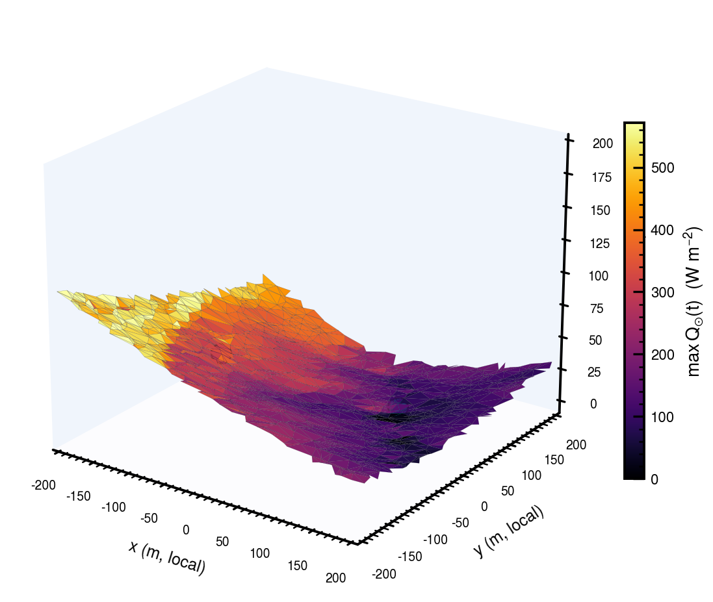
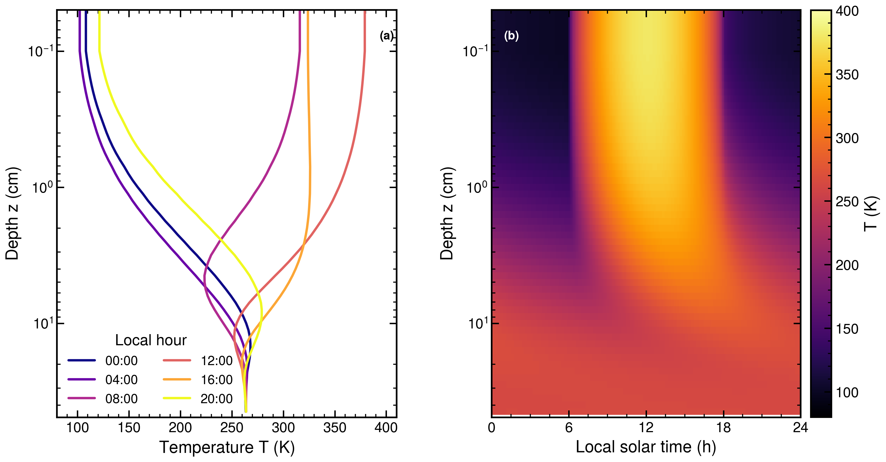
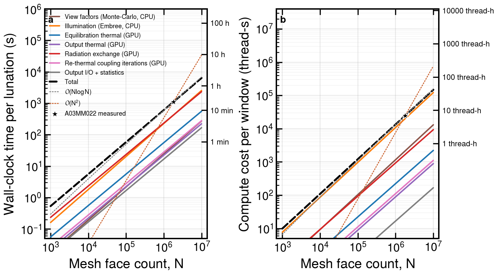
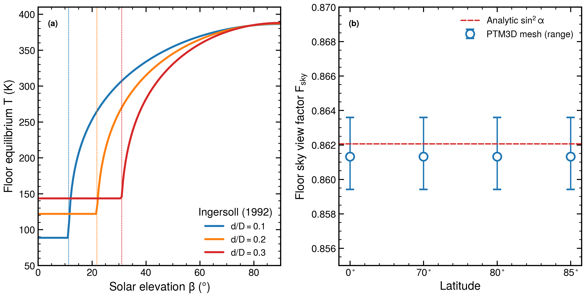
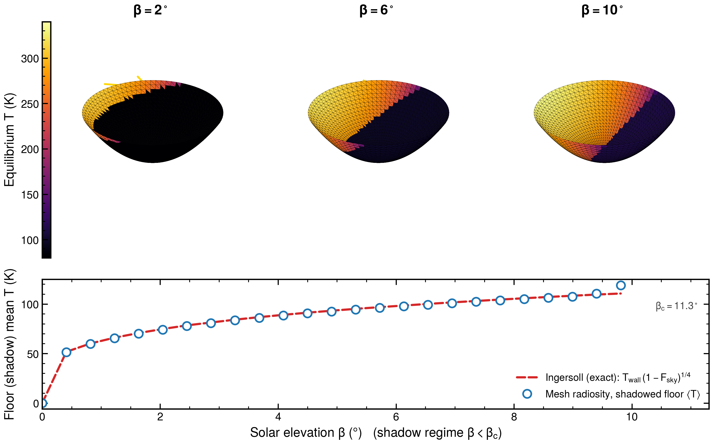
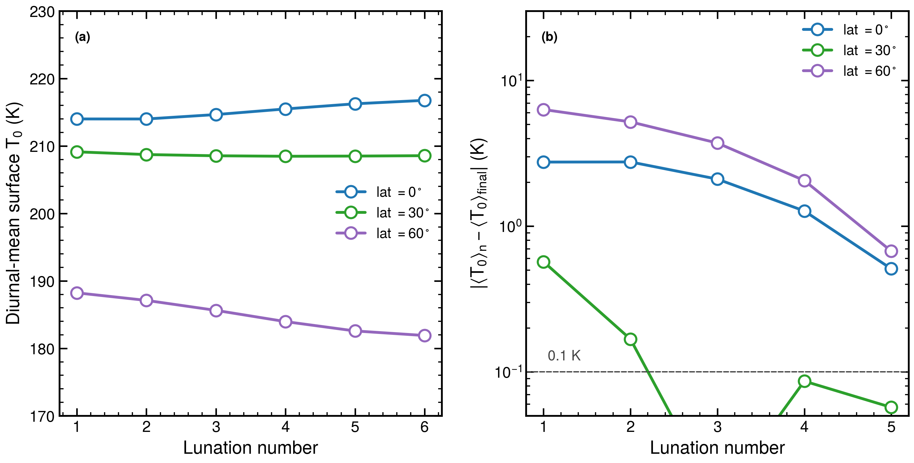
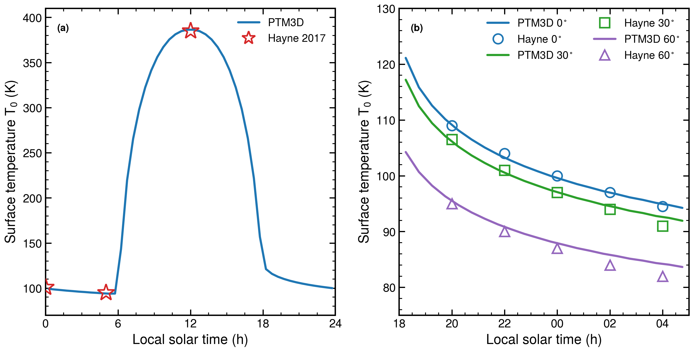
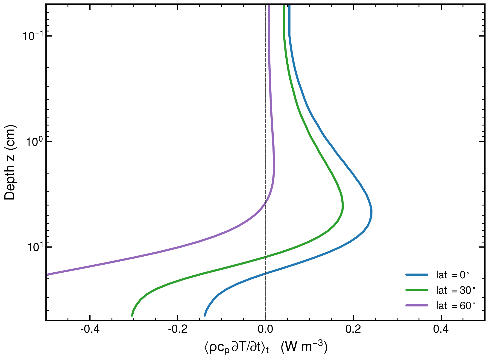

# PTM3D: a coupled thermal and inter-face radiation-exchange model for airless planetary surfaces

*Draft methods paper for JGR-Planets.*

## Abstract

The PTM3D framework couples a one-dimensional heat-conduction model
of the regolith subsurface with an ephemeris-driven illumination
model and an inter-face thermal-radiation-exchange module on a
triangulated planetary surface mesh. The radiation-exchange module
solves the radiosity equation on the visible-mesh enclosure at each
output time step using either a sparse top-$K$ view-factor matrix
constructed by Monte Carlo or a hierarchical-matrix representation,
and feeds the absorbed indirect flux back into the thermal solver
through a Picard iteration. The thermal solver uses an
unconditionally stable Crank–Nicolson scheme on a skin-depth-scaled
vertical grid; the equilibration and output phases run on decoupled
time cadences so that production runs at fine output cadence (e.g.\
1 min for camera-simulation applications) remain tractable. Inside
the Picard iteration, a linearized radiative-response predictor
$\widehat{\Delta T}_i = (1-\alpha_i)\,\Delta F_i / (4\varepsilon_i
\sigma T_{\mathrm{eff},i}^{3})$ selects only those faces whose
temperature is expected to change measurably on the next sweep,
typically reducing the re-thermalized face set by a factor of three
or more relative to a fixed-flux selector while preserving sub-K
convergence accuracy. We validate the model against the analytic
two-zone bowl-crater solution of Ingersoll et al.\ (1992) and against
the Diviner-derived lunar regolith model of Hayne et al.\ (2017),
matching the Hayne et al.\ (2017) surface temperatures to within
$1.27\thinspace\mathrm{K}$ RMS across fifteen nighttime reference points
spanning three latitudes. On a representative production workload
(1.8-million-face lunar polar mesh, 30-day output window at hourly
cadence, full radiation coupling), a coupled solve completes in
roughly two wall-clock hours on a four-GPU workstation. The
framework is released as open source.

## 1. Introduction

On airless planetary bodies, surfaces in topographically complex
terrain exchange thermal infrared radiation and reflect incident
sunlight onto their neighbors. In permanently shadowed regions
(PSRs) such as polar craters on the Moon, this inter-face radiative
coupling can be the dominant heat source (Vasavada et al. 1999;
Paige et al. 2010; Hayne et al. 2015): the floor of a deep crater receives essentially no
direct sunlight but is bathed in infrared emission from the warmer
crater walls illuminated above it, and a small fraction of any
direct or scattered solar flux on those walls is reflected diffusely
toward the floor. Modeling cold-trap temperatures and the long-term
stability of volatiles requires resolving these multi-bounce
exchanges, but the cost of doing so naively scales as the square of
the mesh face count.

We describe in this paper a thermal-physics framework, PTM3D, that
couples four modeling components — a 1-D conduction solver for the
subsurface, an ephemeris-driven illumination model, an inter-face
radiation-exchange module, and a Picard outer loop that closes the
coupling self-consistently — in a single binary, with attention to
the algorithmic and software-engineering choices that make the
million-face polar-terrain regime tractable. The framework is
designed for high-cadence science applications (camera-simulation
flythroughs, ice-stability mapping, multi-year insolation surveys)
on irregular meshes derived from Shape-from-Shading-augmented
digital terrain models. Section 2 derives the surface energy
balance; sections 3–5 cover the conduction solver, time integration,
and the decoupled equilibration scheme that allows fine output
cadence; section 6 presents the radiation-exchange module, including
the linearized face-selection optimization that is the principal
algorithmic contribution of this work; section 7 reports
implementation and scaling on a multi-GPU workstation; section 8
validates the model against an analytic bowl-crater test and against
Diviner thermal observations; section 9 discusses limitations.

The complete symbol table is given in Appendix A and the production
default parameters in Appendix B.

## 2. Surface energy balance

At the surface ($z = 0$) of each mesh face $i$ the thermal model
enforces

$$
Q_{s,i}(t)  +  k_0 \frac{T_1 - T_0}{\Delta z_0}
    =  \varepsilon_i \sigma T_0^4,
\tag{1}
$$

where $T_0(t)$ is the surface temperature at face $i$ and time $t$
(the unknown), $T_1(t)$ is the temperature at the first subsurface
node a distance $\Delta z_0$ below the surface, $k_0$ is the thermal
conductivity at the surface, $\varepsilon_i$ the broadband IR
emissivity, and $\sigma=5.6705\times10^{-8}\thinspace\mathrm{W\thinspacem^{-2}\thinspaceK^{-4}}$
the Stefan–Boltzmann constant. The absorbed surface flux $Q_{s,i}(t)$
combines four contributions,

$$
Q_{s,i}(t)  = 
   \bigl[Q_{\odot,i}(t) + Q_{\mathrm{refl},i}(t)\bigr]\thinspace\bigl[1 - \alpha_i(\theta_i)\bigr]
    +  \varepsilon_i\thinspace Q_{\mathrm{IR},i}(t)
    +  Q_{\mathrm{ind},i}(t),
\tag{2}
$$

namely direct solar flux $Q_{\odot,i}$ with the corresponding
albedo-weighted absorbed fraction; primary-body reflected solar flux
$Q_{\mathrm{refl},i}$ (e.g.\ earthshine in the lunar case);
primary-body thermal IR $Q_{\mathrm{IR},i}$; and the inter-face
indirect flux $Q_{\mathrm{ind},i}(t)$ computed by the
radiation-exchange module (§6). The first three contributions come
from the ephemeris-driven illumination model and are independent of
the surface temperature state; the fourth depends on $\lbraceT_i(t)\rbrace$
across all radiatively coupled faces and motivates the iterative
coupling scheme in §6.3.

The visible-wavelength albedo $\alpha_i(\theta_i)$ optionally carries
an incidence-angle dependence after Hayne et al.\ (2017),

$$
\alpha(\theta)  =  \alpha_0
    +  a\thinspace\Bigl(\tfrac{\theta}{\pi/4}\Bigr)^{3}
    +  b\thinspace\Bigl(\tfrac{\theta}{\pi/2}\Bigr)^{8},
\tag{3}
$$

with body-dependent coefficients $\alpha_0$, $a$, $b$. The factor
$\varepsilon_i$ on the primary-body IR term encodes Kirchhoff's law,
$\alpha_{\mathrm{IR}} = \varepsilon$, so the IR multiplier in the
radiation-exchange module and in the primary-body IR are consistent
to leading order. Figure 1 illustrates the geometry of the four
flux contributions schematically.

**Figure 1.** Schematic of the surface energy balance on a triangulated
planetary mesh. Direct solar flux $Q_\odot$ (yellow), primary-body
reflected solar $Q_{\mathrm{refl}}$ (orange), primary-body thermal
IR $Q_{\mathrm{IR}}$ (red), and inter-face indirect flux
$Q_{\mathrm{ind}}$ (purple) sum to the absorbed surface flux $Q_s$
that drives the thermal solver. Cross-mesh radiative exchange
populates the radiosity field $B_j$ at each face $j$; the absorbed
fraction $\varepsilon_i \sum_j F_{ij} B_j$ closes the inter-face
coupling.

## 3. Heat conduction and vertical grid

### 3.1 Governing equation

The thermal evolution of the regolith subsurface is governed by the
1-D heat-conduction equation

$$
\rho(z)\thinspace c_p(T)\thinspace \frac{\partial T}{\partial t}
    =  \frac{\partial}{\partial z}\negthinspace\left[k(T)\thinspace\frac{\partial T}{\partial z}\right],
\qquad 0 \leq z \leq z_b,
\tag{4}
$$

solved at each mesh face $i$ with the radiative surface condition
(1) at $z=0$ and a fixed-flux geothermal lower boundary
$-k\thinspace\partial T/\partial z = Q_b$ at $z_b$. The thermal conductivity
$k(T) = k_c\thinspace[\thinspace1 + \chi\thinspace(T/350\thinspace\mathrm{K})^{3}\thinspace]$ supplements the
solid-contact conductivity $k_c$ with a radiative pore-transfer term
that grows as $T^{3}$ (Mitchell and de Pater 1994); with the
production value $\chi \approx 2.7$ the radiative term equals the
contact term near $250\thinspace\mathrm{K}$ and dominates transport at
daytime surface temperatures. The heat capacity $c_p(T)$ is a
low-order polynomial fitted to laboratory regolith data.

### 3.2 Skin-depth-scaled vertical grid

For sinusoidal surface forcing at period $P$, the linear diffusion
equation (4) admits a self-similar attenuated traveling-wave
solution. The characteristic penetration depth is the *thermal skin
depth*

$$
\delta(P)  =  \sqrt{\frac{k\thinspaceP}{\pi\thinspace\rho\thinspacec_p}},
\tag{5}
$$

so the diurnal skin depth on the Moon (regolith $k_s \approx
7.4\times 10^{-4}\,\mathrm{W\,m^{-1}\,K^{-1}}$, $\rho_s = 1100\,
\mathrm{kg\,m^{-3}}$, $c_p \sim 800\,\mathrm{J\,kg^{-1}\,K^{-1}}$,
$P_{\mathrm{lun}} = 29.5\thinspace\mathrm{d}$) is $\delta_1 \approx 3\,
\mathrm{cm}$. Longer-period insolation
modulation penetrates deeper by $\sqrt{P_{\mathrm{long}}/
P_{\mathrm{diur}}}$; for the 18.6-yr lunar nodal cycle this is
$\sim 15\times$ the diurnal skin depth, and for the 1-yr annual
cycle $\sim 3.5\times$.

PTM3D places the lower boundary at $z_b = b\thinspace\delta_1$, where $b$ is
a depth scaling factor configurable per run. The radiative
enhancement of solid conductivity deepens the effective skin depth
at high $T$, and we adopt $b=15$ as a production default, placing
the bottom Neumann condition at $\sim 9$ effective $e$-folds of
damping in the high-temperature limit and fully attenuating the
diurnal amplitude at $z_b$ to $<0.1\thinspace\mathrm{K}$ for any planetary
application of interest. The vertical grid uses $m$ logarithmically
spaced surface layers filling the first skin depth (default $m=10$)
and, in the legacy non-adaptive path, a geometric expansion ratio
$\eta = 1 + 1/n$ (default $n=15$) beyond, terminating at $z_b$. At
the production defaults the legacy grid spans 30 layers with surface
layer thickness $\Delta z_0 \approx 0.03\thinspace\delta_1$. The
production path is an adaptive grid that places at least one layer
per skin depth in the deep regolith and resolves the surface to the
same $\Delta z_0$. Figure 2 illustrates the resulting diurnal
thermal-wave penetration as a function of depth at four
representative lunar latitudes.

**Figure 2.** Diurnal thermal-wave profiles $T(z, t)$ at four lunar
latitudes ($0°, 30°, 60°, 85°$), showing the exponential attenuation
of diurnal amplitude with depth and the production grid layout
(black markers). The bottom boundary at $z_b = 15\thinspace\delta_1$ sits
well below the diurnal wave and isolates the lower Neumann
condition from the surface forcing.

## 4. Time integration

Equation (4) is discretized in time by the Crank–Nicolson scheme,
which is implicit and unconditionally stable for the linear
diffusion operator at all $\Delta t$. Material properties are
re-evaluated at the layer temperatures every time step ($k(T)$
includes the $T^3$ radiative term and $c_p(T)$ the regolith
polynomial), so the resulting tridiagonal system is mildly nonlinear;
we solve it with a Picard loop that typically converges in two
passes against a fixed-point tolerance of $10^{-3}\thinspace\mathrm{K}$. The
radiative surface boundary condition (1) is closed by
Newton–Raphson on $T_0$ at each time step (typically 3–5 iterations
to $10^{-4}\thinspace\mathrm{K}$ on the equilibrium residual).

The Crank–Nicolson scheme has truncation error $\mathcal{O}(\Delta
t^{2})$. Stability does not constrain $\Delta t$ but accuracy does:
a too-coarse cadence under-samples the diurnal forcing itself. This
sets the rationale for the cadence target in §5.

## 5. Decoupled equilibration

### 5.1 Why equilibrate

Even when the forcing on (4) is strictly periodic (a single
repeating diurnal/seasonal cycle), the solution starting from an
arbitrary initial profile $T(z,0)$ approaches the periodic steady
state only on the multi-orbit timescale set by the deepest active
layer's thermal time constant. Reporting science quantities (peak
temperature, mean temperature, ice-stability depth) on a
non-equilibrated profile contaminates them with the transient toward
the periodic attractor.

The numerical strategy in PTM3D is therefore to spin up the model
for a number of pre-science orbits at coarse cadence, discard the
spin-up output, and only sample the periodic-steady-state thermal
trajectory in a separate science window.

### 5.2 Decoupled equilibration cadence

Conventionally one would simply choose a single $\Delta t$ such that
the diurnal cycle is well resolved (e.g.\ 144 or 240 samples per
diurnal period) and use it for both spin-up and science output. The
science window on PTM3D, however, often requires very fine output
cadence — e.g.\ one-minute sampling for camera-simulation
applications requires $\sim 4\times 10^{4}$ samples per lunar
synodic month. Spinning up over many lunations at that cadence is
prohibitive (memory and wall-time both scale linearly with
$N_{\mathrm{eq}}$).

The key observation is that the *accuracy of the equilibration
phase need not match the accuracy of the output phase*. Equilibration
needs only to relax the depth profile $T(z,t)$ to the periodic
attractor; it does not need to resolve sub-diurnal events such as
eclipses, crater-rim shadow ingress, or spacecraft fly-by geometry.
We therefore decouple the two cadences, parameterizing the
equilibration time step $\Delta t_{\mathrm{eq}}$ by a body-independent
target $N_{\mathrm{s}}$ samples per diurnal cycle on the body under
study:

$$
\Delta t_{\mathrm{eq}}  =  P_{\mathrm{diur}}\big/\thinspaceN_{\mathrm{s}}.
\tag{6}
$$

The default is $N_{\mathrm{s}}=120$ samples per cycle, motivated by
the calibration study in §8.2. This is independent of the target
body (the diurnal period $P_{\mathrm{diur}}$ is fed from the
illumination model's ephemeris) and independent of the output
cadence.

We integrate for $N_{\mathrm{orb}}$ full diurnal cycles in the
equilibration phase (production default: 2 lunar synodic months),
then hand the post-equilibration profile $T(z, t = N_{\mathrm{orb}}\,
P_{\mathrm{diur}})$ to the output phase, which then runs at the
science cadence $\Delta t_{\mathrm{out}}$ over one further full
diurnal cycle. Only the output phase is saved to disk.

On a representative large-mesh production case (4.8-million-face
lunar polar mesh, one-minute output cadence over a 30-day window)
the decoupled cadence reduces the equilibration phase from
$8.5\times 10^{4}$ to $1.4\times 10^{3}$ time steps and the peak
in-RAM thermal-state footprint from $227\thinspace\mathrm{GB}$ to
$13\thinspace\mathrm{GB}$, while keeping the surface temperature error at
the first output time step below $2\thinspace\mathrm{K}$.

### 5.3 Initial profile

The equilibration phase requires an initial subsurface temperature
profile. We use an exponential blend between a near-surface target
and a deep-soil target,

$$
T(z, t=0)  =  T_{\mathrm{deep}}
    + \bigl(T_{\mathrm{avg}} - T_{\mathrm{deep}}\bigr)\thinspace\exp(-z/\delta_1),
\tag{7}
$$

with

$$
T_{\mathrm{avg}}  =  \frac{T_{\mathrm{ss}}}{\sqrt{2}}, \qquad
T_{\mathrm{ss}}  =  \biggl[\frac{(1-\alpha_i)\thinspaceS}{\varepsilon_i\thinspace\sigma}\biggr]^{1/4},
\qquad
T_{\mathrm{deep}}  =  T_{\mathrm{avg}}  +  \min\negthinspace\bigl(Q_b\thinspacez_b/k,\thinspace50\thinspace\mathrm{K}\bigr),
\tag{8}
$$

where $S$ is the body-averaged solar constant at the target's
orbital distance. $T_{\mathrm{ss}}$ is the substellar radiative
equilibrium temperature in the absence of conduction,
$T_{\mathrm{avg}} \approx T_{\mathrm{ss}}/\sqrt{2}$ is the
energy-conserving hemispherical mean for slow-rotator polar
latitudes, and the cap on the geothermal contribution prevents an
unphysically large excursion on faces with anomalous $Q_b$.

The initial profile is *not* the periodic attractor; the
equilibration phase relaxes it toward the attractor by integrating
forward $N_{\mathrm{orb}}$ diurnal cycles. The relaxation is
governed by a hierarchy of thermal time constants: a layer at depth
$z$ relaxes on $\tau(z)\sim z^{2}/\kappa$, where $\kappa = k/\rho
c_p$ is the thermal diffusivity. The uppermost skin depths — which
set the surface diurnal temperature extremes — equilibrate within a
few diurnal cycles, but the deepest layers of a domain extending to
$z_b = b\thinspace\delta_1$ carry a time constant of order $\tau_b \sim
(b^{2}/\pi)\,P_{\mathrm{diur}}$ ($\approx 70$ diurnal periods at the
production depth $b=15$). Quantities controlled by the deep column
therefore require substantially longer equilibration than the
surface extremes do. For diurnal surface temperature at low and
middle latitudes, where the surface is forced strongly every cycle,
two equilibration orbits reach the periodic attractor to sub-Kelvin
accuracy. For permanently shadowed polar floors and for any
seasonally modulated quantity, by contrast, the off-peak and
time-mean surface temperatures are set by the slowly relaxing deep
reservoir, so two orbits leave a warm transient bias and these
applications require equilibration over a significant fraction of
$\tau_b$ (§9). Section 8.2 quantifies the separate question of the
*temporal cadence* needed to integrate each cycle accurately, which
should not be conflated with the *number of orbits* needed to reach
the deep-column steady state.

## 6. Inter-face radiation exchange

### 6.1 Radiosity equation

For an enclosure of $N$ diffuse, gray surfaces, the radiosity
$B_i(t)$, defined as the total outgoing radiant flux per unit area
(emission plus reflection), satisfies

$$
B_i  =  \varepsilon_i\thinspace \sigma\thinspace T_i^4
        +  \rho_i \sum_{j=1}^{N} F_{ij}\thinspace B_j
        +  \rho_i\thinspace Q_{\odot,i},
\tag{9}
$$

where $\rho_i = 1 - \varepsilon_i$ is the broadband reflectivity and
$F_{ij}$ is the view factor from face $i$ to face $j$. The three
terms represent thermal self-emission, reflected incoming radiation
from other faces, and reflected direct solar flux. In matrix form,

$$
(\mathbf{I} - \boldsymbol{\rho} \mathbf{F})\thinspace\mathbf{B}
    =  \mathbf{E}  +  \boldsymbol{\rho}\thinspace\mathbf{Q}_{\odot},
\tag{10}
$$

with $\mathbf{E}_i = \varepsilon_i \sigma T_i^4$ and
$\boldsymbol{\rho}=\mathrm{diag}(\rho_i)$. After solving for
$\mathbf{B}$, the absorbed indirect flux at each face is

$$
Q_{\mathrm{ind},i}  =  \varepsilon_i \sum_{j=1}^{N} F_{ij}\thinspace B_j
    =  \varepsilon_i\thinspace(\mathbf{F}\mathbf{B})_i.
\tag{11}
$$

We solve (10) at each output time step $t \in \lbrace1,\dots,N_t\rbrace$ in
the science window using current surface temperatures $\lbraceT_i(t)\rbrace$.
Solar fluxes $\mathbf{Q}_{\odot}(t)$ vary on the diurnal timescale
and are sampled at the same cadence as the temperature trajectory.

### 6.2 View factor computation

The view factor between two mutually visible diffuse facets $i$ and
$j$ in vacuum is

$$
F_{ij}
    =  \frac{1}{A_i} \int_{A_i} \int_{A_j}
   \frac{\cos\theta_i\thinspace\cos\theta_j}{\pi\thinspace r^{2}}\thickspace
   V_{ij}(\mathbf{x},\mathbf{y})\thickspace
   dA_j\thinspace dA_i,
\tag{12}
$$

where $\theta_i,\theta_j$ are the angles between the inter-element
ray $\mathbf{x}\negthinspace\to\negthinspace\mathbf{y}$ and the local outward normals, $r$
is the inter-element distance, and $V_{ij}\in\lbrace0,1\rbrace$ is a
visibility indicator (1 if the segment is not occluded by
intervening terrain, 0 otherwise). By construction the matrix
$\mathbf{F}$ is row-stochastic modulo the sky aperture: $\sum_j
F_{ij} = 1 - F_{i,\mathrm{sky}}$, where $F_{i,\mathrm{sky}}$ is the
fraction of hemispherical solid angle at $i$ that is unblocked by
mesh faces.

#### 6.2.1 Monte-Carlo estimator with adaptive top-K compaction

For production runs on meshes with $N \sim 10^{6}$ faces we use a
cosine-weighted Monte-Carlo estimator: from each source face $i$ we
emit $M$ rays sampled with PDF $\cos\theta_i/\pi$ on the upper
hemisphere of the local frame, propagate them to the first
intersection with another face $j$ (via an Embree-built BVH), and
accumulate $F_{ij} \approx M_{ij} / M$, where $M_{ij}$ is the number
of rays that hit $j$. The cosine weighting matches the integrand of
(12) so each ray contributes equally to the estimator. Rays that
escape without striking any face contribute to $F_{i,\mathrm{sky}}$.
Statistical error scales as $\mathcal{O}(M^{-1/2})$; we use $M =
10^{5}$ for production lunar workloads, giving $\sim 10^{-3}$
relative error on $F_{ij}$ at the dominant pairs.

After Monte-Carlo sampling we apply an *adaptive top-$K$
compaction* that retains, per face, the smallest neighbor set whose
cumulative view factor captures a target fraction $\eta$ (default
$\eta = 0.95$) of the non-sky energy. The compaction yields a
sparse $\mathbf{F}$ with $\mathcal{O}(NK)$ entries where $K \sim
100$ on production lunar polar meshes; the remaining $1-\eta$ of
non-sky energy is absorbed into $F_{i,\mathrm{sky}}$, slightly
inflating the apparent sky aperture relative to the unsparsified
estimator. In our lunar polar test cases we have not found a face
class where $\eta = 0.95$ leads to a visible artifact in the
converged $\lbraceT_i(t)\rbrace$.

The sensitivity of $K$ to $\eta$ is geometry-dependent. Table 1
gives the trade-off on a 6320-face spherical-cap bowl crater (§8.1
geometry, $d/D = 0.1$): the bowl is fully concave, every face sees
every other face, and the per-face $F$ distribution is so uniform
that compaction barely reduces $K$. Production lunar terrain
sits at the opposite extreme — heterogeneous horizons mean
$F_{ij}$ is dominated by a handful of near-field neighbors per
face, so a step from $\eta = 0.95$ to $\eta = 0.99$ typically
expands the kept-neighbor set by a much larger factor (an empirical
$\sim 2$–$3\times$ on production 1.8 M-face polar meshes, where
$K(\eta = 0.95) \approx 90$). Faces with very flat local horizons
typically need only $\mathcal{O}(20)$ neighbors; faces inside
narrow gullies saturate to a configurable cap (default 500).

**Table 1.** Top-$K$ compaction sensitivity to $\eta$ on the §8.1
6320-face bowl-crater (concave-everywhere stress case, $d/D = 0.1$).
$\langle K \rangle$ is the area-averaged retained-neighbor count and
$\langle \mathrm{leaked} \rangle$ is the mean fraction of the
non-sky energy budget absorbed into $F_{i,\mathrm{sky}}$ by the
compaction.

| $\eta$  | $\langle K \rangle$ | $K_{99}$ (99th pct) | $K_{\max}$ | total non-zeros | $\langle \mathrm{leaked} \rangle$ |
|---------|--------------------:|-----------:|-----------:|----------------:|----------------------------------:|
| 0.50    | 1885 |  1896 |  1896 | 11.9 M |  1.93 % |
| 0.80    | 3549 |  3565 |  3565 | 22.4 M |  0.77 % |
| 0.90    | 4384 |  4403 |  4403 | 27.7 M |  0.39 % |
| 0.95    | 4975 |  4993 |  4993 | 31.4 M |  0.19 % |
| 0.99    | 5761 |  5778 |  5778 | 36.4 M |  0.04 % |
| 0.999   | 6191 |  6203 |  6203 | 39.1 M | 0.004 % |

#### 6.2.2 Hierarchical-matrix alternative

For meshes where ray sampling is too expensive, the framework
optionally constructs a hierarchical matrix (H-matrix)
representation of $\mathbf{F}$ following Hackbusch (1999) and the
topographic application of Potter et al.\ (2023). An octree-based
cluster tree partitions the face set; admissible block pairs
(geometrically well-separated) are approximated by low-rank
factorizations $\mathbf{F}_{IJ} \approx \mathbf{U}_{IJ}
\mathbf{V}_{IJ}^{\top}$ with rank chosen by either an adaptive
cross approximation (ACA) error tolerance or a truncated randomized
SVD; inadmissible blocks at the leaf level are stored densely or as
sparse blocks. Asymptotically this yields $\mathcal{O}(N \log N)$
storage and matrix-vector product complexity. Figure 3 reports a
head-to-head benchmark on a sequence of bowl-crater meshes of
increasing resolution (456–2940 faces, ACA tolerance $10^{-2}$):
the H-matrix compresses storage by a factor of 1.5–4$\times$
relative to the sparse top-$K$ baseline on the same mesh, and the
matrix-vector product is within a factor of 2 of the sparse path
in either direction at this scale. The MVP relative error against
the sparse reference holds at $\sim$5–6% across the sequence,
dominated by the per-block ACA truncation. Practically, on the
$1.8\thinspace\mathrm{M}$-face polar meshes used in this paper, the
Monte-Carlo path with adaptive top-$K$ compaction is faster and
simpler and is the default; the H-matrix path is retained for
future workloads where $N \gg 10^{7}$ exceeds the per-face
ray-budget memory pressure.

**Figure 3.** H-matrix vs sparse top-$K$ view-factor compression on
a sequence of spherical-cap bowl-crater meshes (ACA tolerance
$10^{-2}$, $\eta = 0.95$). Panel (a) gives per-storage cost in
megabytes; the dotted curve is the dense $N^{2}\negthinspace\cdot\negthinspace8\thinspace$byte
extrapolation, included for reference. Panel (b) gives the
matrix-vector-product wall-clock per call. Panel (c) gives the
maximum relative MVP error of the H-matrix solution against the
sparse top-$K$ reference. The bowl crater is a stress case for both
schemes because the geometry is fully concave (every face sees
every other face), so the $F$-row distribution is uniform and
neither path approaches the asymptotic $\mathcal{O}(N\log N)$
scaling at these sizes; production heterogeneous lunar polar
terrain is much sparser and the sparse path scales linearly there.

#### 6.2.3 Reciprocity check

The view factor matrix satisfies a strict reciprocity relation,
$A_i F_{ij} = A_j F_{ji}$, which we use as an internal consistency
check. Two regimes are useful to characterise. On the analytic
1404-face bowl-crater test of §8.1, where view factors are
constructed by direct quadrature of the differential-area integral
(12) rather than by Monte-Carlo sampling, the maximum relative
residual over the 1.97 million significant face-pairs is
$7\times 10^{-14}$% (mean $1\times 10^{-14}$%), i.e.\ at the
double-precision round-off floor — the analytic formula is
constructed to satisfy reciprocity exactly by symmetric integration
of the differential-area form. With the Monte-Carlo estimator the
unbiased ray sampler produces a residual that scales as
$\mathcal{O}(M^{-1/2})$ on top of this floor; for $M = 10^{5}$
rays/face the residual on the dominant ($F_{ij} \gtrsim 10^{-2}$)
pairs is at the percent level, consistent with the theoretical
$\sim$1% relative scatter at that $F$ magnitude. Either way the
residual is well below the per-iteration thermal sensitivity of the
coupled solver. The GPU radiosity solver itself agrees with the
reference CPU solver to $10^{-6}$ relative error.

### 6.3 Coupled thermal–radiation Picard iteration

Because $\lbraceT_i(t)\rbrace$ and $\lbraceQ_{\mathrm{ind},i}(t)\rbrace$ depend on each
other through equations (1), (2), and (9)–(11), the coupled system
is solved by a Picard iteration that wraps the thermal model and
the radiosity solver in an outer loop.

We denote by $\mathcal{T}\negthinspace\bigl[\thinspace\cdot\thinspace\bigr]$ the thermal-model
operator that, given a time series of total absorbed flux
$\lbraceQ_{s,i}(t)\rbrace$ at each face, returns the surface temperature
trajectory $\lbraceT_i(t)\rbrace$ over one full output cycle of the diurnal
window. Internally $\mathcal{T}$ also takes the initial subsurface
temperature profile $\mathbf{T}_i(z, t=0)$ as input — a critical
detail revisited in §6.3.2. We denote by $\mathcal{R}\!\bigl[\,\cdot\,
\bigr]$ the radiosity operator (10)–(11) that maps a temperature
trajectory $\lbraceT_i(t)\rbrace$ to the indirect-flux trajectory
$\lbraceQ_{\mathrm{ind},i}(t)\rbrace$.

#### 6.3.1 Outer fixed-point iteration

The fixed-point iteration is

$$
\begin{aligned}
T^{(0)}_i(t) &= \mathcal{T}\bigl[Q^{(0)}_{s,i}(t)\bigr],
   \qquad Q^{(0)}_{s,i}(t) = (1-\alpha_i)\bigl(Q_{\odot,i}+Q_{\mathrm{refl},i}\bigr) + \varepsilon_i Q_{\mathrm{IR},i}, \\
Q^{(k)}_{\mathrm{ind},i}(t) &= \mathcal{R}\bigl[T^{(k-1)}_i(t)\bigr],
   \qquad k \geq 1, \\
Q^{(k)}_{s,i}(t) &= Q^{(0)}_{s,i}(t) + Q^{(k)}_{\mathrm{ind},i}(t), \\
T^{(k)}_i(t) &= \mathcal{T}\bigl[Q^{(k)}_{s,i}(t)\bigr].
\end{aligned}
\tag{13}
$$

Iteration 0 is the radiation-off solution; each subsequent iteration
refines $\lbraceT_i\rbrace$ using the indirect flux computed from the prior
iteration's temperatures. The iteration is terminated by the
convergence criterion described in §6.4 or when a maximum count is
reached (default 10).

#### 6.3.2 Post-equilibration state hand-off

A subtlety not present in single-shot thermal simulations becomes
important inside the fixed-point loop (13). Each call to
$\mathcal{T}$ needs a starting subsurface profile $\mathbf{T}_i(z,
t=0)$. Two options at iteration $k$ are:

  (i) restart the equilibration phase from a cold-start guess and
      let it relax against the new flux boundary condition; or

  (ii) inherit the iteration-$0$ post-equilibration state and run
       *only* the output cycle from that profile with the updated
       boundary condition.

Option (i) is conceptually simpler but is sensitive to the
equilibration-phase initial guess: on cold polar terrain where the
diurnal-mean equilibrium temperature is very low (and clamped by a
sanity floor in the cold-start formula (8)), the equilibration phase
converges to a different fixed point than iteration 0 reached, and
the subsequent output cycle inherits the offset. In our tests on
the lunar polar Mons Mouton site this produced a systematic surface
temperature offset of order $30\thinspace\mathrm{K}$ relative to iteration 0
on the majority of re-equilibrated faces.

Option (ii) eliminates the dependence on the cold-start guess by
construction: iteration $k\negthinspace\geq\negthinspace1$ uses the subsurface profile
that iteration 0 actually reached at the end of its equilibration
phase (saved off the GPU once at iteration 0 and held in memory).
The only difference between iteration 0 and iteration $k$ at the
same face is then the additive indirect-flux term in $Q_{s,i}(t)$,
and we recover the physically required property that
$T^{(k)}_i(t) \geq T^{(0)}_i(t)$ pointwise whenever
$Q^{(k)}_{\mathrm{ind},i}(t) \geq 0$ (true for radiosity solutions
with positive emissivities and non-negative view factors). We adopt
option (ii) as the default coupling scheme.

In practice we observe that on a $1.8\thinspace\mathrm{M}$-face lunar polar
mesh the coupling iteration converges in 2–3 Picard sweeps (see
§6.4); the first sweep absorbs the dominant indirect-flux signal
(typically warming PSR floors by tens of K) and the subsequent
sweeps refine the spatially-correlated wall–floor feedback. Because
$\mathcal{T}$ in option (ii) executes only the output cycle (not
the equilibration), each iteration is roughly $5\times$ faster than
the rad-off iteration-0 thermal solve.

### 6.4 Selective re-thermal and convergence

The thermal operator $\mathcal{T}$ is the most expensive component
of (13) — typically $\mathcal{O}(\mathrm{minutes})$ on
$\mathcal{O}(10^{6})$-face meshes — so we re-solve only those faces
whose temperature is *expected* to change on the next iteration.
The selection criterion uses a linearized radiative response:

$$
\widehat{\Delta T}_i^{\thinspace(k)}
    =  \frac{(1-\alpha_i)\thinspace\Delta F_i^{\thinspace(k)}}
                {4\thinspace\varepsilon_i\thinspace\sigma\thinspaceT_{\mathrm{eff},i}^{3}},
   \qquad
   \Delta F_i^{\thinspace(k)}  = 
   \max_t Q_{\mathrm{ind},i}^{\thinspace(k)}(t) - \max_t Q_{\mathrm{ind},i}^{\thinspace(k-1)}(t),
\tag{14}
$$

with $T_{\mathrm{eff},i} = \max\bigl(\max_t T^{(k-1)}_i(t),\,
T_{\mathrm{floor}}\bigr)$ and $T_{\mathrm{floor}} = 40\,\mathrm{K}$.
The lower bound on $T_{\mathrm{eff}}$ regularizes the $1/T^{3}$
divergence of the predictor on faces where iteration 0 left the
peak-of-cycle temperature unphysically low: the cold-start formula
(8) caps the deep-soil component but allows the diurnal-mean
surface to fall arbitrarily close to zero on a PSR floor with no
direct sun, and without the floor an arbitrarily small indirect
flux $\Delta F_i$ would predict an arbitrarily large $\widehat{\Delta
T}_i$. The $40\,\mathrm{K}$ value is several skin-depth-averaged
standard deviations above the lowest physically plausible
PSR-floor radiative-equilibrium temperature (typically $\sim
30\,\mathrm{K}$ on the lunar polar floors) and well below the
temperatures where the linearization itself is accurate.

A face is included in the re-solve set if $\widehat{\Delta T}_i
\geq s\,\tau_T$ (Phase A: the new indirect flux predicts a
significant future change) *or* if its observed change from the
prior iteration already exceeds the same threshold (Phase B: the
face is still moving and may not have converged yet). A face whose
flux has stabilized *and* whose past temperature has stabilized is
naturally frozen by the conjunction. The Phase A criterion alone
provides aggressive pruning on iteration 1 (when $\Delta F^{(1)} =
Q_{\mathrm{ind}}^{(1)}$ is the full indirect flux); Phase B prevents
premature exclusion of slow-converging PSR-floor edges in later
iterations.

The linearization naturally gives cold PSR floors a larger predicted
response per unit flux than warm crater walls — the desired
asymmetry, since cold faces are the ones sensitive to inter-face
IR. On a $300\thinspace\mathrm{K}$ rim face an indirect flux of
$1\thinspace\mathrm{W\thinspacem^{-2}}$ corresponds to a predicted response of
$\sim 0.2\thinspace\mathrm{K}$; on an $80\thinspace\mathrm{K}$ floor face the same
flux predicts $\sim 13\thinspace\mathrm{K}$. A constant-flux selector with a
fixed threshold ($0.1\thinspace\mathrm{W\thinspacem^{-2}}$, retained as a legacy
mode) instead selects warm faces it does not need to re-solve and
may miss cold faces it does. Figure 4 shows the
head-to-head iteration-by-iteration comparison on the Amundsen
crater PSR validation run: a 4.0 million-face mesh of the central
Amundsen permanently-shadowed region built from LDEM 80°S 20-m
data, run with full radiation coupling and identical illumination,
view-factor cache, and thermal solver, differing only in the
selector mode flag.

The two selectors produce qualitatively different convergence
behavior. The legacy flux-threshold selector picks
$2.45\times10^{6}/4.00\times10^{6}$ faces ($61.3$%) on iteration 1
and $61.2$% on iteration 2; the selection set is essentially
unchanged from iteration to iteration because $\max_t Q_{\mathrm
{ind},i}(t)$ above the constant $0.1\,\mathrm{W\,m^{-2}}$ threshold
is dominated by the same crater-wall population on every sweep,
regardless of whether those faces are still moving. The physics
selector picks $1.31\times10^{6}$ ($32.8$%) on iteration 1 — the
cold PSR-floor population where the predicted $\widehat{\Delta T}$
is large — drops to $7.33\times10^{5}$ ($18.3$%) on iteration 3
as those floors warm and stop moving, and collapses to
$9.7\times10^{3}$ ($0.24$%) on iteration 4 once the per-face
freeze (Phase B) removes everything below $s\tau_T$. Convergence
on the $f_{\min} = 1$% floor follows immediately, terminating the
loop in four iterations instead of the ten that legacy would have
required at unchanging $\sim 61$% selection. Because the cost of
each re-thermal pass scales linearly in the selection-set size,
the physics selector reduces the total re-thermal compute on this
workload by a factor of $\sim 5$ relative to legacy ($1.31 +
1.31 + 0.73 + 0.01 \approx 3.4\,\mathrm{M}$ face-iterations vs the
$10 \times 2.45 = 24.5\thinspace\mathrm{M}$ legacy alternative at the
default $k_{\max}$).

**Figure 4.** Physics-based vs legacy face selection on the
Amundsen-crater PSR validation run (4.0 M faces, full radiation
coupling, identical inputs and view-factor cache). Panel (a) gives
the per-iteration selected-face fraction on a log axis: the legacy
flux-threshold selector (gray) holds steady at $61$% of the mesh
every iteration regardless of how much has converged, while the
physics selector (blue) drops by more than two decades — from
$32.8$% at iteration 1 to $0.24$% at iteration 4 — once the
cold-floor population stops moving and the Phase B per-face freeze
removes them. Panel (b) gives the observed maximum face-wise
temperature change per iteration; both selectors share the same
radiosity solve so the iter-2 $\Delta T_{\max}$ matches (the iter-1
re-thermal selection set is a superset of the physics one), but
the physics selector reaches the $\tau_T = 0.5\thinspace\mathrm{K}$ floor
at iteration 4 while legacy would continue grinding to $k_{\max}$.
Legacy was stopped at iteration 3 after producing two complete
iterations of selection data, since the trend is by then clear.

The Picard iteration is terminated when *either* the maximum
face-wise temperature change drops below $\tau_T$ or the fraction
of faces still moving falls below the configured floor
$f_{\min}$:

$$
\Delta T^{\thinspace(k)}_{\max} < \tau_T
   \thickspace\thickspace\mathrm{or}\thickspace\thickspace
   f^{(k)}_{\mathrm{moving}} < f_{\min}.
\tag{15}
$$

Default values are $\tau_T = 0.5\thinspace\mathrm{K}$, $f_{\min} = 0.01$,
$s = 0.5$, $k_{\max} = 10$. The disjunction is necessary because a
handful of pathological faces — typically PSR-floor edges with
extreme radiative feedback — can oscillate above $\tau_T$ for many
iterations after the bulk of the mesh has converged; a
conjunctive criterion would force unnecessary additional sweeps to
chase a small set of outliers.

Table 2 shows the iteration-by-iteration behavior of the selector
and convergence criteria on a representative production window
(A03MM022 Mons Mouton site, 1.80-million-face core+ring mesh, 30
day output window at hourly cadence, full radiation coupling).
The first selection (row $k=1$, driven by the iteration-0 indirect
flux) flags 27% of faces — the cold, shadowed portion of the mesh
where the linearized predictor sees the largest response per unit
flux. The re-thermal of that set produces a maximum surface
temperature change of $114.6\thinspace\mathrm{K}$ (row $k=2$; a deep PSR
floor warming in response to newly accounted-for crater-wall IR).
The next pass reduces the maximum change by $\sim 20\times$ to
$5.1\thinspace\mathrm{K}$ and drops the fraction of faces still moving above
$\tau_T$ below the $f_{\min}$ floor (row $k=3$), terminating the
loop.

**Table 2.** Picard-iteration convergence on the A03MM022 production
window. Selected fraction is the share of mesh faces above
$s\tau_T = 0.25\thinspace\mathrm{K}$ in either the predicted or observed
$\Delta T$. $f_{\mathrm{moving}}$ is the share of faces whose
observed peak-of-cycle change exceeds $\tau_T = 0.5\thinspace\mathrm{K}$.

| $k$ | Selected faces  | Selected % | $\Delta T^{\thinspace(k)}_{\max}$ (K) | $f^{(k)}_{\mathrm{moving}}$ | Status |
|-----|-----------------|-----------:|------------------------------:|----------------------------:|---------------------------|
| 1   | 490 091/1 797 769 | 27.26 %  | —                             | —                           | predict-only (iter-0 ΔF)  |
| 2   | 490 090/1 797 769 | 27.26 %  | 114.6                         | 23.7 %                     | still moving               |
| 3   |   3 905/1 797 769 |  0.22 %  |   5.1                         |  0.052 %                   | converged on $f_{\min}$    |

Figure 5 plots the same trace, with the $\tau_T$ temperature
tolerance and $f_{\min}$ termination floor drawn as horizontal
references. The two-decade drop in selected fraction between
iteration 2 and iteration 3 — the bulk of the cold-floor population
crossing $s\tau_T$ in a single Picard sweep — is the characteristic
signature of the physics-based selector on lunar polar terrain.

**Figure 5.** Thermal–radiation Picard convergence on the
A03MM022 production window. Panel (a) gives the per-iteration
selected-face fraction (blue, the union of predicted-$\widehat
{\Delta T}$ and observed-$\Delta T$ above $s\tau_T$) and observed
$f_\mathrm{moving}$ (gray); the dashed red line is the
$f_{\min}=1$% termination floor. Panel (b) gives the observed
maximum face-wise temperature change per iteration on a log axis;
the dashed red line is the $\tau_T=0.5\thinspace\mathrm{K}$ temperature
tolerance. The green dotted line marks the converged iteration
($k=3$, terminated on the $f_{\min}$ criterion).

### 6.5 Configurable parameters

The Picard-iteration thresholds are exposed through both a YAML
configuration block and a command-line flag set; defaults are
listed in Appendix B. Production runs to date have not required
deviation from the defaults except for the maximum-iteration cap
$k_{\max}$, which is occasionally raised on workloads with strong
seasonal forcing where the first sweep does not fully linearize
the response.

## 7. Implementation and performance

The framework is implemented in portable C++ and parallelized on
both the CPU (shared-memory threads) and the GPU. Ray tracing for
visibility and shadowing uses Intel Embree; ephemerides are supplied
by SPICE. The two most expensive numerical kernels — the per-time-step
radiosity solve and the per-face thermal column solve — are
offloaded to the GPU, and on workstations with several GPU devices
each is dispatched across all of them concurrently (§7.2). View-factor
construction and the Embree shadow-ray queries run on the CPU thread
pool. All GPU paths fall back to an equivalent CPU implementation
when no device is available.

### 7.1 Cost decomposition on a production workload

On a representative production workload (eleven lunar polar sites,
each at $\sim\negthinspace1.8\thinspace\mathrm{M}$ faces, eight 30-day windows at
hourly cadence) a coupled solve takes roughly two wall-clock hours
per site on a workstation with two AMD W6800X Duo cards (four GPU
dies total) and 48 CPU threads. Table 3 lists the dominant cost
contributions per window after the first; view factors are cached
and reused across windows on the same site.

**Table 3.** Time decomposition of a single 30-day production
window at hourly cadence on a 1.8-million-face lunar polar mesh
(A03MM022 Mons Mouton site, two equilibration orbits, full
radiation coupling). View-factor construction is amortized across
the eight windows of a site.

| Component                                | Backend           | Wall-clock      |
|------------------------------------------|-------------------|----------------:|
| View-factor construction (amortized)     | CPU OpenMP        | 6 min/site / 8   |
| Illumination shadow ray tracing          | CPU Embree        | 7 min           |
| Iteration-0 thermal solve (eq + output)  | OpenCL 4 dies     | 4 min           |
| Radiosity time-marching (per coupling iter)| OpenCL 4 dies   | 2 min           |
| Selective re-thermal (per coupling iter) | OpenCL 4 dies     | 1 min           |
| Output I/O                               | CPU               | <1 min          |

### 7.2 Multi-GPU scaling

Both the thermal solver and the radiosity solver dispatch work
batches — independent face columns and independent time steps,
respectively — across all available GPU devices concurrently. On
the four-die workstation the thermal solver runs $2.82\times$ faster
with all four dies enabled (234 s on one die, 83 s on four for the
4.8-million-face Mons Mouton mesh at one-day cadence), and the
radiosity time-marching loop scales similarly. The end-to-end
speedup of a complete coupled solve is a more modest
$1.2$–$1.4\times$, because for the lunar workload the CPU-bound
Embree ray tracing and view-factor construction — which do not
benefit from the GPU pool — come to dominate the wall-clock budget.

### 7.3 Scaling with mesh face count

Figure 6 reports the computational cost of a complete 1-lunation
PTM3D run on lunar polar terrain, broken down by component, as a
function of mesh face count. The model is anchored on the A03MM022
production run of 2026-05.

**Figure 6.** Wall-clock time (a) and total compute cost
(b) per 1-lunation PTM3D run with full inter-face radiation coupling,
broken down by component, as a function of mesh face count. Curves
are power-law fits anchored on the measured A03MM022 production
batch (star, $N=1.80\times 10^{6}$); the diagonal dashed line is
the sum of all components. Dotted reference curves show the
asymptotic scalings $\mathcal{O}(N \log N)$ (gray, naive
view-factor enumeration with BVH ray casting) and $\mathcal{O}(N^{2})$
(orange, dense radiosity without sparse top-$K$ compaction), each
anchored at the same point as the measured total — at $N = 10^{7}$
the $\mathcal{O}(N^{2})$ alternative would consume roughly 9
wall-clock hours per window, $\sim 5\times$ the actual time.
Right-axis tick labels give wall-clock time in human units (a) and
thread-time in thread-hours (b). The 4-die multi-GPU back-end is
used for all thermal and radiation components; the CPU OpenMP pool
(48 threads) is used for the Monte-Carlo view-factor construction
and the Embree-based illumination shadow rays.

All components scale approximately linearly in face count $N$ for
the fixed time-step counts of the production workload (240
equilibration steps + 720 output steps): the sparse view-factor
matrix has bounded average neighbor count $K \sim 100$ after the
adaptive top-$K$ compaction, the Embree BVH shadow-ray query
amortizes to near-linear in face count, and the GPU thermal kernel
is embarrassingly parallel in face index. A complete 1-lunation,
$1\times 10^{6}$-face run with full radiation coupling completes in
10 wall-clock minutes on this workstation, and a $1\times 10^{7}$
-face run in approximately 1 h 45 min. At the small-mesh extreme
($N \lesssim 10^{4}$), output I/O and equilibration thermal account
for a substantial fraction of the cost; at production polar-terrain
scale ($N \sim 10^{6}$) the radiosity solver, illumination ray
tracing, and equilibration are co-dominant and together account for
$\sim 90$% of the wall time.

## 8. Validation

### 8.1 Ingersoll bowl-crater analytic test

We validate the radiation-exchange module against the analytic
two-zone bowl-crater model of Ingersoll, Svitek and Murray (1992).
A spherical-cap crater with depth-to-diameter ratio $d/D \in \{0.1,
0.2, 0.3\}$ is discretized into 1404 triangular faces (20 radial ×
36 azimuthal divisions) and embedded in a flat-plain mesh. We
compute the PTM3D radiosity solution at four solar elevations
($0°, 70°, 80°, 85°$) and compare against the analytic
equilibrium-floor temperature $T_f(\beta)$ at each elevation $\beta$.
The per-mesh-face sky view factor $F_{\mathrm{sky}}$ agrees with
the analytic spherical-cap value $\sin^{2}\alpha$ to within $0.5$%,
with a per-face dispersion of $\pm 0.4$%. Figure 7 plots the
PTM3D-modeled equilibrium-floor temperature against the analytic
prediction across the latitude grid; Figure 8 shows the 3-D
visualization of the meshed crater colored by indirect flux at the
worst-case ($d/D = 0.3$, $\beta = 85°$) configuration.

**Figure 7.** Equilibrium floor temperature $T_f$ of a spherical-cap
crater as a function of solar elevation $\beta$, for three
depth-to-diameter ratios. Solid lines: analytic Ingersoll et al.\
(1992) two-zone solution. Markers: PTM3D radiosity solver on a
1404-face mesh.

**Figure 8.** Three-dimensional visualization of the meshed
spherical-cap bowl crater colored by absorbed indirect flux
$Q_{\mathrm{ind},i}$, at the worst-case configuration
($d/D = 0.3$, $\beta = 85°$). Rim faces emit IR that bathes the
shadowed floor at a maximum of ${\sim}5\thinspace\mathrm{W\thinspacem^{-2}}$.

### 8.2 Equilibration-cadence sensitivity

This subsection isolates the *temporal cadence* needed to integrate
each diurnal cycle accurately, a question separate from the number
of equilibration orbits needed to reach the deep-column steady state
(§5.3). At each of four latitudes ($0°, 30°, 60°, 85°$) on the Moon
we run the thermal solver for 24 diurnal cycles at $N_{\mathrm{s}}
\in \{24, 48, 96, 192, 384, 768\}$ samples per diurnal cycle,
comparing per-layer temperatures against a Fourier-stable reference
solution at $\sim 5000$ samples per cycle. The error scales as
$\mathcal{O}(\Delta t^{2})$, consistent with the second-order
temporal accuracy of Crank–Nicolson (Figure 9): the worst-case
per-layer error across latitudes — always at the $85°$ polar slope,
where the radiative forcing is most strongly modulated by the
diurnal cycle — falls from $11.9\thinspace\mathrm{K}$ at $N_{\mathrm{s}}=24$
to $0.99\thinspace\mathrm{K}$ at $N_{\mathrm{s}}=192$ and $0.21\thinspace\mathrm{K}$
at $N_{\mathrm{s}}=768$. The production default of $N_{\mathrm{s}}=
120$ samples per cycle lies on this curve at a worst-case polar
error of $\sim$2–3 K, a deliberate accuracy/cost compromise for the
fine-output-cadence workloads of §5.2.

**Figure 9.** Worst-case per-layer temperature error at the first
output time step as a function of equilibration samples per diurnal
cycle $N_{\mathrm{s}}$, at four lunar latitudes. The slope-2
reference is the expected second-order Crank–Nicolson convergence.

### 8.3 Diviner lunar cross-validation

We additionally validate the full equilibration-plus-output pipeline
against the Diviner-derived lunar regolith model of Hayne et al.\
(2017) on a global ico7 icosphere mesh, using six equilibration
orbits and the Hayne et al.\ (2017) Table A1 thermophysical
defaults. PTM3D matches the Hayne et al.\ (2017) surface
temperatures to within $1.4\thinspace\mathrm{K}$ at peak (local noon),
$1.7\thinspace\mathrm{K}$ at midnight, and $1.1\thinspace\mathrm{K}$ at the
post-dawn minimum, with $1.27\thinspace\mathrm{K}$ RMS across fifteen
nighttime reference points spanning three latitudes (Table 4,
Figure 10). Per-face energy balance, integrated over a full synodic
month after spin-up, closes to $2.0$% of absorbed solar flux; the
residual reflects the combination of finite-time-of-flight thermal
lag between absorbed solar input and re-radiated thermal emission,
and Jensen's inequality applied to the nonlinear $\sigma T^{4}$
emission when comparing time-averaged temperatures (Figure 11).

**Table 4.** Summary of the Diviner cross-validation. RMS computed
over the indicated nighttime reference points.

| Phase of diurnal cycle | PTM3D − Hayne (K) | Reference points |
|------------------------|-------------------|------------------|
| Local noon (peak)      | $\leq 1.4$        | 3 latitudes      |
| Midnight               | $\leq 1.7$        | 3 latitudes      |
| Post-dawn minimum      | $\leq 1.1$        | 3 latitudes      |
| Nighttime RMS overall  | 1.27              | 15 points        |

**Figure 10.** PTM3D vs.\ Hayne et al.\ (2017) Diviner-derived lunar
regolith model on a global ico7 mesh at three latitudes. PTM3D
matches the published reference surface temperatures to
$1.27\thinspace\mathrm{K}$ RMS across fifteen nighttime reference points.

**Figure 11.** Per-face surface energy balance closure on the
global lunar validation mesh, integrated over a full synodic month
after spin-up. The residual is dominated by Jensen-inequality bias
in the nonlinear $\sigma T^{4}$ emission term when comparing
time-averaged temperatures, and by finite-time-of-flight thermal
lag between absorbed solar and re-radiated thermal emission.

## 9. Discussion and limitations

Four limitations of the present framework are worth flagging for
science use.

**Gray, diffuse, isotropic radiation.** The radiosity formulation
treats all faces as gray (single-band) diffuse Lambertian emitters
and reflectors. Spectral effects in the visible (which would change
the partition between absorbed solar and reflected solar for
multi-bounce paths) and in the thermal IR (e.g.\ regolith
emissivity wavelength dependence) are folded into the constants
$\alpha_i$ and $\varepsilon_i$, respectively. For most planetary
thermal applications the gray approximation is acceptable; for
applications sensitive to spectral inter-face transfer (e.g.\
detailed sublimation modeling at sub-percent precision) a band
generalization of (9) is straightforward but not currently
implemented.

**Steady-state radiosity.** We solve (10) at each output time step
treating the radiosity field as instantaneous — that is, the speed
of light is taken as infinite. This is exactly valid for all
planetary applications.

**Topological closure.** The view-factor matrix is row-stochastic
modulo the sky aperture (§6.2) but the sparse storage truncates rows
to the top-$K$ neighbors capturing $\eta = 95$% of energy by
default. The remaining $5$% is absorbed into the sky-aperture term,
slightly inflating $F_{i,\mathrm{sky}}$ relative to the
unsparsified estimator. We have not found any face class in our
lunar polar test cases where $\eta = 95$% leads to a visible
artifact in the converged $\lbraceT_i(t)\rbrace$.

**Equilibration duration.** The surface diurnal temperature extremes
equilibrate within a few diurnal cycles, but quantities set by the
deep regolith column relax only on the deepest-layer time constant
$\tau_b \sim (b^{2}/\pi)\thinspaceP_{\mathrm{diur}}$, of order 70 diurnal
periods at the production domain depth $b=15$. The time-mean and
off-peak temperatures of permanently shadowed floors, ice-stability
depths whose thermal wave penetrates below the diurnal skin depth,
and any seasonally modulated signal all fall in this slowly relaxing
class. A run equilibrated for only two orbits therefore retains a
warm-biased deep column at polar floors: in our lunar polar tests
the modeled winter-mean PSR-floor temperature decreases by several
tens of kelvin as the equilibration is extended from two to several
dozen orbits, converging toward the Diviner seasonal polar
temperature product (Williams et al. 2019), whereas the summer-peak
floor temperature — set by the fast surface
response to crater-wall infrared — is far less sensitive. Cold-trap
and ice-stability applications consequently require equilibration
over a substantial fraction of $\tau_b$; the framework allows
$N_{\mathrm{orb}}$ to be configured per run, and the coarse
equilibration cadence of §5.2 keeps the longer spin-up affordable.
Independently of duration, at high latitudes the diurnal forcing is
both weaker and more impulsive than at the equator, so polar runs
adopt a slightly finer equilibration cadence ($N_{\mathrm{s}}=120$
versus the equatorial 96 samples per cycle) at negligible added
cost.

## 10. References

- Hackbusch, W. (1999). A sparse matrix arithmetic based on
  $\mathcal{H}$-matrices. Part I: Introduction to
  $\mathcal{H}$-matrices. *Computing*, 62, 89–108.
- Hayne, P. O., Hendrix, A., Sefton-Nash, E., Siegler, M. A., Lucey,
  P. G., Retherford, K. D., Williams, J.-P., Greenhagen, B. T., and
  Paige, D. A. (2015). Evidence for exposed water ice in the Moon's
  south polar regions from Lunar Reconnaissance Orbiter ultraviolet
  albedo and temperature measurements. *Icarus*, 255, 58–69.
- Hayne, P. O., Bandfield, J. L., Siegler, M. A., Vasavada, A. R.,
  Ghent, R. R., Williams, J.-P., Greenhagen, B. T., Aharonson, O.,
  Elder, C. M., Lucey, P. G., and Paige, D. A. (2017). Global
  regolith thermophysical properties of the Moon from the Diviner
  Lunar Radiometer Experiment. *J. Geophys. Res. Planets*, 122,
  2371–2400.
- Ingersoll, A. P., Svitek, T., and Murray, B. C. (1992). Stability
  of polar frosts in spherical bowl-shaped craters on the Moon,
  Mercury, and Mars. *Icarus*, 100, 40–47.
- Mitchell, D. L., and de Pater, I. (1994). Microwave imaging of
  Mercury's thermal emission at wavelengths from 0.3 to 20.5 cm.
  *Icarus*, 110, 2–32.
- Paige, D. A., Foote, M. C., Greenhagen, B. T., Schofield, J. T.,
  Calcutt, S., Vasavada, A. R., Preston, D. J., Taylor, F. W.,
  Allen, C. C., Snook, K. J., Jakosky, B. M., Murray, B. C.,
  Soderblom, L. A., Jau, B., Loring, S., Bulharowski, J., Bowles,
  N. E., Thomas, I. R., Sullivan, M. T., Avis, C., De Jong, E. M.,
  Hartford, W., and McCleese, D. J. (2010). The Lunar Reconnaissance
  Orbiter Diviner Lunar Radiometer Experiment. *Space Sci. Rev.*,
  150, 125–160.
- Potter, S., et al. (2023). Fast hierarchical view factors for
  topographic radiative transfer. *J. Comp. Phys.*, 491, 112381.
- Spencer, J. R., Lebofsky, L. A., and Sykes, M. V. (1989).
  Systematic biases in radiometric diameter determinations.
  *Icarus*, 78, 337–354.
- Vasavada, A. R., Paige, D. A., and Wood, S. E. (1999). Near-surface
  temperatures on Mercury and the Moon and the stability of polar
  ice deposits. *Icarus*, 141, 179–193.
- Williams, J.-P., Greenhagen, B. T., Paige, D. A., Schorghofer, N.,
  Sefton-Nash, E., Hayne, P. O., Lucey, P. G., Siegler, M. A., and
  Aye, K. M. (2019). Seasonal polar temperatures on the Moon.
  *J. Geophys. Res. Planets*, 124, 2505–2521.

## Appendix A. Symbol notation

| Symbol | Definition | Units |
|--------|------------|-------|
| $A_i$ | Area of face $i$ | m² |
| $B_i$ | Radiosity of face $i$ | W m⁻² |
| $b$ | Domain depth in diurnal skin depths | — |
| $c_p(T)$ | Specific heat capacity | J kg⁻¹ K⁻¹ |
| $\Delta F_i$ | Iter-to-iter change in indirect flux | W m⁻² |
| $\Delta T^{(k)}_{\max}$ | Maximum face-wise $\lVert T^{(k)} - T^{(k-1)}\rVert_\infty$ | K |
| $\widehat{\Delta T}_i$ | Linearized predicted temperature change | K |
| $\Delta t_{\mathrm{eq}}$ | Equilibration time step | s |
| $\Delta t_{\mathrm{out}}$ | Output time step | s |
| $\Delta z_0$ | Surface layer thickness | m |
| $\delta_1$ | Diurnal thermal skin depth | m |
| $E_i$ | Thermal self-emission flux $\varepsilon_i \sigma T_i^4$ | W m⁻² |
| $\varepsilon_i$ | Broadband IR emissivity of face $i$ | — |
| $\eta$ | Energy-capture fraction for top-$K$ compaction | — |
| $F_{ij}$ | View factor from face $i$ to face $j$ | — |
| $F_{i,\mathrm{sky}}$ | Sky-aperture view factor at face $i$ | — |
| $f_{\min}$ | Convergence threshold on moving-face fraction | — |
| $f^{(k)}_{\mathrm{moving}}$ | Fraction of faces with observed $\Delta T > \tau_T$ at iter $k$ | — |
| $k(T)$ | Thermal conductivity | W m⁻¹ K⁻¹ |
| $k_{\max}$ | Maximum coupling iterations | — |
| $M$ | Monte-Carlo rays per source face | — |
| $m$ | Layers per diurnal skin depth in upper grid | — |
| $N$ | Mesh face count | — |
| $N_{\mathrm{orb}}$ | Equilibration orbits | — |
| $N_{\mathrm{s}}$ | Equilibration samples per diurnal cycle | — |
| $n$ | Layer growth factor (legacy grid) | — |
| $P_{\mathrm{diur}}$ | Diurnal period of target body | s |
| $Q_b$ | Geothermal heat flux at $z_b$ | W m⁻² |
| $Q_{\mathrm{ind},i}$ | Absorbed inter-face indirect flux | W m⁻² |
| $Q_{\mathrm{IR},i}$ | Primary-body thermal IR flux | W m⁻² |
| $Q_{\mathrm{refl},i}$ | Primary-body reflected solar flux | W m⁻² |
| $Q_{s,i}$ | Total absorbed surface flux | W m⁻² |
| $Q_{\odot,i}$ | Direct solar flux | W m⁻² |
| $\rho_i$ | Broadband reflectivity $1-\varepsilon_i$ | — |
| $\rho(z)$ | Regolith bulk density | kg m⁻³ |
| $s$ | Selection-safety factor on $\tau_T$ | — |
| $\sigma$ | Stefan–Boltzmann constant | W m⁻² K⁻⁴ |
| $T_{\mathrm{eff},i}$ | Effective temperature for predictor: $\max(\max_t T^{(k-1)}_i, T_{\mathrm{floor}})$ | K |
| $T_{\mathrm{floor}}$ | Lower bound on $T_{\mathrm{eff}}$ | K |
| $\tau_T$ | Convergence threshold on $\Delta T$ | K |
| $V_{ij}$ | Mutual-visibility indicator | $\lbrace0,1\rbrace$ |
| $z_b$ | Domain lower boundary | m |

## Appendix B. Production-default parameters

| Parameter | Symbol | Default | Source |
|-----------|--------|---------|--------|
| Layers per upper skin depth | $m$ | 10 | `thermal_model.h:188` |
| Layer growth factor (legacy grid) | $n$ | 15 | `thermal_model.h:189` |
| Domain depth in skin depths | $b$ | 15 | `thermal_model.h:198` |
| Fourier mesh number | $F$ | 0.5 | `thermal_model.h:187` |
| Equilibration samples per diurnal cycle | $N_{\mathrm{s}}$ | 120 | `config_parser.h` |
| Equilibration orbits | $N_{\mathrm{orb}}$ | 2 | `config_parser.h` |
| Coupling temp tolerance | $\tau_T$ | 0.5 K | `config_parser.h:209` |
| Coupling face-fraction floor | $f_{\min}$ | 0.01 | `config_parser.h:211` |
| Selection-safety factor | $s$ | 0.5 | `config_parser.h:224` |
| Max coupling iterations | $k_{\max}$ | 10 | `config_parser.h:208` |
| Selection mode | — | `"physics"` | `config_parser.h:220` |
| Predictor temperature floor | $T_{\mathrm{floor}}$ | 40 K | `ptm_thermal_sim.cpp:10248` |
| Legacy flux threshold | — | 0.1 W m⁻² | `config_parser.h:210` |
| Top-$K$ energy capture | $\eta$ | 0.95 | `radiation_config.h` |
| Monte-Carlo rays per face | $M$ | $10^{5}$ | `radiation_config.h` |
| Top-$K$ neighbor cap | $K_{\max}$ | 500 | `radiation_config.h` |
