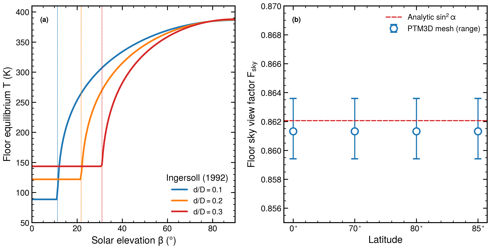

# Radiation Exchange Module

This document describes the inter-face thermal radiation module in PTM3D: how view factors
between mesh faces are built, how the band-separated radiosity system is solved, and how the
resulting indirect flux is coupled back into the 1D thermal solver at each surface element.
It describes current behavior; configuration keys, defaults and thresholds quoted here are the
ones the code uses.

## 1. Physical context

On airless bodies, faces in complex topography exchange thermal infrared radiation and scatter
incident sunlight toward one another. In permanently shadowed regions such as polar craters this
indirect radiation is often the dominant heat source and controls cold-trap temperatures and
volatile stability. The module captures it by solving for multi-bounce radiative transfer among
all mutually visible faces.

The module sits between the illumination model, which supplies direct solar flux
$Q_{\text{solar}}$, primary-body reflected flux $Q_{\text{refl}}$ and primary-body thermal IR
flux $Q_{\text{IR}}$, and the 1D conduction solver, which returns surface temperatures. The
absorbed indirect flux is added to the surface boundary condition.

## 2. Surface energy balance

At the surface ($z = 0$) of face $i$ the thermal model solves

$$Q_{s,i} + k_0 \frac{T_1 - T_0}{\Delta z_0} = \varepsilon_i \sigma T_0^4$$

where $T_0$ is the surface temperature, $T_1$ the first subsurface node temperature, $k_0$ the
surface conductivity, $\Delta z_0$ the first layer thickness, $\varepsilon_i$ the broadband IR
emissivity and $\sigma = 5.67051196 \times 10^{-8}$ W m<sup>-2</sup> K<sup>-4</sup>. The surface
temperature is found by Newton-Raphson iteration on

$$f(T_0) = Q_{s,i} + k_0 \frac{T_1 - T_0}{\Delta z_0} - \varepsilon_i \sigma T_0^4 = 0$$

with derivative $f'(T_0) = -k_0/\Delta z_0 - 4\varepsilon_i \sigma T_0^3$.

The absorbed surface flux combines four components:

$$Q_{s,i}(t) = \bigl[Q_{\text{solar},i}(t) + Q_{\text{refl},i}(t)\bigr](1 - \alpha_i) + Q_{\text{IR},i}(t)\varepsilon_i + Q_{\text{indirect},i}(t)$$

- $Q_{\text{solar},i}(t)$ — direct solar flux (W m<sup>-2</sup>), from SPICE ephemerides with
  finite solar-disk integration, Embree shadow ray tracing and eclipse geometry.
- $Q_{\text{refl},i}(t)$ — solar flux reflected from the primary body (Earthshine, Jupiter-shine),
  from phase angle and a Lambertian sphere model.
- $Q_{\text{IR},i}(t)$ — thermal IR from the primary body, scaled by the solid-angle factor
  $(R_p/d)^2$ and the primary's effective temperature.
- $\alpha_i$ — visible-wavelength albedo. Optionally incidence-angle dependent, by either the
  Hayne et al. (2017) polynomial $\alpha(\theta) = \alpha_0 + a(\theta/(\pi/4))^3 + b(\theta/(\pi/2))^8$
  or the analytic Hapke directional-hemispheric form, selected in the `thermophysical:` block.
- $\varepsilon_i$ — broadband IR emissivity (equal to absorptivity by Kirchhoff's law).
- $Q_{\text{indirect},i}(t)$ — absorbed indirect flux from this module, already weighted by the
  appropriate absorptivity in each band.

## 3. Band-separated radiosity

PTM3D solves the radiosity system in **two spectral bands by default**
(`radiation.band_separated: true`): a visible band that scatters sunlight with the Bond albedo
$A_i$, and a thermal-IR band that scatters with $\rho_i = 1 - \varepsilon_i$. The two bands share
the same view-factor operator and the same iterative kernel, and their absorbed fluxes are summed.

**Visible band.** Sunlight scattered between faces. There is no emission source and the system is
temperature-independent:

$$(I - A F)\mathbf{B}_{\text{vis}} = A\mathbf{Q}_{\text{solar}}, \qquad Q^{\text{vis}}_{\text{ind},i} = (1 - A_i)\sum_j F_{ij} B_{\text{vis},j}$$

**Thermal-IR band.** Self-emission and its multiple reflections:

$$(I - \rho F)\mathbf{B}_{\text{ir}} = \mathbf{E}, \qquad E_i = \varepsilon_i \sigma T_i^4, \qquad Q^{\text{ir}}_{\text{ind},i} = \varepsilon_i \sum_j F_{ij} B_{\text{ir},j}$$

**Total.** The surface boundary condition receives

$$Q_{\text{indirect},i} = Q^{\text{vis}}_{\text{ind},i} + Q^{\text{ir}}_{\text{ind},i}$$

The direct term $(1 - A_i)Q_{\text{solar},i}$ stays in the caller's boundary condition (§2), so
there is no double counting.

Here $A$ and $\rho$ denote diagonal matrices of the per-face visible albedo and IR reflectivity.
Band separation requires a per-face Bond albedo; if none has been supplied the module warns and
falls back to the gray solve rather than proceeding with an implicit albedo.

**First-bounce source albedo.** The first scattering event acts on the collimated direct beam, so
the visible source term uses the *direct-beam* albedo the surface boundary condition applied
(the incidence-angle-dependent value, when one is configured), while the operator and the
absorptivity $1 - A_i$ keep the diffuse Bond value.

**Gray fallback.** Setting `radiation.band_separated: false` recovers the single-band gray solve

$$(I - \rho F)\mathbf{B} = \mathbf{E} + \rho\mathbf{Q}_{\text{solar}}, \qquad Q_{\text{indirect},i} = \varepsilon_i \sum_j F_{ij} B_j$$

in which sunlight scatters with the thermal reflectivity $1 - \varepsilon$ rather than the Bond
albedo. The two formulations agree exactly when $A = 1 - \varepsilon$.

## 4. View factors

### 4.1 Definition

The view factor $F_{ij}$ is the fraction of radiation leaving face $i$ that is intercepted by
face $j$:

$$F_{ij} = \frac{1}{A_i} \int_{A_i} \int_{A_j} \frac{\cos\theta_i \cos\theta_j}{\pi r^2} V_{ij} \thinspace dA_j \thinspace dA_i$$

where $\theta_i$ and $\theta_j$ are the angles between the two surface normals and the line
joining the area elements, $r$ is their separation and $V_{ij} \in \lbrace 0, 1\rbrace$ is the
binary visibility function. View factors satisfy reciprocity $A_i F_{ij} = A_j F_{ji}$ and the
sum rule $\sum_j F_{ij} + F_{\text{sky},i} = 1$, where $F_{\text{sky},i}$ is the fraction of the
hemisphere open to space.

### 4.2 Construction methods

Two builders are available. The default is the deterministic pairwise builder; the Monte Carlo
ray-gather builder is selected with `radiation.use_monte_carlo_vf: true`.

**Pairwise builder.** Each retained face pair is evaluated by one of two estimators, chosen from
the dimensionless separation $N_s = r/\sqrt{A_{\text{eff}}}$ with $A_{\text{eff}} = \sqrt{A_i A_j}$:

*M1, centroid approximation* (far field, $N_s > 5$) evaluates the integrand at the face centroids:

$$F_{ij} \approx \frac{A_j}{\pi} \frac{\cos\theta_i \cos\theta_j}{r^2}$$

with $\cos\theta_i = \hat{n}_i \cdot \hat{r}_{ij}$ and $\cos\theta_j = -\hat{n}_j \cdot \hat{r}_{ij}$,
$\hat{r}_{ij}$ the unit vector from centroid $i$ to centroid $j$. A single Embree ray verifies
visibility. This follows the M1 formulation of Rezac & Zhao (2020).

*M3, subdivision* (near field, $N_s \le 5$) subdivides the receiving face into sample points
(about 10 points at `subdivision_level: 3`) and averages:

$$F_{ij} \approx \frac{A_j}{\pi n_{\text{pts}}} \sum_{k=1}^{n_{\text{pts}}} \frac{\cos\theta_{i,k} \cos\theta_{j,k}}{r_k^2}$$

The switch between them is `adaptive_ns_threshold` (default 5.0); `method` may also be pinned to
`CENTROID` or `SUBDIVISION`.

**Monte Carlo ray-gather builder.** For each source face, shoot `mc_rays_per_face`
cosine-weighted hemispherical rays and count first hits, giving $F_{ij} \approx \text{hits}_j/N$.
The result is a sparse CSR matrix with row sums $\le 1$ by construction, and it plugs into the
solver unchanged. This path exists for meshes beyond the practical H-matrix build limit (several
million faces), where H-matrix build memory and the adaptive-neighbor cap both become binding.
The default 100,000 rays per face gives roughly 10% relative error on $F_{ij} \sim 10^{-3}$.

### 4.3 Visibility testing

Visibility between face pairs is tested with Intel Embree:

- single rays for M1 centroid pairs;
- batched queries for M3 subdivision points;
- SIMD ray packets during H-matrix construction — AVX-512 16-wide (`rtcIntersect16`) or AVX2
  8-wide (`rtcIntersect8`), selected at runtime from CPU support.

Pairs that face away from each other, or that are within numerical noise of grazing
($\cos\theta_i < 10^{-6}$ or $\cos\theta_j < 10^{-6}$), are rejected before any ray is traced.
Ray origins are lifted off the source face by $\max(0.001 r, 0.5\ \text{m})$, capped at $0.1 r$,
with a matching margin at the far end; pairs closer than the resulting minimum are treated as
mutually visible without a trace. On sub-meter meshes those metric offsets are coarse relative to
the facets — see [KNOWN_LIMITATIONS.md](KNOWN_LIMITATIONS.md).

### 4.4 Neighbor selection

Computing all $N^2$ pairs is prohibitive, so each face selects a subset of partners.

**Adaptive selection** (default, `adaptive_neighbors: true`). For each face $i$:

1. Collect candidates within $R_{\text{search}} = f_R \sqrt{A_i}$ (`search_radius_factor`,
   default 10) using a spatial grid.
2. Score each candidate by its radiative potential
   $\hat{F}_{ij} \propto A_j |\cos\theta_i||\cos\theta_j| / r^2$.
3. Take candidates in descending order until `captured_energy_target` (default 0.95) of the total
   potential is captured.
4. Enforce `min_neighbors` (default 20) and `max_neighbors` (default 500).
5. Track total memory with atomic counters to stay within budget.

**Fixed selection** takes the top `max_neighbors` candidates by potential.

A conservative **cluster-level pre-cull** (`use_cluster_cull`, default on) drops candidate
clusters whose average normal is strongly back-facing before per-face ranking.

### 4.5 Row-sum renormalization

The M1 point estimator overshoots in the near field, so on fine or strongly concave meshes some
rows sum to more than 1. That makes the radiosity gain exceed unity and the iteration diverge.
The solver therefore computes the row sums once with a single $F\mathbf{1}$ product and stores

$$w_i = \frac{1}{\max(1, \sum_j F_{ij})}$$

applying $w_i$ after every $F\mathbf{x}$ product. Rows already summing to $\le 1$ are untouched.
The number of renormalized rows, the maximum row sum and the mean row sum are reported at
radiation start-up; `PTM_DUMP_VF_ROWSUMS` writes the per-face row sums for inspection.

### 4.6 Sparse storage

The sparse matrix is stored in Compressed Sparse Row form: `values_` (non-zero $F_{ij}$),
`col_indices_` (partner index) and `row_ptrs_` (size $N+1$). Operations are `matvec`
($\mathbf{y} = F\mathbf{x}$), `matvecTranspose`, `get(i,j)`, `getRow(i)` and `rowSums`.

## 5. H-matrix compression

For large meshes the full sparse matrix becomes expensive to store and to multiply. Following
Potter et al. (2023), the module offers hierarchical-matrix compression with
$O(N \log N)$ storage and product cost (`radiation.use_hmatrix: true`).

### 5.1 Spatial partitioning

Faces are partitioned recursively with a **3D octree** — preferred over a 2D quadtree because
crater geometry has significant vertical extent. Each node stores its face indices, a 3D bounding
box and the box diagonal as its diameter. Subdivision stops at `max_tree_depth` (default 10) or
`min_block_size` (default 64 faces).

### 5.2 Admissibility

For each pair of leaf clusters $(X, Y)$, the block is compressible when

$$\max\bigl(\text{diam}(X), \text{diam}(Y)\bigr) \le \eta \cdot \text{dist}(X, Y), \qquad \eta = 0.8$$

with $\text{dist}$ the 3D distance between cluster centers. Inadmissible blocks are subdivided
recursively for up to `max_hierarchical_levels` (default 2) further levels. A cluster-level
visibility cull uses the average normals to skip pairs that cannot see each other.

### 5.3 Block types

- **ZeroBlock** — clusters cannot see each other.
- **LowRankBlock** — $F \approx U\Sigma V^T$ with $U$ ($m \times k$) and $V$ ($n \times k$),
  $k \ll \min(m,n)$.
- **SparseBlock** — CSR storage for small or near-field blocks.
- **DenseBlock** — full dense storage.
- **HierarchicalBlock** — recursively subdivided.
- **DiskBlock** — out-of-core storage for very large meshes.

### 5.4 Low-rank compression

**Adaptive Cross Approximation (ACA)** is the default and is substantially faster than SVD. It
builds the factorization directly by greedy row/column sampling:

1. Start from pivot row $i_0 = 0$.
2. For rank $k = 0, 1, \ldots$: compute row $i$, subtract the current rank-$k$ approximation,
   find the pivot column $j$ of maximum residual, stop if
   $|r_{ij}| < \tau_{\text{ACA}}\lVert F\rVert$ or $|r_{ij}| < 10^{-15}$, otherwise compute
   column $j$ and add the rank-1 update.
3. The result costs $O(k(m+n))$ storage.

Parameters: `aca_tolerance` (default $10^{-3}$), `aca_max_rank` (default 50), `aca_min_block_size`
(default 100 — smaller blocks use SVD).

**SVD** is the fallback for small blocks and for blocks where ACA fails: the block is formed and
truncated with `Eigen::JacobiSVD`, or with a randomized SVD (oversampling $p = 10$, $q = 2$ power
iterations), at `hmatrix_tolerance` (default $10^{-2}$) keeping at most `hmatrix_max_rank`
(default 50) singular values.

**Subdivide instead of zero.** When ACA on a large admissible block would be too expensive, or
fails, the builder bisects the face-index lists and re-attempts ACA on the compact sub-clusters
rather than zeroing the block (`hmatrix_subdivide_admissible`, default on; env
`PTM_HMATRIX_SUBDIVIDE`). Zeroing those blocks removes crater floor-to-wall coupling on meshes
above roughly 100k faces.

### 5.5 Serialization

- **`.hmat`** — H-matrix, magic `0x484D4154`; stores the block structure, low-rank factors and
  sparse blocks.
- **`.vfm`** — sparse matrix, magic `0x5646464D`; the CSR arrays written directly.

`RadiationExchangeManager::loadViewFactors()` auto-detects both formats.

### 5.6 Memory-mapped loading

For pre-computed H-matrices on very large meshes (default threshold 500k faces) the module can
memory-map the file and load blocks on demand during `matvec` rather than reading it all into RAM.

## 6. Radiosity solver

### 6.1 Jacobi iteration

Used when the operator is an H-matrix (no efficient row access) or when Gauss-Seidel acceleration
is off:

$$\mathbf{B}^{(k+1)} = \mathbf{E} + \rho\mathbf{Q}_{\text{solar}} + \rho\left(w \odot F\mathbf{B}^{(k)}\right)$$

initialized with $\mathbf{B}^{(0)} = \mathbf{E} + \rho\mathbf{Q}_{\text{solar}}$, where $w$ is the
row-sum renormalization of §4.5. Each iteration costs one matrix-vector product:
$O(N \log N)$ for the H-matrix, $O(\text{nnz})$ for the sparse matrix.

### 6.2 Gauss-Seidel iteration

Used when the operator is a sparse CSR matrix with row access and `use_acceleration` is on
(default):

$$B_i^{(k+1)} = E_i + \rho_i Q_{\text{solar},i} + \rho_i \sum_j F_{ij} B_j^{(*)}$$

where $B_j^{(*)}$ is the most recently updated value — the current sweep for $j < i$, the previous
one for $j > i$. It converges in fewer sweeps than Jacobi because updates propagate within a sweep.

### 6.3 Fused two-band Jacobi

When band separation is active and row access is unavailable, the two bands are driven through a
single width-2 matrix-vector product per iteration, reading the CSR once for both. Each band
keeps its own initialization, update, renormalization, convergence test and sweep count, and is
frozen as soon as its own residual clears the tolerance. The per-band sweep counts of the first
solve are logged once per process.

### 6.4 Convergence

Each band stops when

$$\frac{\max_i |B_i^{(k+1)} - B_i^{(k)}|}{\max_i |B_i^{(k+1)}|} < \tau_{\text{solver}}$$

(`convergence_tolerance`, default 0.01) or at `max_iterations` (default 100). Diagnostics:
`getLastIterations()`, `getLastResidual()`, `didConverge()`.

The CPU paths apply that test every iteration — the residual is already in host memory. The GPU
path must pay a device→host round trip for it, so it tests every
`convergence_check_interval` iterations and can therefore only stop at a multiple of that
interval. The default, `0`, resolves the interval per matrix
(`gpu::opencl::resolveConvergenceCheckInterval`) by weighing the cost of one Jacobi traversal,
$\approx \text{nnz}/2.05\times10^{10}\thinspace\mathrm{s}$, against the ~3.7 ms of one convergence read:
above ≈7.6e7 stored non-zeros a traversal is the more expensive of the two and the solver checks
every iteration; below it, it checks every 10. Both constants were measured on a Radeon Pro
W6800X on 2026-08-15 (509,337-face lunar CSR at 495,163,704 nnz, and a 12,800-face bowl crater).
A positive `convergence_check_interval` pins it instead. See
[ENVIRONMENT.md](ENVIRONMENT.md) `PTM_RAD_GPU_CHECK_INTERVAL` for the diagnostic override.

Absorbed flux is recovered from the converged radiosity by the fixed-point identity
$w \odot F\mathbf{B} = (\mathbf{B} - \mathbf{E} - \text{source})/\rho$, which avoids a second
matrix-vector product; where the reflectivity approaches zero the last iterate's normalized
incoming flux is used instead.

### 6.5 Energy-balance check

After a solve the module can verify global conservation:

$$\text{imbalance} = \left|\sum_i \varepsilon_i \sigma T_i^4 A_i - \sum_i \left(\varepsilon_i Q_{\text{solar},i} + Q_{\text{indirect},i}\right) A_i\right|$$

available as `RadiositySolver::checkEnergyBalance()`.

### 6.6 GPU acceleration (OpenCL)

With `radiation.use_gpu: true` (or `--rad-use-gpu`) the solve is offloaded to OpenCL. The GPU path
uses CSR sparse matrix-vector multiply for $F\mathbf{B}$, parallel Jacobi iteration with a
periodic convergence check, and warm starts from the previous solution in the gray
path. Kernels: `spmv_kernel`, `spmv_vector_kernel`, `spmv_chunk_kernel`,
`spmv_vector_chunk_kernel`, `max_reduction_kernel`, `emission_kernel`, `solar_source_kernel`,
`jacobi_kernel`, `indirect_flux_kernel`. The chunked variants split very large matrices across
multiple dispatches so the number of stored entries is not limited by a single allocation.

Per-timestep solves are independent, so a batch can be split across several devices
(`gpu_devices`, `gpu_device_ids`, `gpu_batch_size`, `gpu_inter_batch_pause_ms`), mirroring the
thermal pool's dispatch model.

**Band separation on the GPU** requires a sparse view-factor matrix, and it runs on either a single
device or the multi-device pool. It does *not* require row sums below 1: the GPU Jacobi kernel
applies the row renormalization of §4.5 on the device, from a per-face buffer uploaded alongside the
matrix, so the GPU and CPU iterate the same operator $\rho\thinspace(\hat{\mathbf n}\odot F)$. What is
checked instead is the condition under which Jacobi converges at all,

$$\text{gain} \thickspace=\thickspace \rho_{\max}\thinspace\max_i \min\Bigl(\textstyle\sum_j F_{ij},\thinspace 1\Bigr) \thickspace<\thickspace 1,$$

which the renormalization already caps at $\rho_{\max}$; it can only fail for a perfect reflector
($A \geq 1$ or $\varepsilon \leq 0$), where no solver converges. When the sparse-matrix requirement
or the gain condition is not met, the run says so and the band-separated solve falls back to the
CPU, which is unrestricted; it never silently reverts to the gray kernel for a two-band request.

**Reaching the GPU with a corrected view-factor matrix.** The route follows the config:
`PTM_HMATRIX_VF_REPLACE` installs the replacement as the GPU sparse operator when
`radiation.use_gpu: true`, and as the CPU operator when it is false. Nothing else is needed:

```sh
PTM_HMATRIX_VF_REPLACE=/path/to/corrected.csr \
ptm_thermal_sim --config run.yaml     # with radiation.use_gpu: true, use_hmatrix: false
```

The run names the route it took — `[PTM_HMATRIX_VF_REPLACE] ROUTE = GPU (radiation.use_gpu in the
config)` — and then names the rung the GPU landed on. `PTM_HMATRIX_VF_REPLACE_GPU` and
`PTM_HMATRIX_VF_REPLACE_CPU` override the choice in either direction; setting both is fatal.

Until 2026-08-16 the GPU route required `PTM_HMATRIX_VF_REPLACE_GPU` as a *second* switch, which no
tracked launcher set, so every corrected-matrix run did its whole radiosity solve on the CPU while
the config read `radiation.use_gpu: true`.

Both routes apply identical mesh-identity, row-sum and non-negativity checks.

**Where the choice is made, and why it is not made at load time.** The matrix is always installed
first as the CPU `SparseVFOperator`, because the loader runs from the `RadiositySolver` constructor
and the configuration does not exist yet — `setConfig()` has not been called, so `config_.use_gpu`
still holds its `false` default whatever the YAML says. `initGPU()` is the first point at which the
config is populated, so that is where the route is chosen: it *promotes* the CPU operator to a GPU
`ViewFactorMatrix` (widening the stored `float` values to `double`) and points `F_ptr_` at it for the
upload.

The CPU operator is never destroyed. That is what makes the fallback correct by construction: if no
GPU rung engages — no device, or the matrix does not fit VRAM — the engine simply drops `F_ptr_` and
the float64 replica and continues on the operator it already had, which is the production CPU solver
(the fused width-2 two-band Jacobi). It does the same after a *successful* upload, since the device
now holds the matrix and nothing on the host reads the replica again; clearing `F_ptr_` additionally
keeps any mid-run CPU fallback on the fused Jacobi rather than Gauss-Seidel, because `solveTwoBand`
selects Gauss-Seidel precisely when `F_ptr_` is non-null.

### 6.6 What the GPU radiosity solver costs, measured

All numbers below are measurements on this machine's four AMD Radeon PRO W6800X Duo
dies, 2026-08-16, on two real view-factor matrices. Nothing here is derived except
the clearly-labeled campaign projection at the end.

**Traversals.** The honest unit of radiosity cost is the number of times the matrix
is read, and it is *not* the Jacobi iteration count: every solve also pays one final
matvec to turn the converged radiosity into absorbed flux, and the band-separated GPU
route used to pay it twice per timestep. `PTM_RAD_COST_REPORT` counts dispatches.

| route | A3GT A03MP026 (2.485e9 nnz) | moon3d 509k (4.95e8 nnz) |
|---|---|---|
| CPU (fused width-2 Jacobi) | 2.000 traversals/solve | 2.792 |
| GPU, unfused + absolute criterion | 7.000 | 9.927 |
| GPU, fused only | 4.000 | — |
| GPU, relative criterion only | 6.000 | — |
| GPU, fused + relative (current) | **3.500** | **4.375** |

So the GPU's traversal excess over the CPU falls from 3.50x to 1.75x at A3GT and
from 3.56x to 1.57x at moon3d. The two changes are close to multiplicative
(1.75 x 1.17 = 2.04 against the 2.00 measured together).

**Sweep wall clock.** Bracketed from the engine's own structural markers
(`--- Radiation Iteration N ---` to `Computing indirect flux ... 100%`), which is
uniform across routes; the progress bar is not, because the multi-GPU pool emits a
single frame per sweep. Four sweeps per arm; the spread is the standard deviation.

| arm | A3GT sweep (s) | g = CPU/arm | moon3d sweep (s) | g |
|---|---|---|---|---|
| CPU | 134.62 ± 0.88 | 1.000 | 7.11 ± 0.30 | 1.000 |
| GPU N=1, unfused + absolute | 82.23 ± 1.47 | 1.637 | 5.20 ± 0.10 | 1.367 |
| GPU N=1, fused only | 75.34 ± 0.58 | 1.787 | — | — |
| GPU N=1, relative only | 72.10 ± 0.85 | 1.867 | — | — |
| GPU N=1, fused + relative | **66.27 ± 0.14** | **2.032** | **3.53 ± 0.10** | **2.014** |
| GPU N=4 pool, unfused + absolute | 29.53 ± 0.19 | 4.559 | — | — |
| GPU N=4 pool, fused + relative | **26.74 ± 0.57** | **5.034** | — | — |

⚠️ **The traversal ratio overstates the time saving, and by a lot.** Traversals fell
2.00x at A3GT but the sweep only 1.24x (1.10x at N=4); at moon3d, 2.27x against
1.47x. The reason is that a width-2 traversal is *not* the cost of one single-band
traversal: it shares the CSR value and column reads (8 bytes per stored entry) but
doubles the gather from the radiosity vector, the arithmetic and the output writes.
Measured on the fusion-only arm, one fused traversal costs **1.60x** a single-band
one (time ratio 0.916 against a traversal ratio of 0.571), so fusing two traversals
into one buys 1.09x, not 1.75x. The criterion change, which removes whole
single-band traversals at unchanged unit cost, converts almost exactly (1.14x of
time against 1.17x of traversals).

The practical reading: **this radiosity SpMV is gather-bound, not CSR-stream-bound.**
Halving the matrix reads is worth far less than halving the traversals, and further
work should target the gather (column ordering, blocking) rather than the traversal
count.

**Campaign impact — DERIVED, not measured.** Folding g(N=4) into the measured
A03MP026 window profile (99.19-min CPU window, radiosity 67.4 %, per-window GPU
setup penalty +46.3 s at N=4) over 472 windows:

| arm | window (min) | campaign (days) |
|---|---|---|
| GPU N=4, unfused + absolute | 47.8 | 15.7 |
| GPU N=4, fused + relative | 46.4 | **15.2** |
| Amdahl ceiling (radiosity free) | 33.1 | 10.9 |

That closes about 9 % of the gap to the ceiling, not most of it — because at N=4
radiosity is already only ~31 % of the window, and because of the gather-bound
result above.

**Equivalence.** Against the same run's CPU route, worst temperature max\|Δ\|:
**0.0066 K** at A3GT (weak coupling, max Σ_j F_ij = 0.2) and **0.271 K** at moon3d
(strong coupling); 14 of 22 statistics products byte-identical in both cases (the 8
that differ are exactly the radiosity-derived ones), sign census 92–96 % one-sided
at A3GT and 99.6–99.9 % at moon3d. The relative criterion moved the moon3d delta
only slightly (0.279 K → 0.271 K): at these scales the CPU/GPU difference is
dominated by float32-vs-float64, not by where the iteration stops. **The A3GT
milli-kelvin figure does not transfer to a strongly-coupled mesh.**

## 7. Thermal-radiation coupling

Surface temperatures depend on indirect flux and indirect flux depends on surface temperatures,
so the two are solved by an outer Picard iteration.

### 7.1 Algorithm

Starting from the temperatures of the initial thermal solve (computed without indirect flux), for
each coupling iteration $k = 1, 2, \ldots, k_{\max}$:

1. **Compute the time-varying indirect flux.** For each timestep, take the current surface
   temperatures and direct solar flux, solve the radiosity system, and store
   $Q_{\text{indirect},i}(t)$.
2. **Select faces for a thermal re-run** (§7.2).
3. **Check convergence** (§7.3).
4. **Re-run the 1D thermal model** on the selected faces over all timesteps with

   $$Q_{s,i}(t) = \bigl[Q_{\text{solar},i}(t) + Q_{\text{refl},i}(t)\bigr](1 - \alpha_i) + Q_{\text{IR},i}(t)\varepsilon_i + Q_{\text{indirect},i}(t)$$

   warm-started from the previous iteration's temperature profile.
5. **Update** the temperatures and return to step 1.

### 7.2 Face selection

Two selection criteria are available through `coupling_select_mode`.

**`physics`** (default) uses a linearized temperature-response predictor:

$$\widehat{\Delta T}_i = \frac{(1-\alpha_i)\Delta F_i}{4\varepsilon\sigma T_{\text{eff},i}^3}, \qquad T_{\text{eff},i} = \max\bigl(\max_t T_i(t), 40\ \text{K}\bigr)$$

with $\Delta F_i = \max_t Q^{(k)}_{\text{indirect},i}(t) - \max_t Q^{(k-1)}_{\text{indirect},i}(t)$
for $k > 0$ and $\max_t Q^{(0)}_{\text{indirect},i}(t)$ at $k = 0$. A face is re-run when
$\widehat{\Delta T}_i$ exceeds the selection threshold, or when the temperature change it actually
showed in the previous re-run still exceeds it. Faces that have stopped moving *and* whose flux is
stable are frozen. Because the response scales as $T^{-3}$, cold shadowed floors and warm slopes
are treated asymmetrically without a separate rule.

**`legacy`** selects on absolute flux: face $i$ is re-run when
$\max_t Q_{\text{indirect},i}(t) > \tau_Q$ (`coupling_flux_threshold`, default
0.1 W m<sup>-2</sup>).

### 7.3 Coupling modes and window dependence

Every quantity the loop uses to select faces and to stop is a maximum **over the output window**:
$\max_t Q_{\text{indirect},i}$, $\max_t T_i$, $\max_{i,t}|T^{(k)} - T^{(k-1)}|$, and the count of
faces whose window-maximum change exceeds the tolerance. A shorter window therefore scores every
face lower, selects fewer faces, and can stop an iteration earlier, which makes the converged
field depend on where a chunked run's boundaries fall. `coupling_mode` controls that.

| Mode | Selection threshold | Exit criteria |
|---|---|---|
| `bounded` (default) | absolute `coupling_select_dt` (default 0 K — every face carrying any indirect flux) | maximum per-face temperature change below `coupling_temp_threshold`, or $k_{\max}$ |
| `fixed` | as `bounded` | always runs $k_{\max}$ iterations |
| `legacy` | `coupling_temp_threshold` × `coupling_select_safety` | as `bounded`, plus a face-fraction exit when fewer than `coupling_face_fraction` of faces are still changing |

`bounded` removes the window dependence from both the selection and the exit: the threshold is
absolute and the face-fraction exit is disabled, so a chunked run reproduces the single-shot field
to within the checkpoint's `float32` rounding. `fixed` additionally fixes the iteration count,
which is the only way to make it provably independent of the decomposition, at the cost of running
every iteration. `legacy` reproduces the pre-2026-08 behavior bit-for-bit and is provided only to
reproduce a run published under it; it re-introduces the window dependence. It can be selected
without editing a configuration through `PTM_COUPLING_MODE`.

Setting `coupling_select_dt` above 0 trades accuracy for speed on very large meshes and
re-introduces the dependence up to that magnitude per face. The run warns when it is set, and
warns that `coupling_face_fraction` is inert outside `legacy`, rather than ignoring either
silently.

Convergence in `bounded` and `fixed` is measured by
$\Delta T_{\max} = \max_{i,t}|T_i^{(k)}(t) - T_i^{(k-1)}(t)|$, which bounds the residual on every
face. The `legacy` face-fraction criterion has no such bound: it can stop while up to
`coupling_face_fraction` of the mesh is still moving by an arbitrary amount.

### 7.4 The radiation-exchange face set

`RadiositySolver::solve()` returns $Q_{\text{indirect},i}$ for **every** face — face
classification never enters the solve. The *exchange set* is applied afterwards as a copy mask
that decides which of the computed values reach the thermal step; everything it excludes is set to
exactly 0 W m<sup>-2</sup>.

| Key | Flag | Default | Meaning |
|---|---|---|---|
| `exchange_selection` | `--rad-exchange-selection` | `all` | `all` keeps every face's computed flux; `shadow` keeps only faces in shadow for at least `min_shadow_fraction` of the run |
| `min_shadow_fraction` | `--rad-min-shadow-fraction` | 0.3 | consulted in `shadow` mode only |

`all` is the default and the only setting with a physical justification: the radiosity solution is
a self-consistent global linear solve, so discarding part of its output is data loss rather than
an approximation. It is also effectively free, because the set never gated the solve.

`shadow` measures each face's shadow fraction over the run's **own** illumination series, whose
length is $n_{\text{equilibration steps}} + n_{\text{output steps}}$. A warm-started chunk has no
equilibration samples, so the criterion becomes a function of the chunk plan: a chunk falling in
local daytime reclassifies faces out of radiation exchange entirely and zeroes their indirect
flux. A two-chunk test cannot detect this — a half-lunation window still spans enough night for
every face to clear the gate — so decomposition independence should be certified at three chunks
or more. `shadow` reproduces the pre-2026-08 behavior bit-for-bit, warns and names the number of
faces it is about to zero, and should be paired with `coupling_mode: legacy` when reproducing a
run published under it. It is selectable without editing a configuration through
`PTM_EXCHANGE_SELECTION`.

`min_shadow_fraction` is inert in `all` mode, and the run says so when it is set there.

Correcting a truncated mask also changes single-shot results for any window that was being
truncated (a short warm-started window, or `equilibration_orbits: 0`): previously zeroed faces
warm, because restoring a positive absorbed flux can only raise a temperature.

### 7.5 Convergence parameters

| Quantity | YAML key | Flag | Default |
|---|---|---|---|
| $k_{\max}$ | `max_coupling_iterations` | `--rad-coupling-iter` | 16 |
| $\tau_T$ | `coupling_temp_threshold` | `--rad-coupling-temp-tol` | 0.5 K |
| $\tau_Q$ | `coupling_flux_threshold` | `--rad-coupling-flux-tol` | 0.1 W m<sup>-2</sup> (`legacy` selection only) |
| $f_{\text{threshold}}$ | `coupling_face_fraction` | `--rad-coupling-face-frac` | 0.01 (`legacy` coupling mode only) |
| selection mode | `coupling_select_mode` | `--rad-coupling-select-mode` | `physics` |
| safety factor | `coupling_select_safety` | `--rad-coupling-select-safety` | 0.5 (`legacy` coupling mode only) |
| coupling mode | `coupling_mode` | `--rad-coupling-mode` | `bounded` |
| $\tau_{\text{sel}}$ | `coupling_select_dt` | `--rad-coupling-select-dt` | 0 K (`bounded`/`fixed` only) |

An unrecognized `coupling_mode` or `exchange_selection` is fatal at configuration time, before the
illumination pass.

#### 7.5.1 Choosing $k_{\max}$ from the view-factor spectrum

$k_{\max}$ was raised from 10 to **16** on 2026-08-15, and the reason is that it should never have
been chosen by habit in the first place. Linearize the outer loop — radiosity, then re-thermal —
about a converged state. The re-thermal's temperature response to a flux perturbation is
$G \le D^{-1}$ with $D = \mathrm{diag}(4\varepsilon\sigma T^3)$ (equality in the
radiative-equilibrium limit; conduction only shrinks it), and the radiosity's response to a
temperature perturbation is $\varepsilon F (I - \rho_r F)^{-1} D$ with $\rho_r = 1-\varepsilon$.
The iteration matrix is therefore

$$M = G\thinspace\varepsilon F (I-\rho_r F)^{-1} D,$$

which is similar to $\varepsilon F (I-\rho_r F)^{-1}$ — **the $T^3$ factors cancel**. The
asymptotic sweep-to-sweep rate is then a property of the geometry alone:

$$r \thickspace\le\thickspace \frac{\varepsilon\thinspace\rho(F)}{1 - (1-\varepsilon)\thinspace\rho(F)},\qquad
\rho(F) = \text{spectral radius of the view-factor matrix}.$$

Measured at two meshes, three digits:

| mesh | max row sum | $\rho(F)$ | predicted $r$ | measured $r$ |
|---|---|---|---|---|
| 509k lunar flagship (`..._corrected_pp.csr`, 495.2M nnz) | 1.0000 | 0.7766 | 0.7676 | **0.7451** |
| 12,800-face `lunar_crater_80N` (tutorial 04) | 0.13988 | 0.13409 | 0.1282 | **0.077–0.128** |

On the flagship the sweep-to-sweep increment first falls below 2 K at sweep 12, below **1 K at
sweep 16**, and below 0.1 K at sweep 23. A run capped at 5 sweeps was truncated by up to **+26.2 K**
on its worst face, and the truncation is one-signed — a capped run is **cold** on the most enclosed
faces (99.4 % of moving faces warm when the cap is lifted). Cold-trap area statistics moved <0.03 pp,
but the hot tail did not: faces above 400 K rose 1056 → 1168 and the global maximum 460.7 → 477.1 K.

⚠️ **The 80 N crater is not a proxy for the flagship.** Its maximum row sum is 0.14 against 1.00, it
reaches 0.01 K by sweep 5, and $k=20$ differs from $k=5$ by 0.0013 K. A coupling-convergence study
run there will report "5 sweeps is plenty" and tell you nothing about a closed lunar enclosure.
**Pick the test mesh by its row-sum distribution, not by its name.**

⚠️ Read the row-sum maximum from `vf_rowsum_dump`, not from the run log: the engine's
`[Radiosity] View-factor row sums Σ_j F_ij: max=…` line prints at default `std::cout` precision, so
the crater's 0.13988 shows there as `max=0.1`. That rounding is where the crater's ρ was first
recorded as "≈0.081" — a value Perron-Frobenius makes impossible to distinguish from the real
0.13409 by eye, since both sit below the true row-sum bound.

**The engine reports this itself.** Before the first sweep of a coupled run it power-iterates the
view-factor operator **the solve actually applies** — $\mathrm{diag}(1/\max(1,\sum_j F_{ij}))\thinspace F$,
because the radiosity renormalizes every row of $F\mathbf{x}$ right after the matvec; iterating raw
$F$ would over-state $\rho$ on exactly the meshes that renormalization exists for, and could report
"not a contraction" about a solve that contracts — and prints ρ, the implied $r$, and an upper bound
on the sweeps needed for a 1 K and a 0.1 K increment, and it **warns** when
`max_coupling_iterations` is below the 1 K count. The bound extrapolates a pure geometric tail from a first-sweep increment equal to the
subsolar radiative-equilibrium temperature, so it over-states: on the flagship it says 23 where the
measured crossing is 16. It is an advisory, not a clamp — the run continues either way.
`PTM_RHO_ADVISORY=0` skips it (measured 3.0 s at 495M nnz on a 48-core host).

### 7.6 Other coupling behavior

- **Warm-started thermal re-runs.** Each iteration initializes from the previous iteration's
  temperature profile, reducing the number of timesteps needed to reach the new equilibrium.
- **Per-face albedo consistency.** The coupling loop uses the same per-face albedo maps as the
  initial thermal solve.
- **Under-relaxation.** `PTM_RAD_COUPLING_RELAX` applies a Picard under-relaxation factor for
  pathological meshes; the default 1.0 is no relaxation.
- **Post-coupling checkpoint.** When `thermal.final_state_file` is set, the checkpoint written by
  the initial solve is rewritten after the coupling loop with the coupled end-of-window column on
  every face the re-run touched, so a resumed chunk does not cold-start the faces where indirect
  radiation sets the temperature. This applies to the **GPU** thermal path only: the CPU re-run
  keeps no `T(z)` column, so on a CPU solver the archived checkpoint stays the **un-coupled**
  iter-0 column on the re-run faces. The run reports that rather than implying otherwise.

### 7.7 Indirect flux during equilibration

The coupling loop of §7.1 supplies indirect flux over the **output window**. The equilibration
phase that precedes it runs before any radiosity solution exists, so by construction its surface
forcing omits the indirect term. On a face whose only heat source is infrared from neighboring
faces, that means the deep column equilibrates against the geothermal flux alone, reaches
$T_{\text{geo}} = (Q_b/\varepsilon\sigma)^{1/4}$, and then warms through the output window. Every
statistic taken over that window is biased cold.

PTM3D therefore estimates the equilibration-phase indirect flux and applies it, by default.

**How it is estimated.** The run performs a radiosity sweep over the window, reduces it to the
per-face output-window time mean

$$\langle q_{\text{ind}}\rangle_i = \frac{1}{N_{\text{out}}} \sum_{t \in \text{window}} Q_{\text{indirect},i}(t),$$

repeats the whole-mesh thermal solve with $\langle q_{\text{ind}}\rangle_i$ added to the absorbed
flux at every equilibration step, and then restarts the coupling loop. The output window is
untouched — it already carries the time-varying indirect from the coupling — so there is no double
counting. Equilibration sets the deep column, whose response time is many diurnal cycles, so the
cycle-mean forcing is the quantity that determines it; dropping the diurnal modulation of the
indirect term is correct at leading order.

That is one *pass*. `thermal.eq_indirect_passes` (default 1) sets how many run: pass 2 re-reduces
$\langle q_{\text{ind}}\rangle$ from the field pass 1 produced and re-equilibrates against it, and
so on. This is a fixed-point iteration, and nothing stops it early — the run prints the
pass-to-pass change in $\langle q_{\text{ind}}\rangle$ so the knee is visible in the log for the
mesh at hand rather than assumed from someone else's.

**Two estimators, two fixed points.** `thermal.eq_indirect_source` chooses *which* sweep is
reduced, and the choice matters more than the pass count:

* `auto` (default) reduces the coupling loop's **iteration-0** sweep. The emitters in that sweep
  have not yet received any output-window indirect themselves, so $\langle q_{\text{ind}}\rangle$
  is low — measured 13.3% low on the 80 N crater — and stays low at **any** pass count.
* `converged` reduces the sweep **after the coupling loop converges**. That is the flux the output
  window actually carries, so it removes the iteration-0 bias. It costs one extra coupling loop per
  pass.

Measured on the shipped 12,800-face `lunar_crater_80N` mesh, 25-lunation equilibration at 2
steps/day, 1-lunation output window, CPU solver, over the 1,086 faces that receive no direct and no
reflected sunlight anywhere in the run (mean equilibrated deep-column temperature):

| `eq_indirect_source` | 1 pass | 2 passes | 3 passes | 4 passes | wall clock vs `off` |
|---|---|---|---|---|---|
| `off` | 28.53 K | — | — | — | 1.00× |
| `auto` | 118.672 K | 118.956 K | 118.958 K | 118.958 K | 1.21× / 1.47× / 1.71× / 2.01× |
| `converged` | 122.570 K | 122.626 K | 122.626 K | — | 1.94× / 2.86× / 3.78× |

So the knee is at **2 passes for `auto`** (pass 3 moves the deep column 0.0015 K, 190× less than
pass 2 did) and at **1 pass for `converged`** (pass 2 moves it 0.056 K). The `auto` fixed point
sits 3.61 K below the `converged` one, and no pass count closes that. The `converged` fixed point
agrees with the manual two-run `eq_indirect_flux_file` workflow below to better than 0.0001 K,
which is what that workflow has always been doing by hand.

**The default is nevertheless 1 pass, on both estimators**, because a knee is not by itself a
reason to buy. Read the table across rather than down: the second `auto` pass buys 0.284 K of deep
column for +0.26× wall, while switching estimator — `converged` at *one* pass — buys 3.90 K for
+0.73×. Per kelvin that is roughly five times worse, and it gets worse as the equilibration
lengthens: an `auto` pass is a whole-mesh solve over the equilibration span, while a `converged`
pass adds a coupling loop over the output window only, so the two costs scale with different
things. Measured on this crater, the second `auto` pass costs +12% of the run at
`equilibration_orbits: 1` and +21% at 25. Where it crosses over and costs more in absolute wall
clock than switching estimator does is therefore a property of the equilibration length, not a
fixed ratio — check the arming banner's numbers against your own run. The pass count is the right
knob only once
`eq_indirect_source: converged` is already set. `eq_indirect_passes: 2` remains available and
remains a real fixed point — it is simply not where the first unit of budget should go.

The consequence for the *output window* on a one-lunation window is small — the second `auto` pass
moves the dark-face window mean by 0.0004 K and `converged` by 0.019 K — because a one-lunation
window gives the deep column almost no time to feed back to the surface. The deep column is the
quantity these settings control; a long or seasonal window is where it shows up at the surface.

**Every run reports its own accuracy.** None of the numbers above are printed as a prediction for
your mesh. At the end of the coupling loop the engine holds both halves of the comparison — the
$\langle q_{\text{ind}}\rangle$ it installed on the equilibration forcing, and the converged
coupling loop's — so it measures the shortfall on the mesh in front of it and converts it to
kelvin through the radiative stiffness of each face's own column,

$$\delta T_i \simeq \frac{\delta \langle q_{\text{ind}}\rangle_i}{4\varepsilon\sigma T_{\text{rad},i}^3},
\qquad T_{\text{rad},i} = \left(\overline{T_i^4}\right)^{1/4},$$

using the *radiative* mean over the output window rather than $\overline{T}$, which on a strongly
modulated sunlit face differs by tens of kelvin. The report splits the never-lit faces from the
sunlit ones, because the never-lit column is set by this term alone and a mesh-wide average hides
the whole effect. It also quotes what `converged` would cost in that run's own minutes, from its
own phase stopwatches, as a range: the extra coupling loop runs on a re-equilibrated field and
needs at least as many Picard iterations as the one just timed, in practice one more.

The linearization was checked against the deep columns above at three magnitudes spanning two
orders: it predicted 3.80, 3.54 and 0.06 K where the re-run measured 3.910, 3.614 and 0.056 K
(within 7%, and conservative on the large ones). It is a first-order estimate and the run labels
it as one.

**Cost.** Each `auto` pass is one extra radiosity sweep and one extra whole-mesh thermal solve.
Each `converged` pass is one extra whole coupling loop and one extra whole-mesh thermal solve. The
wall-clock share depends on what fraction of a given run those phases are, so the table above names
its case; on the 20,000-face `lunar_crater_85N` mesh a single `auto` pass measured 12–25%. The run
states its own expected cost in the arming banner before it charges it.

**When it applies.** The pass runs when radiation coupling is active and the window has an
equilibration phase to correct. It is skipped, with a message naming the reason, when
`thermal.initial_state_file` is set (a warm-started chunk has no equilibration phase; it inherits
the column the first chunk equilibrated) or when `equilibration_orbits` leaves no equilibration
steps. On a mesh with no meaningful inter-face view the pass still runs, measures
$\langle q_{\text{ind}}\rangle = 0$, reports it, and leaves the run identical to `off` — a measured
no-op rather than a special case.

**Sources and precedence.**

| Setting | Effect |
|---|---|
| `thermal.eq_indirect_source: auto` | Default. Internal pass off the coupling loop's iteration-0 sweep, as above. |
| `thermal.eq_indirect_source: converged` | Internal pass off the **converged** coupling loop. Removes the iteration-0 low bias; costs one extra coupling loop per pass. |
| `thermal.eq_indirect_source: off` | Legacy. Equilibration carries no indirect term. Reproduces pre-2026-08 results bit-for-bit. Also selectable through `PTM_EQ_INDIRECT_SOURCE`. |
| `thermal.eq_indirect_passes: N` | How many passes, on whichever estimator. Default `1`, which is also the 2026-08-11 behavior bit-for-bit. Must be ≥ 1 — `0` is rejected rather than accepted as a second spelling of `off`. Also selectable through `PTM_EQ_INDIRECT_PASSES`. |
| `thermal.eq_indirect_flux_file` | Explicit override, and it always wins. Reads a per-face `'QIND'` file (magic `0x51494E44`, `uint32` face count, then one `float64` per face) written by a prior run's `thermal.indirect_mean_out_file`. Use it to pin a run to a specific forcing. |

`thermal.indirect_mean_out_file` writes the same quantity the internal pass computes, but always
from the **converged** coupling loop. Feeding that file back through `eq_indirect_flux_file` in a
second run is the manual version of `eq_indirect_source: converged`, and lands on the same fixed
point (122.626 K on the crater case above, agreeing to better than 0.0001 K). Use the config
setting unless you need the intermediate file for something else.

The two-phase and single-phase solver paths differ in how much this matters. When the
equilibration cadence equals the output cadence, the coupling loop's selective re-run re-integrates
the whole span including the equilibration steps, so it largely repairs the omission on its own and
the correction is small (0.1 K in the deep column on the crater case). When the cadences differ —
the usual production setup, and the one long campaigns use — the re-run covers the output window
only, the equilibration phase is never revisited, and the correction is large: 54 K to 126 K in the
deep column, +10.2 K in the window-mean surface temperature of a permanently shadowed crater floor.

## 8. Anisotropic beamed emission

By default every face emits as a Lambertian surface. Setting `rms_slope_deg` above 0 enables the
Smith (1967) statistical-roughness model: a surface with a Gaussian micro-slope distribution of
RMS slope $w$ beams thermal IR preferentially toward the Sun, because its Sun-facing micro-facets
are the hot ones. The model supplies a directional factor

$$\chi(\cos\theta_{\text{sun}}, \cos\theta_e, \cos\psi; w) = \frac{\text{rough-surface radiance toward } \hat{d}}{\text{Lambertian radiance toward } \hat{d}}$$

normalized so that its $\cos\theta_e$-weighted hemispherical mean is exactly 1 — pure angular
redistribution, with the face still emitting $\varepsilon\sigma T^4$ in total. $\chi \to 1$
everywhere as $w \to 0$, so `rms_slope_deg: 0` is the Lambertian case exactly. For polar craters
the effect redistributes wall emission toward the floor in a Sun-direction-dependent way.
`beam_vf_threshold` (default $10^{-7}$) sets the smallest renormalized view factor kept as a beam
pair.

Beaming is off by default. When it is on, its emitter and receiver sets are still selected from
window-scoped shadow fractions and therefore remain dependent on the chunk decomposition; the run
warns.

## 9. Configuration reference

### 9.1 YAML keys (`radiation:` section)

| Key | Default | Meaning |
|---|---|---|
| `enabled` | false | Master switch for radiation exchange |
| `band_separated` | **true** | Band-separated visible + IR radiosity; false = gray |
| `exchange_selection` | `all` | Which faces keep the computed indirect flux (§7.4) |
| `min_shadow_fraction` | 0.3 | Shadow-gate threshold, `shadow` mode only |
| `view_factor_file` | "" | Save/load path for the view-factor matrix (relative paths resolve against the config file's directory) |
| `use_hmatrix` | false | H-matrix compression |
| `use_aca` | true | ACA rather than SVD for low-rank blocks |
| `aca_tolerance` | 1e-3 | ACA relative convergence tolerance |
| `aca_max_rank` | 50 | ACA maximum rank |
| `hmatrix_threads` | 0 | H-matrix build thread cap (0 = auto) |
| `adaptive_neighbors` | true | Per-face adaptive neighbor count |
| `captured_energy_target` | 0.95 | Fraction of radiative potential to capture |
| `max_neighbors` | 500 | Ceiling on partners per face |
| `min_neighbors` | 20 | Floor on partners per face |
| `use_cluster_cull` | true | Conservative cluster-level back-face pre-cull |
| `use_monte_carlo_vf` | false | Monte Carlo ray-gather view-factor builder |
| `mc_rays_per_face` | 100000 | Rays per face for the Monte Carlo builder |
| `rms_slope_deg` | 0.0 | Smith beamed emission; 0 = Lambertian |
| `beam_vf_threshold` | 1e-7 | Smallest renormalized view factor kept as a beam pair |
| `radiance_prune_eps` | 0.0 | Radiance-weighted pruning threshold, applied at assembly (§11) |
| `max_coupling_iterations` | 16 | Picard iteration cap |
| `coupling_temp_threshold` | 0.5 | Temperature convergence threshold (K) |
| `coupling_flux_threshold` | 0.1 | Flux threshold (W m<sup>-2</sup>), `legacy` selection |
| `coupling_face_fraction` | 0.01 | Face-fraction exit, `legacy` coupling mode |
| `coupling_select_mode` | `physics` | Face-selection criterion |
| `coupling_select_safety` | 0.5 | Safety factor, `legacy` coupling mode |
| `coupling_mode` | `bounded` | `bounded` \| `fixed` \| `legacy` |
| `coupling_select_dt` | 0.0 | Absolute selection threshold (K), `bounded`/`fixed` |
| `use_gpu` | false | OpenCL radiosity solver |
| `gpu_devices` | 1 | Devices in the radiosity pool (0 = all enumerated) |
| `gpu_device_ids` | [] | Explicit device indices; overrides `gpu_devices` |
| `gpu_batch_size` | 0 | Timesteps per pool dispatch. `0` = auto = **the whole sweep in one dispatch**, reduced only if the host batch buffers (~6 × `n_faces` doubles per timestep) would exceed the 4 GB budget (`PTM_RAD_POOL_BATCH_BUDGET_MB`), and never below the historical `4 × devices`. Small batches split a sweep into many `std::async` round trips: measured 1.37× two-device speedup at batch 8 versus ≈1.94× at whole-sweep on a 472-timestep crater |
| `gpu_inter_batch_pause_ms` | 0 | Pause between consecutive batches on a device |
| `verbose` | false | Detailed progress output |

### 9.2 Command-line flags

```
--radiation-exchange              Enable inter-face radiation exchange
--rad-hmatrix                     Use H-matrix compression
--rad-force-hmatrix               Force H-matrix (vestigial; the large-mesh auto-disable is gone)
--rad-use-gpu                     Use the OpenCL radiosity solver
--rad-verbose                     Print detailed radiation progress
--rad-view-factor-file FILE       Save/load pre-computed view factors
--rad-vf-monte-carlo              Build view factors by Monte Carlo ray-gather
--rad-mc-rays N                   Rays per face for the Monte Carlo builder
--rad-cluster-cull                Enable the cluster-pair visibility pre-cull
--rad-no-cluster-cull             Disable it
--rad-captured-energy F           Captured-energy target (default 0.95)
--rad-max-neighbors N             Fixed neighbor count (disables adaptive selection)
--rad-use-svd                     Use SVD instead of ACA
--rad-aca-tolerance T             ACA relative tolerance (default 1e-3)
--rad-aca-max-rank R              ACA maximum rank (default 50)
--rad-hmatrix-threads N           H-matrix build thread cap (0 = auto)
--rad-exchange-selection MODE     all | shadow
--rad-min-shadow-fraction F       Shadow-gate threshold (shadow mode only)
--rad-coupling-iter N             Maximum coupling iterations (default 10)
--rad-coupling-temp-tol K         Temperature convergence threshold (default 0.5)
--rad-coupling-flux-tol W         Flux threshold, legacy selection (default 0.1)
--rad-coupling-face-frac F        Face-fraction exit, legacy coupling mode (default 0.01)
--rad-coupling-mode MODE          bounded | fixed | legacy
--rad-coupling-select-mode MODE   physics | legacy
--rad-coupling-select-safety F    Safety factor, legacy coupling mode (default 0.5)
--rad-coupling-select-dt K        Absolute selection threshold, bounded/fixed (default 0)
--rad-gpu-devices N|auto          Devices in the radiosity pool (default 1)
--rad-gpu-device-ids 0,1,...      Explicit device indices
--rad-gpu-batch-size N            Timesteps per pool round
--rad-gpu-inter-batch-pause-ms N  Pause between batches on the same device
```

Related environment variables are listed in [ENVIRONMENT.md](ENVIRONMENT.md).

## 10. Validation: bowl crater (Ingersoll et al. 1992)

The module is validated against the analytic two-zone bowl-crater model of Ingersoll, Svitek &
Murray (1992) with the standalone program `bin/test_bowl_crater`. The crater is a spherical cap of
depth-to-diameter ratio $d/D \in \lbrace 0.1, 0.2, 0.3\rbrace$, discretized into 1404 triangles
(20 radial rings × 36 azimuthal divisions), and the test exercises the full view-factor and
radiosity pipeline at four crater latitudes (0°, 70°, 80°, 85°).

Figure C.1 summarizes the result. Panel (a) shows the geometry and the rim-shadow critical solar
elevation $\beta_c = \arctan(2d/D)$. Panel (b) shows the analytic Ingersoll equilibrium floor
temperature $T_f(\beta)$ for the three depth ratios with lunar defaults $A = 0.12$,
$\varepsilon = 0.95$, $T_w = 200$ K, recovering the shoulder at $\beta = \beta_c$ above which the
floor sees direct sun. Panel (c) compares the per-face floor sky view factor $F_{\text{sky}}$
against the analytic spherical-cap value $\sin^2\alpha$: the four latitudes agree with the
analytic mean (0.8621) to within 0.5%, with a per-face spread of ±0.4% about the mean. Panel (d)
reports solver diagnostics: view-factor density 99.86%, reciprocity satisfied for all 1.97 M
significant pairs, CPU radiosity converging in 2 iterations to a residual near $5 \times 10^{-5}$,
and GPU-to-CPU agreement of 0.0001% relative error.



This test is the acceptance gate for any change to the radiation path.

## 11. Radiance-weighted view-factor pruning (optional, default off)

A per-partner sparse matrix is large because a face couples to many partners, most contributing a
negligible view factor. A geometric cutoff — dropping small $F_{ij}$, or dropping by distance — is
not physically sound, because a large, brightly lit distant wall can matter more than a small
nearby slope. The principled cutoff weights each view factor by the radiance the partner emits:

> keep partner $j$ for receiving face $i$ when $F_{ij} R_j \ge \epsilon$ (W m<sup>-2</sup>), with
> $R_j = \sigma T_{\max,j}^4 + A_0 \cdot \text{direct solar}_{\max,j}$, the maximum IR plus
> reflected-solar radiance that $j$ presents over the cycle.

Cold faint partners fall away; warm faint partners survive. For a given number of retained matrix
entries this drops exactly the lowest-contribution ones. True $F$ values are kept — there is no
renormalization — and the discarded contribution is bounded and reported.

**Where it runs.** At view-factor assembly time, in `scripts/ptm12_diag/assemble_vf_haworth.py`.
The simulator is unchanged: it loads whatever CSR matrix it is given.

- `--radiance-prune-eps` — threshold in W m<sup>-2</sup>. **`0.0` (default) is no pruning, and the
  output is numerically identical to the last digit.** Also settable through
  `PTM_RADIANCE_PRUNE_EPS`.
- `--radiance-weight PATH` — the per-face $R$ source, either a prior run's statistics directory
  (`temperature_max.bin` + `direct_solar_max.bin`), or a `.npy`/`.bin` of per-face $R$ built as a
  cheap illumination proxy without a full thermal run
  ($T_{\text{eq}} = ((1-A)\cdot\text{direct solar}_{\max}/\varepsilon\sigma)^{1/4}$,
  $R \approx \sigma T_{\text{eq}}^4 + A_0 \cdot \text{direct solar}_{\max}$).
- `--radiance-albedo` — visible-band albedo (default 0.12).

**Configuration key and precedence.** The same threshold is exposed as
`radiation.radiance_prune_eps` (default 0.0 = off), distinct from the build-time
`visibility_threshold` storage floor. The simulator does not prune; it logs the effective value at
radiation start-up for provenance. Runners read the configuration key and export it as
`PTM_RADIANCE_PRUNE_EPS` for the assembly step they invoke. **The environment wins**: an
already-set `PTM_RADIANCE_PRUNE_EPS` is left untouched, and the runner fills it from the
configuration only when it is unset. A configuration value of 0.0 exports nothing, so the default
path is byte-identical. When a `<csr>.prune_receipt.json` sidecar accompanies a replacement CSR
matrix, the simulator also logs a one-line summary of that receipt.

**Receipt.** Every pruned assembly prints and writes `<out>.csr.prune_receipt.json`: matrix
entries kept and dropped, file size, predicted speedup, the per-receiving-face discarded
contribution (W m<sup>-2</sup>: maximum, p99, mean) and its temperature bound
$\Delta T \approx \delta Q/(4\sigma T^3)$ at the face's own temperature, so the trade is visible
before the run. That bound is loose — it uses the partner's maximum radiance, decoupled from
timing — so the realized $\Delta T$ is smaller, which is why adoption should rest on a window test
rather than on the bound.

**When it pays.** Pruning does not pay on diffuse polar terrain, where cold floors are heated by
the aggregate of many faint partners and dropping them cools the coldest, most science-critical
faces. On one south-polar window at $\epsilon = 10^{-3}$ it gave 3.2× fewer stored entries and
about 2.0× faster radiosity, but per-face $T_{\max}$ moved by 3.3 K mean and 22.6 K maximum on
shadowed floors while warm rims stayed within 0.6 K. It pays on isolated-crater or warm-body
terrain, where a face's coupling is dominated by a few high-radiance partners. Default off for all
simulations; enable only with a per-terrain window test and the receipt in hand.

## 12. Module architecture

### 12.1 Key classes

| Class | Header | Role |
|---|---|---|
| `RadiationExchangeManager` | `radiation_exchange.h` | Top-level coordinator: face classification, view factors, radiosity |
| `RadiositySolver` | `radiation_exchange.h` | Solves the radiosity system; sparse, H-matrix and GPU backends |
| `ViewFactorCalculator` | `view_factor.h` | Pairwise view factors with Embree; adaptive M1/M3 |
| `ViewFactorMatrix` | `view_factor.h` | CSR storage with `matvec`, row access and binary I/O |
| `computeMonteCarlo` | `mc_view_factor.h` | Monte Carlo ray-gather view-factor builder |
| `HMatrixViewFactor` | `hmatrix_view_factor.h` | Hierarchical matrix: octree partitioning, ACA/SVD compression |
| `IViewFactorOperator` | `radiation_exchange.h` | Abstract matrix-vector interface bridging sparse and H-matrix |
| `FaceSelector` | `radiation_exchange.h` | Shadow-fraction and geometric face classification |
| `RadiationConfig` | `radiation_config.h` | Configuration parameters |
| `FaceClassification` | `radiation_config.h` | Per-face classification results |
| `RadiosityOpenCLSolver` | `gpu/radiosity_opencl.h` | GPU Jacobi solver (OpenCL) |
| Smith beaming helpers | `smith_beaming.h` | Directional emission factor for rough surfaces |

### 12.2 Data flow

```
IlluminationModel
  ├── Q_solar(i,t)     ──┐
  ├── Q_refl(i,t)        │
  └── Q_IR(i,t)          │
                         ▼
              calculateAbsorbedFlux()
                         │
                         ▼
              Initial thermal solve ──► T_i(t)
                         │
          ┌──────────────┘
          ▼
  Radiation-thermal coupling loop:
          │
          ├─► RadiositySolver::solve(T, Q_solar)
          │       │
          │       ├── E_i = eps_i sigma T_i^4
          │       ├── (I - rho F) B_ir  = E
          │       ├── (I - A   F) B_vis = A Q_solar
          │       └── Q_indirect_i = (1-A_i) Sum_j F_ij B_vis_j + eps_i Sum_j F_ij B_ir_j
          │                │
          ├─► Apply the exchange mask, then select faces ◄┘
          │
          ├─► Re-solve thermal with Q_s + Q_indirect
          │
          └─► Convergence check ──► done / next iteration
```

## 13. References

- Potter, S. F., Bertone, S., Schörghofer, N., & Mazarico, E. (2023). Fast hierarchical low-rank
  view factor matrices for thermal irradiance on planetary surfaces. *Journal of Computational
  Physics: X*, 17, 100130. https://doi.org/10.1016/j.jcpx.2023.100130
- Rezac, L. & Zhao, Y. (2020). View factor computation methods for thermal modeling of planetary
  surfaces.
- Ingersoll, A. P., Svitek, T., & Murray, B. C. (1992). Stability of polar frosts in spherical
  bowl-shaped craters on the Moon, Mercury, and Mars. *Icarus*, 100, 40-47. Validation case for
  this module (`test_bowl_crater`).
- Smith, B. G. (1967). Lunar surface roughness: shadowing and thermal emission. *Journal of
  Geophysical Research*, 72, 4059-4067. Anisotropic beamed emission (§8).
- Hayne, P. O., et al. (2017). Global regolith thermophysical properties of the Moon from the
  Diviner Lunar Radiometer Experiment. *Journal of Geophysical Research: Planets*, 122, 2371-2400.
  Incidence-angle-dependent albedo.
