# Tutorial 4: the PTM3D GUI, end to end

**Application:** [`gui/run_gui.py`](../../gui/run_gui.py) (the thermal simulation
app, `gui/ptm3d_gui.py`)
**Cost of the walkthrough run:** one quickstart-class Moon simulation:
1,280 faces, one lunation, CPU only. Measured 3.8 s of engine time on a 48-core
workstation; expect a minute or two on a laptop.
**Last checked:** 2026-08-07 with PyQt6 6.7.1 (Qt 6.7.1). The engine has changed since; numbers shown in the GUI follow the current engine.

This tutorial covers the same ground as the command-line tutorials, through
the graphical front end. The GUI drives the engine binary, so build PTM3D
first ([INSTALL.md](../../INSTALL.md)).

The figures below were rendered from the GUI panels.

---

## 1. Launching the GUI

### Dependencies

```bash
cd gui/
pip install -r requirements.txt
```

Required: `PyQt6`, `numpy`, `PyYAML`, `ruamel.yaml`. The last one is what lets
Save edit your project file in place instead of flattening it; without it the
GUI still runs but every save loses the file's comments, and it tells you so
before the first one. Optional but recommended:
`pyvista` + `pyvistaqt` (the 3D view) and `matplotlib` (the 2D plots). The
launcher checks these and reports which are missing (`gui/run_gui.py:42-90`):

```
ERROR: Missing required dependencies:
  - PyQt6

Install with:
  pip install PyQt6
```

A missing optional package is a warning, not a failure; the app starts with
that feature disabled.

### Entry point

```bash
cd gui/
python run_gui.py
```

Run it from the `gui/` directory. Two optional arguments open the app with
something already loaded:

```bash
python run_gui.py --project /path/to/config.yaml     # open a saved project
python run_gui.py --results /path/to/output_dir/     # open a finished run
```

`run_gui.py` is the supported entry point. `gui/run_dashboard.py` is a
separate multi-module launcher that bundles the DEM/mesh tools and receives
less testing.

On the first launch only, the app asks which target body you want
(`gui/ptm3d_gui.py:163-191`). You can change it any time on the Simulation
tab; the prompt does not appear again.


---

## 2. The window

The window has three regions. On the left are the configuration panel (a nav
rail of pages, plus a live YAML preview underneath) and, as a second tab, the
Results Browser. On the right is the visualization panel, with 3D Visualization
and 2D Plots tabs. At the bottom is a docked Console Output pane, visible from
launch.

The divider between left and right is draggable; ``Ctrl+` `` toggles the
console, and **View > Reset Layout** puts everything back.


Keyboard shortcuts: `F5` run, `Shift+F5` stop, `Ctrl+T`
check configuration (the GUI's checks plus the engine's own), `Ctrl+S` save
project, `Ctrl+L` load a results directory, `F6` refresh the 3D view, `Home`
reset the camera.

---

## 3. Starting from a task

The first page in the nav rail is **Start**: five task cards, each of which
sets a coherent group of keys and then states which ones it set and
which it refused. Nothing is applied until you press a card's button.

| Card | What it sets up |
|---|---|
| Global lunar diurnal | The whole Moon, one synodic period, radiation off. The standard first run. |
| Lunar polar crater with self-heating | Imported core mesh plus its occluder ring, radiation on in bounded coupling, and Smith (1967) roughness at w = 32.5° if the mesh is coarse enough to carry it. |
| Europa diurnal | Europa, one synodic period, built-in albedo map. |
| Asteroid or other custom body | A generic HORIZONS-driven body, no primary reflection, no albedo map. |
| Reproduce a published baseline | Loads a finished run's own `config_used.yaml` and tells you whether your binary is the one that produced it. |

The crater card needs some explanation. The engine enforces only that
`radiation.beaming: true` carries a positive `rms_slope_deg`, and nothing
about the scale of the mesh it is applied to, so a mesh whose facets already
resolve the roughness would have it counted twice, silently. The card therefore
measures the facet scale of the mesh you gave it and refuses to tick the
switch, with the measured number in the message, when the mesh is at or near
the millimeter-to-centimeter roughness band. It still sets up the rest of the
crater run.

"Reproduce a published baseline" deliberately carries no table of remembered
baselines. It reads the run's own record, so it cannot be out of date: the
configuration comes from `config_used.yaml` (including that run's `engine_env:`
block, spin-up seed and beaming setting), and `provenance.txt` supplies the
engine md5 it ran on, which is compared with yours. A reproduction on a
different binary is not a reproduction, and the md5 is the only thing that
settles it.

## 3a. The pages you need

The configuration panel opens in Basic mode. Every page is present; each one
shows its common fields and keeps its expert groups collapsed until you tick
**Advanced options** (section 7).

### Simulation

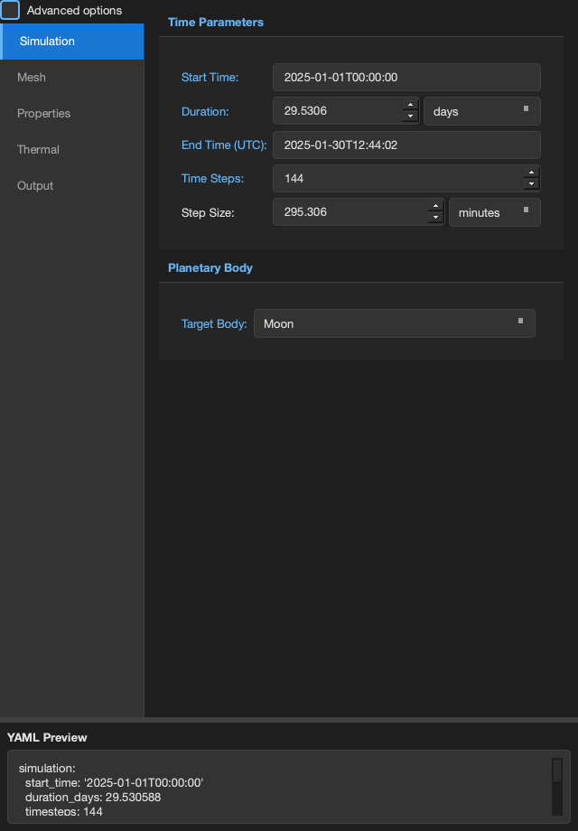

- Start Time: ISO 8601 UTC. Drives the SPICE ephemeris lookup.
- Duration, with a unit selector (days / hours / Earth years / synodic
  periods). Selecting a body re-sets this to one synodic day of that body
  (Moon: 29.530588 d), so a fresh project always starts at one full diurnal
  cycle.
- End Time (UTC): computed from start + duration, and editable: type an
  end time and the duration follows.
- Time Steps and Step Size are two views of the same quantity and stay
  in sync; edit either one. These set the output cadence.
- Target Body: Moon, Europa, Mercury, Enceladus, Titan, Mars, Ceres, plus
  `Custom Body...` and `Browse HORIZONS...` for anything else. Changing the
  body updates every body-aware page at once (properties, mesh datasets, albedo
  maps, equilibration units).

The YAML preview at the bottom is live: it is the file that will be handed
to the engine, and the quickest way to confirm a control changed the key you
intended.

### Mesh

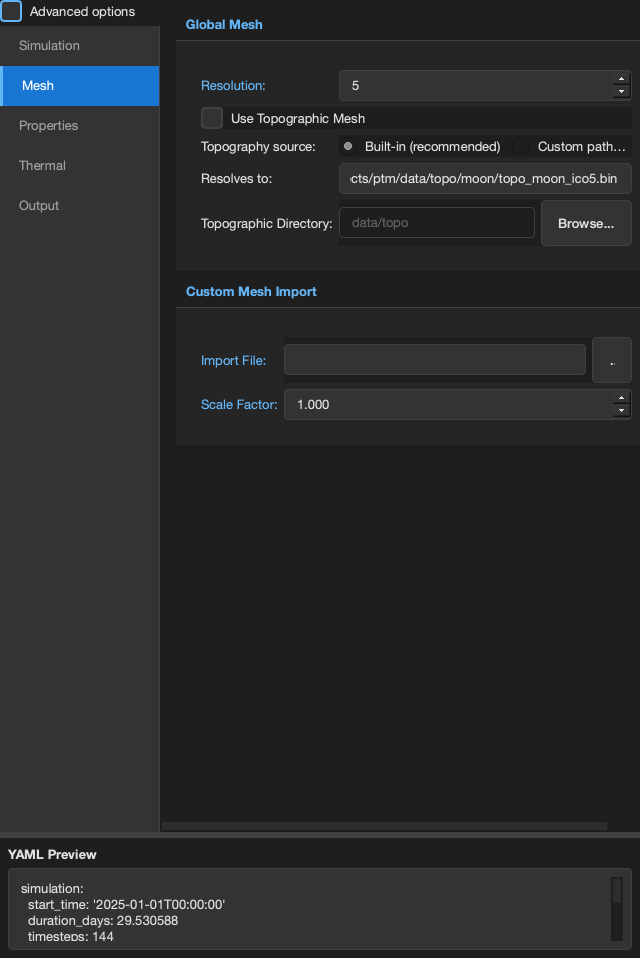

- Resolution: icosphere subdivision level. Level 3 is 1,280 faces (the
  quickstart), level 5 is 20,480, level 7 is 327,680. Face count grows as
  `20 x 4^level`; so does everything downstream.
- Use Topographic Mesh, plus a Topography source selector: *Built-in*
  resolves a shipped dataset under `data/topo` (through `PTM_DATA_ROOT` or the
  repository `data/` directory) and shows you the exact resolved path in the
  read-only Resolves to box; *Custom path* points at your own directory.
  If a built-in dataset is not on disk, the box says `NOT ON DISK` or
  `DATALESS (cloud placeholder)` and a Fetch... button appears.
- Custom Mesh Import: an `.obj`/`.ply`/`.vtk` of your own, with a scale
  factor. Setting an import file disables the global-mesh controls, because they
  no longer apply.

### Properties

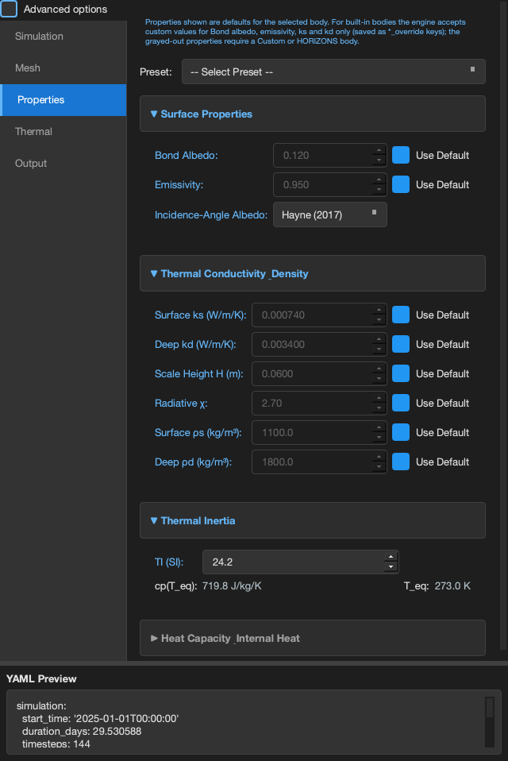

Thermophysical properties, seeded from the selected body. Each row has a
Use Default checkbox; uncheck it to type your own value.

> For a built-in body the engine accepts custom values only for Bond
> albedo, emissivity, ks and kd (written as `*_override` keys). It has no
> path for `H`, `rhos`, `rhod`, `cp0`, `Qb`, or `chi` on a built-in body, so
> the GUI disables those six rows
> (`gui/gui_panels/config_panel.py:1828-1845` and `:2201-2238`).
> To customize them, use a Custom or HORIZONS body, where they are written to
> `generic_body.surface:` and are read.

The Incidence-Angle Albedo control is a model selector, not an on/off switch:
*Hayne (2017)* (the default for global bodies) or *Hapke*. It maps to the single
engine key `incidence_angle_albedo` (`false` = Hayne, `true` = Hapke). There is
no "off"; `false` already selects the Hayne angular model.

The Thermal Inertia row is derived: it shows TI = sqrt(k rho cp) and the
implied `cp(T_eq)`. Typing a value there activates constant-TI mode, which
forces chi to 0 (no radiative conductivity) and makes `cp` constant.

### Thermal

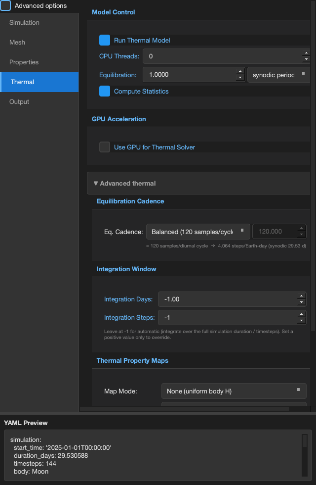

- Run Thermal Model: off gives you an illumination-only run.
- CPU Threads: 0 = auto (all cores).
- Equilibration: spin-up before the output window, in synodic periods by
  default (also selectable in orbital periods, days, hours, Earth years).
- Compute Statistics: writes the per-face min/mean/max binaries. Leave it on.
- Use GPU for Thermal Solver: only meaningful on a GPU-enabled build
  (section 9).

Under Advanced thermal (collapsed by default, expanded in the figure):

- Equilibration Cadence: decouples the equilibration time step from the
  output cadence. Presets are stated with their measured accuracy against a
  legacy reference run (Balanced 120 samples/cycle ~4 K max; High accuracy 240
  ~3 K; Fast 30 ~7 K; Legacy = match output cadence, byte-identical to old
  PTM3D). On a large mesh with fine output cadence this is the difference
  between minutes and hours.
- Integration Window: leave both at `-1` (automatic) unless you are
  deliberately integrating over a sub-window.
- Thermal Property Maps: per-face H or thermal-inertia maps
  (None / bundled-for-body / custom binary file).

### Output

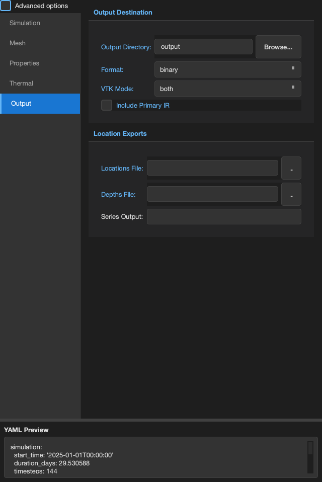

- Output Directory: relative paths resolve against the project root,
  which the GUI derives from the location of the engine binary (the directory
  containing `build/bin/ptm_thermal_sim`), not from wherever you launched the
  GUI. The console prints the pinned working directory (`[run] cwd: ...`) at
  launch.
- Format (`binary` or `vtk`) and VTK Mode (`thermal` / `complete` /
  `both`).
- Location Exports: a `lat,lon` file and a depths file give you
  per-location, per-depth temperature series in addition to the per-face
  binaries.

---

## 4. Your first run

This is [tutorial 02](01_quickstart.md)'s lunar diurnal run, done
through the GUI.

1. Body: Moon (the default). Duration stays at one synodic day.
2. Mesh > Resolution: `3` (1,280 faces).
3. Simulation > Time Steps: `144`.
4. Thermal: leave GPU off; Compute Statistics on.
5. Output > Output Directory: `output/gui_tutorial_moon_quickstart`.
6. Optional: `Ctrl+T` (Simulation > Validate Configuration) for a quick
   check on ranges and required fields.
7. Press **Run** (or `F5`).

Saving first is not required, and Run never writes the file you opened. It
always writes an engine-facing `config.yaml` (all paths absolutized) into the
output directory and runs that; your project file changes only when you press
Save or Save As. The console reports both paths: the one the engine read, and
the project file it left alone.

> Changed on 2026-08-25. Run used to call Save first whenever a project file
> was open, which rewrote the author's own file: on the two shipped examples
> that erased 10 and 19 comments and added 33 and 42 keys. A config is a
> scientific record, so opening is now read-only.

### The pre-flight check

Before the engine starts, the GUI runs a pre-flight
(`gui/gui_core/preflight.py`) and prints the result to the console:

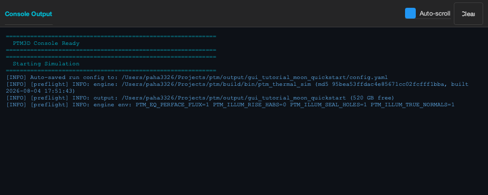

The lines report:

- which binary will run, by absolute path, md5, and build time (a
  quick check that a rebuild took effect);
- where the output goes, and how much disk is free there;
- which engine environment flags are being applied (by default the
  recommended illumination-fix set: `PTM_ILLUM_TRUE_NORMALS=1`,
  `PTM_ILLUM_RISE_EPS=1`, `PTM_ILLUM_RISE_KEPS=0.2`, `PTM_ILLUM_RISE_HABS=0`,
  `PTM_ILLUM_SEAL_HOLES=1`), and which source they came from: the
  recommended set, or an `engine_env:` block in the config, which is honored
  exactly as written.

> This set changed on 2026-08-25, and it changes what GUI runs compute.
> Until then the GUI set `PTM_ILLUM_RISE_HABS=0` without setting
> `PTM_ILLUM_RISE_EPS=1`, which is the gate that makes the engine read it at
> all. The validated grazing-incidence leak fix was therefore not applied to
> any GUI run between 2026-07-29 and 2026-08-25, while the GUI's own comment
> and this page both said it was. Adding the gate and its scale factor turns
> the fix on, so illumination (and therefore temperatures) differ from
> earlier GUI runs of the same config.
>
> `PTM_EQ_PERFACE_FLUX` is deliberately no longer injected. The
> engine reports it has no effect on the CPU path, and on the GPU path with
> `thermal.spinup_seed: legacy` it silently overrides the one setting whose
> whole purpose is reproducing a pre-fix baseline digit-for-digit. A config
> that wants it can ask for it in its own `engine_env:` block.

Pre-flight blocks the launch on missing/unreadable files and on "dataless"
cloud placeholders (files evicted to the cloud; reading one hangs the engine
indefinitely). It asks for an explicit override on cloud-synced paths and on a
view-factor rebuild. Keep simulation input data on a local disk.

### The view-factor cost estimate

If radiation exchange is on and no view-factor file is set, the engine builds
the view-factor matrix first, which can dominate the run. The GUI warns
before launch, with an estimate:

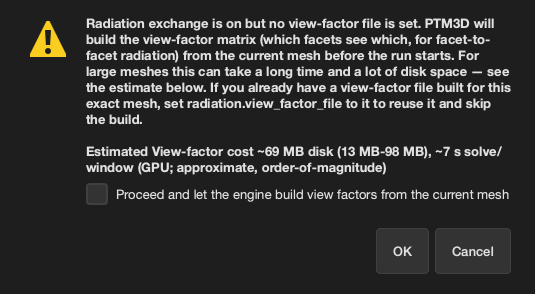

The estimate is labeled approximate (disk from 8 bytes per nonzero; solve time
from measured throughput; the build time is separate and highly variable)
and advisory: it warns but never blocks. The same estimate updates live on
the Radiation page (section 7).

For this walkthrough radiation is off, so no dialog appears.

### Watching it run

The Run button grays out, Stop becomes available, a progress bar appears
in the status bar, and the indicator on the right turns yellow (Running). The
console streams the engine's output.


Two notes on the console:

- Lines are colored by content, not by which stream they came from (the
  engine writes informational banners to stderr). Red is reserved for genuine
  failure signatures (`ERROR:`, `FATAL:`, tracebacks, crash signatures,
  "simulation failed"), yellow for warnings
  (`gui/gui_core/simulation_runner.py:33-57`).
- A watchdog samples the child process's CPU clock every 30 s. If the
  process stops accumulating CPU time it posts a `[watchdog]` warning and the
  status bar reads `STALLED`, distinguishing a long computation from a hang
  (a blocked file read, a wedged GPU).

### Completion

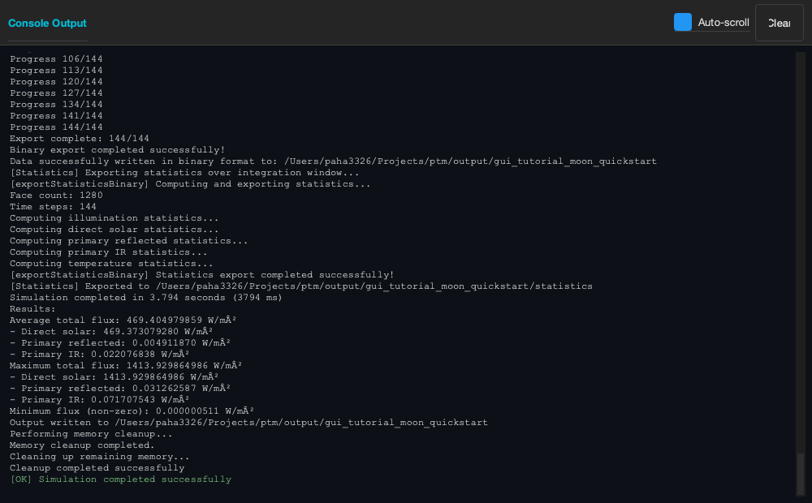

On exit code 0 you get a green `Simulation completed successfully`, and the GUI
loads the output directory automatically and switches to the Results
Browser. On a nonzero exit code you get a red failure line with the code, and no
auto-load.

Exit code 0 alone does not confirm a healthy run. Check the tail of the log:
face count, time steps, `Statistics export completed successfully`, and a flux
summary that is not all zeros. The run above reported 1,280 faces, 144 time
steps, and a maximum total flux of 1,413.9 W/m^2, about right for the Moon at
1 AU.

---

## 5. Looking at the results

### Results Browser

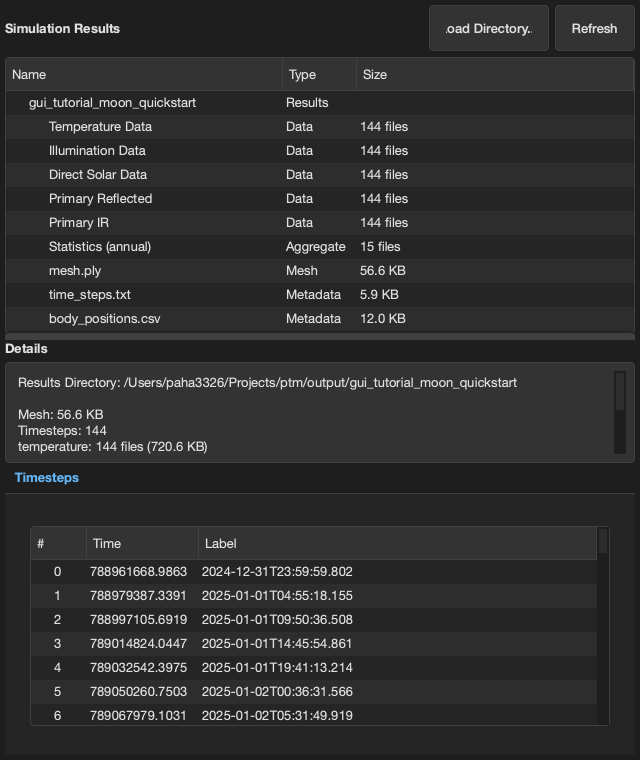

The tree shows what the run produced (per-timestep series for temperature,
illumination, direct solar, primary reflected and primary IR; the
`Statistics (annual)` aggregate set; `mesh.ply`, `time_steps.txt`, and
`body_positions.csv`), with file counts and sizes. The Details pane
summarizes the directory; the Timesteps table lists every output step with
its epoch and UTC label, and clicking a row drives the 3D view.

A directory is only accepted if it contains `mesh.ply`; otherwise the panel
tells you it is not a PTM3D output directory.

### 3D and 2D views

The right-hand panel has two tabs. 3D Visualization renders the mesh colored
by the selected field, with rotate/zoom/pan, face picking (click a face to get
its values), timestep animation, and image export (`Ctrl+E`). 2D Plots gives
temperature histograms, temperature-vs-latitude scatter, and time series,
including the series for a picked face.

The toolbar's Timestep and Field selectors populate from what is
present in the loaded directory (statistics fields from `statistics/*.bin`,
per-step fields from the per-field subdirectories), so only fields the run
wrote are selectable (`gui/ptm3d_gui.py:947-997`).


For exporting to other tools, the Export Data button on the visualization
panel writes GeoTIFF, HDF5, both, or VTU/PVD (`ExportDataDialog`,
`gui/gui_panels/visualization_panel.py:2125`); the 2D Plots tab has its own
Export Data (ASCII) button for the plotted series. For reading the raw
binaries yourself, see
[03_outputs.md](03_outputs.md).

---

## 6. Saving and reopening a project

`Ctrl+S` writes the configuration as YAML in the same schema the command-line
engine reads, so a GUI project is a config file and vice versa. `Ctrl+O`
reopens one, File > Open Recent keeps the last ten. Every run's
`config.yaml` (in the output directory, with absolutized paths) is the exact
configuration that ran, which makes it the right thing to archive next to the
results.

Three properties of a save matter:

- Save edits your file in place. It rewrites only the keys whose values you
  changed, so comments, ordering, blank lines and quoting all survive, and a
  key your file never mentioned stays unmentioned. Measured on the two shipped
  commented examples: open-then-save with no edits is byte-identical, and
  changing one field changes exactly two lines (the old and new spelling of
  that field, keeping its own trailing comment). The console says how many keys
  were rewritten after every save.
  This needs `ruamel.yaml`, which `gui/requirements.txt` requires. Without it
  the GUI falls back to the old flattening writer and says so in the
  console, in the status bar, and in a dialog you can cancel.
- The YAML Preview pane is not what Save writes. It is the fully expanded,
  engine-facing configuration a run is handed, which lands beside the output
  directory as `config.yaml`.
- An `engine_env:` block is honored exactly as written, including an empty
  one. Only a config with no `engine_env:` key at all gets the recommended set.

### Checking a configuration

Simulation > Check Configuration (`Ctrl+T`) runs the GUI's own checks and
hands the configuration to `ptm_thermal_sim --validate-config`, which parses it,
applies every startup check that does not need the mesh or SPICE, and exits
without simulating. The engine's own message is shown verbatim, so the GUI is
no longer maintaining a second, weaker copy of the rules.

If the engine cannot be asked (no binary, a binary too old to carry the flag,
or a timeout), the result says NOT CHECKED. It never reports "could not
ask" as "fine". And `rc = 0` there means the configuration is well formed, not
that the run will complete: mesh units, SPICE kernels, property-map face counts
and the `martinez2021` density guard are all checked later, and the engine's
own banner names them.

---

## 7. Advanced mode

The Basic/Advanced boundary is drawn by field, not by page. Every page
(Simulation, Mesh, Properties, Thermal, Output, Illumination, Radiation, GPU,
Engine Flags and HORIZONS) is in the nav rail in both tiers. Body is the
one exception, and its gate is relevance rather than tier: it describes a
custom or HORIZONS body, and there is nothing for it to describe on a built-in
one.

Tick Advanced options above the nav rail and each page grows a collapsed
expert section:

| Page | Advanced section |
|---|---|
| Mesh | Mesh Placement and Occluder |
| Thermal | Advanced thermal (cadence, convergence, integration window, property maps, depth grid) · Initial Condition and Run State · Ice Stability · GPU Dispatch and Wedge Mitigations |
| Properties | Heat Capacity and Internal Heat |
| Radiation | Thermal-Radiation Coupling · View Factor Options · Sparse View Factors · Radiosity GPU Dispatch |
| Illumination | Advanced illumination (ray tracing, precomputed positions, BVH cache, illumination GPU) |
| GPU | Change the GPU safety policy |
| Engine Flags | Edit engine flags |

Measured split: 71 bound controls in Basic, 74 behind Advanced.

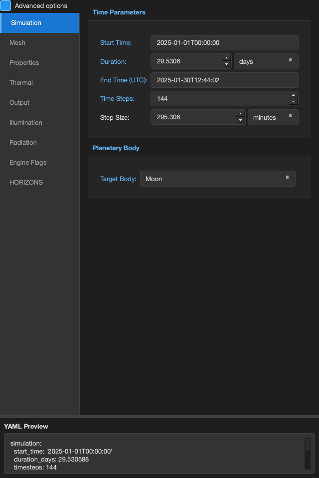

This is purely a visibility filter. Every control exists in both tiers and
still loads and saves; the configuration that would be written is
byte-identical with the toggle off, on, and off again.

Radiation and Illumination used to be hidden wholesale, which meant the Basic
tier could not express a crater run at all, and this model exists mostly to run
craters. That is the most visible change.

### Illumination

Include Reflected Sunlight from Primary Body gates only the
reflected-sunlight term from the primary (Jupiter for Europa, Earth for
the Moon) in the total incident flux
(`src/cpp/illumination/illumination_model.cpp:2279`). It does not gate the
primary's thermal IR, which is computed independently and zeroed only when
the primary is the Sun (`:2263-2271`). Turning this off is not "no primary
body."

The page also carries the albedo source selector: *Built-in* resolves
the shipped Bond-albedo map for the body and resolution and shows the resolved
path, *Custom path* takes your own file or directory, *None* means every face
uses the constant albedo from the Properties tab. Under Advanced
illumination are the ray-tracing batch controls and precomputed Sun/primary
position files.

### Radiation

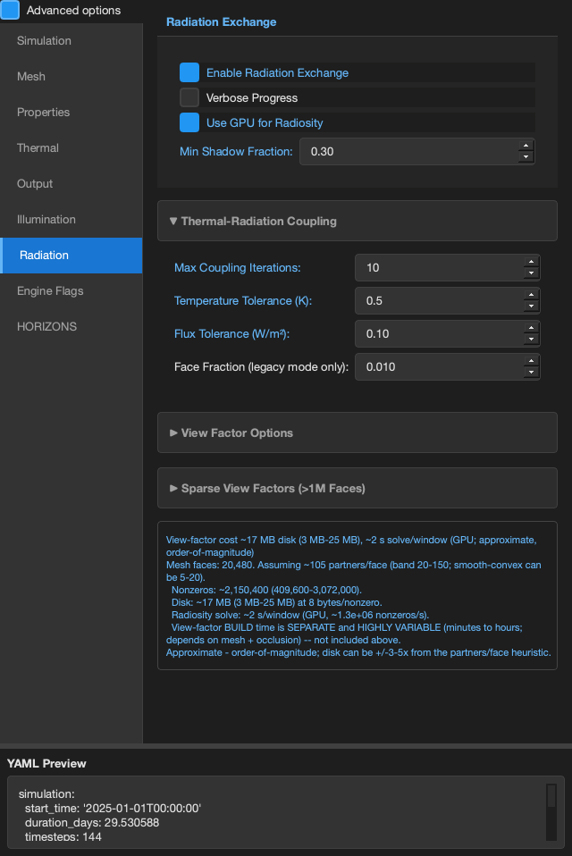

Enable Radiation Exchange turns on face-to-face radiosity. It is necessary for
craters, rough terrain, and anything with self-heating, and has no effect on a
smooth convex sphere. Use GPU for Radiosity and Min Shadow Fraction sit
alongside it, and the collapsed sections hold the coupling controls, the
view-factor file/H-matrix/ACA options, and the sparse-view-factor settings for
meshes above ~1M faces.

Coupling controls: the engine's default coupling mode is `bounded`
(`src/cpp/tools/config_parser.h:315`). Coupling Mode is now a three-way
selector in the Thermal-Radiation Coupling section (`bounded` / `fixed` /
`legacy`), and the Face Fraction field below it is gated on it: the
face-fraction exit criterion has no error bound, so `bounded` and `fixed`
ignore it, and the field is disabled unless `legacy` is selected. Before that
gate existed, a field labeled "legacy mode only" sat editable next to a mode
nobody could choose. If Face Fraction is changed without setting
`coupling_mode: legacy`, the engine prints a console warning:

  ```
  WARNING: radiation.coupling_face_fraction=0.02 is IGNORED in
  coupling_mode='bounded' (the face-fraction exit has no error bound).
  Use coupling_mode: legacy to restore it.
  ```

Max Coupling Iterations, Temperature Tolerance, and Flux Tolerance
are live in the default mode.

The blue box at the bottom of the page is the live view-factor cost
estimate, recomputed whenever the mesh or the radiation settings change. It
reports estimated nonzeros, disk, and radiosity solve time per window, with an
explicit band (partners-per-face is a heuristic, 5-20 for smooth convex, ~105
default). At high resolution it adds a warning:

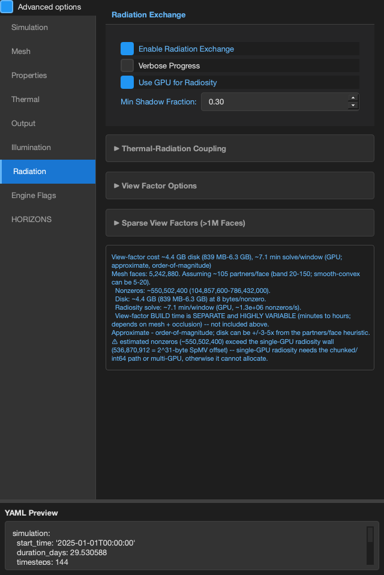

At level 9 (5,242,880 faces) the estimate crosses the single-GPU radiosity
limit of 536,870,912 nonzeros (a 2^31-byte SpMV offset), beyond which
single-GPU radiosity cannot allocate; the chunked/int64 path or multiple GPUs
are required. The estimator warns and lets you proceed; it is advisory, not a
gate.

If radiation is off, the box reads
`Enable radiation exchange to see a view-factor cost estimate.`

### Engine Flags

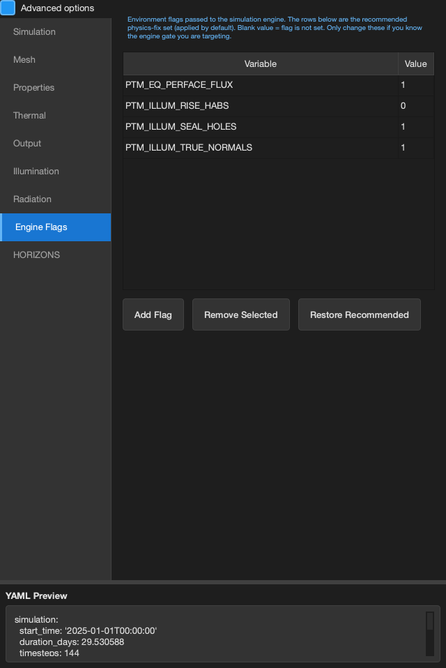

The engine gates several physics fixes behind `PTM_*` environment variables so
that old runs stay byte-identical. The GUI applies the recommended-ON set by
default.

The page leads with a read-only summary of exactly what the launch will
export (computed from the same planner the launch uses, so the two cannot
disagree), and the editable table is behind Advanced options. That summary
is in the Basic tier on purpose: the whole page used to be Advanced-only, which
is where an inert `PTM_ILLUM_RISE_HABS` sat unnoticed for a month while the
GUI's own comment said the fix was applied. A summary that cannot be reached
discloses nothing.

The table lets you override a value, add a flag, or blank one out (blank = not
set). Restore Recommended puts the default set back. The set is stored in
the project YAML under `engine_env:`, so a saved project records exactly what
its run had set, and the engine reads the same block at startup.

Change these only deliberately, for example to reproduce an old run that
predates a fix. The "Reproduce a published baseline" card on the Start page is
the safer route: it takes the block from the baseline's own record.

### GPU

The GPU page is the cross-cutting safety policy: whether a GPU rung is
allowed at all and which dies each pool may use. It is deliberately
read-mostly: it leads with the effective value of each guardrail and
where that value came from, plus this host's calibration profile, and the
editable controls are behind Advanced options.

The page exists to carry one distinction: `gpu.min_vram_margin_gib = 2.0` as
the engine's own default is enforced on macOS + AMD and advisory elsewhere,
while the same number written into your config is enforced on every
platform (`src/cpp/tools/config_parser.h:826`; the engine reads the key's
presence as the request). Two identical numbers, two different behaviors, and
nothing in a YAML file shows you which one you have.

Because of that, the GUI writes this section selectively (the only section
it treats this way). A guardrail equal to the engine's default is not written at all, so a
config the GUI touched does not silently change GPU policy on someone else's
machine, and the floor is written only when you tick "Enforce the VRAM floor
on EVERY platform". A default GUI config carries no `gpu:` section.

Per-solver device and batch controls (`gpu_devices`, `gpu_device_ids`,
`gpu_batch_size`, `gpu_inter_batch_pause_ms`) live in the Advanced sections of
the Thermal, Radiation and Illumination pages; they are the main wedge
mitigations on this hardware, where a hard wedge needs a reboot.

`Illumination > Use GPU for Illumination` is off by default and that is a
recommendation, not an oversight: the CPU illumination path here is both
correct and faster. The control exists so the choice is visible.

### Body / HORIZONS

`Browse HORIZONS...` on the Simulation page searches JPL HORIZONS for a small
body, caches a `body_config.yaml`, and adds it to the body list; the Body
page then exposes its shape, orbit, spin, and surface properties, including
the six thermophysical fields that a built-in body cannot set. Selecting a
HORIZONS body also switches the albedo source to *None* and turns off primary
reflection, since an asteroid has no parent body to reflect from.

There is also an optional Camera tool (View > Show Camera Tool), hidden
by default, which drives `ptm_camera_sim` for synthetic imaging.

---

## 8. Confirming a setting took effect

Some engine settings apply only in certain modes or on certain body types,
such as the `coupling_face_fraction` case above, or thermophysical scalars on built-in
bodies. The GUI disables or labels the known cases; to confirm any setting
reached the run:

1. Read the YAML preview. Change the control and check that the key
   changed in the pane at the bottom of the configuration panel; the run uses
   exactly that file.
2. Read the pre-flight lines. Binary md5, output path, engine environment:
   a record of exactly what is about to run.
3. Read the engine's banners in the console. The engine announces what it
   did (`Radiation exchange enabled from config file`,
   `Loaded view factors from: ...`, `Face count: ...`) and warns when a set
   value is ignored. If a setting is never mentioned, check the YAML.
4. Compare the outputs. For anything that should change temperatures, run
   both arms and difference them, as [tutorial 04](02_crater_radiosity.md)
   does.

---

## 9. Troubleshooting

**"Could not find ptm_thermal_sim executable" / pre-flight error
`ptm_thermal_sim executable not found. Build the project first`.**
The GUI looks for `build/bin/ptm_thermal_sim` relative to the repository
(`gui/gui_core/simulation_runner.py:389-406`). You have not built the engine, or
you built it somewhere else. Follow [INSTALL.md](../../INSTALL.md):

```bash
cmake -S . -B build -DCMAKE_BUILD_TYPE=Release -DPTM_ENABLE_GPU=OFF \
      -DCSPICE_ROOT="$CSPICE_ROOT"
cmake --build build --target ptm_thermal_sim -j
```

**The run dies almost immediately with a SPICE error.**
The SPICE kernels are not downloaded (they are large, and not in the
repository):

```bash
python3 scripts/fetch_kernels.py --bodies moon    # Moon/Mercury core, ~44 MB
python3 scripts/fetch_kernels.py --bodies europa  # adds the Galilean ephemeris (~1.1 GB)
```

`data/kernels/*.tm` metakernels use paths relative to the repository root.
The GUI pins the working directory to the project root, so this works from the
GUI; it is a common failure when running the engine by hand from elsewhere.

**"Use GPU" is checked and the run fails or ignores it.**
CPU and GPU are a build-time choice. `PTM_ENABLE_GPU=OFF` is the default on
a fresh checkout, and PTM3D is designed to run well on ordinary CPUs using all
cores. For the GPU path, configure with `-DPTM_ENABLE_GPU=ON` and run the
one-time per-host calibration (`ptm_thermal_sim --calibrate-gpu`). Run the
calibration deliberately, not automatically: on some AMD hardware a wedged GPU
can take down the whole machine. On Apple Silicon (no OpenCL support), use the
CPU path.

**Everything in the console is red and the run "failed" but the outputs look
fine.** You are on an old build; severity is classified by content on current
`main`. Update.

**The launch is blocked with "Cloud placeholder (dataless) files".** Those files
have been evicted to the cloud; reading one hangs the engine indefinitely.
Hydrate them (Finder: right-click > "Always Keep on This Device", wait for the
download) or point the config at a local copy. It is better to keep simulation
input data off cloud-synced folders entirely.

**No 3D view.** `pip install --upgrade pyvista pyvistaqt vtk`. Only the 3D tab
is affected; the rest of the app works without it.

**A control seems to do nothing.** See section 8, and check the console for an
engine warning saying the value is ignored.

---
