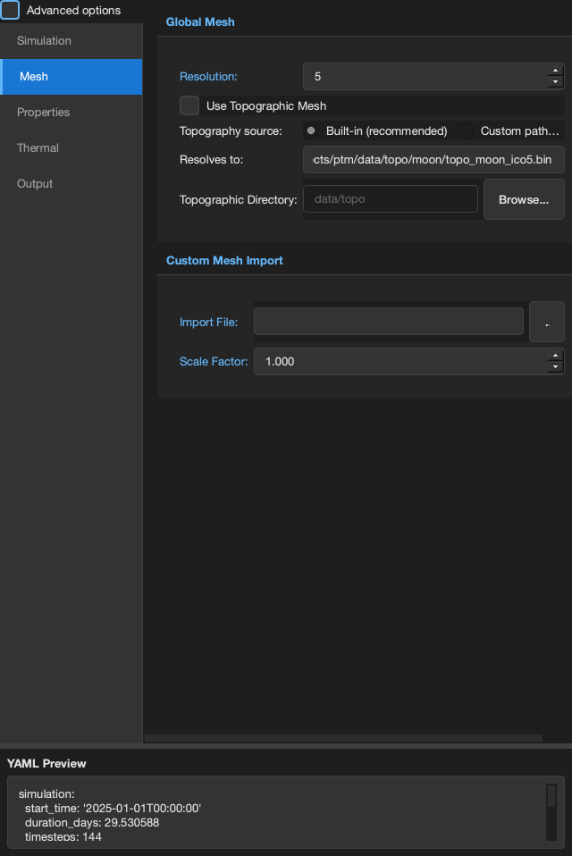
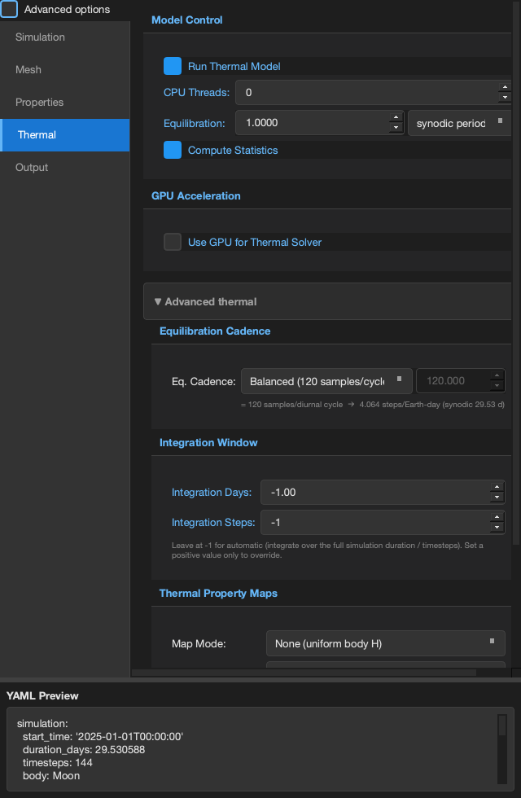
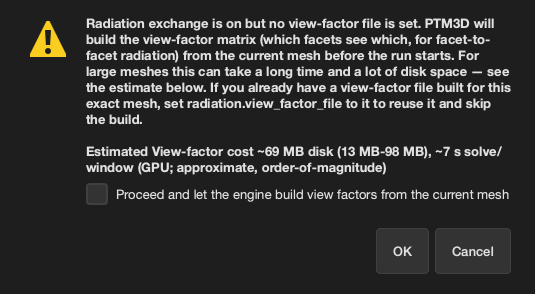
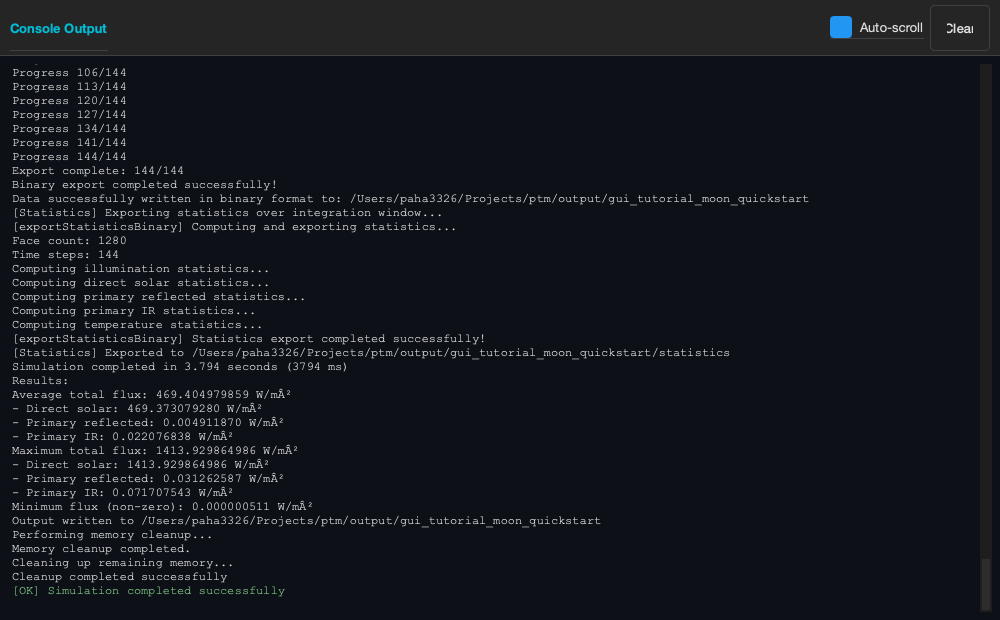
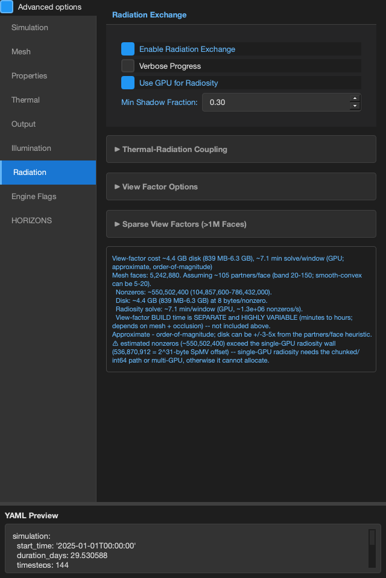

# Tutorial 07 — The PTM3D GUI, end to end

**Application:** [`gui/run_gui.py`](../../gui/run_gui.py) (the thermal simulation
app, `gui/ptm3d_gui.py`)
**Cost of the walkthrough run:** one quickstart-class Moon simulation —
1,280 faces, one lunation, CPU only. Measured 3.8 s of engine time on a 48-core
workstation; expect a minute or two on a laptop.
**Verified:** 2026-08-07 against `origin/main` (7fd214f), PyQt6 6.7.1 / Qt 6.7.1.

Everything in the other tutorials can be done from the command line. This one
covers the same ground through the graphical front end, which is what most
colleagues will actually use. If you have not built PTM3D yet, start with
[INSTALL.md](../../INSTALL.md) — the GUI is a front end, not a substitute for
the engine binary.

All figures below were rendered from the real panels. The five marked
**[SCREENSHOT-PAUL #n]** still need to be shot on a live display; they are
tabulated again at the end.

---

## 1. Launching the GUI

### Dependencies

```bash
cd gui/
pip install -r requirements.txt
```

Required: `PyQt6`, `numpy`, `PyYAML`. Optional but strongly recommended:
`pyvista` + `pyvistaqt` (the 3D view) and `matplotlib` (the 2D plots). The
launcher checks these for you and says which are missing rather than dying with
an import traceback (`gui/run_gui.py:42-90`):

```
ERROR: Missing required dependencies:
  - PyQt6

Install with:
  pip install PyQt6
```

A missing *optional* package is a warning, not a failure — the app starts with
that feature disabled.

### The one supported entry point

```bash
cd gui/
python run_gui.py
```

Run it **from the `gui/` directory**. Two optional arguments open the app with
something already loaded:

```bash
python run_gui.py --project /path/to/config.yaml     # open a saved project
python run_gui.py --results /path/to/output_dir/     # open a finished run
```

`gui/run_dashboard.py` is a separate multi-module launcher that bundles the
DEM/mesh tools. It gets less testing; `run_gui.py` is the supported door.

On the **first launch only**, the app asks which body you want, so the default
(Moon) is an explicit choice rather than a silent one
(`gui/ptm3d_gui.py:163-191`). You can change it any time on the Simulation tab,
and the prompt never appears again.

> **[SCREENSHOT-PAUL #1]** — the first-launch "Select target body" dialog. To
> make it appear again, quit the GUI and run
> `defaults delete com.ptm3d.PTM3DSimulator bodyPickerShown`, then relaunch.
> Frame the dialog with the body list open.

---

## 2. The window

Three regions:

- **Left** — the configuration panel (a nav rail of pages, plus a live YAML
  preview underneath) and, as a second tab, the **Results Browser**.
- **Right** — the visualization panel: **3D Visualization** and **2D Plots**.
- **Bottom** — a docked **Console Output** pane, visible from launch.

The divider between left and right is draggable; ``Ctrl+` `` toggles the
console, and **View > Reset Layout** puts everything back.

> **[SCREENSHOT-PAUL #2]** — the whole window immediately after launch, before
> any run: config panel on the left with the Simulation page selected, the empty
> 3D view on the right, the console at the bottom showing "PTM3D Console Ready".
> Frame the full window so the toolbar, status bar, and all three regions are
> visible.

Keyboard shortcuts worth memorizing: `F5` run, `Shift+F5` stop, `Ctrl+T`
validate configuration, `Ctrl+S` save project, `Ctrl+L` load a results
directory, `F6` refresh the 3D view, `Home` reset the camera.

---

## 3. Basic mode — the five pages you need

The configuration panel opens in **Basic** mode: five pages, which is everything
a standard thermal run needs. The **Advanced options** checkbox above the nav
rail reveals the rest (section 7).

### Simulation


- **Start Time** — ISO 8601 UTC. Drives the SPICE ephemeris lookup.
- **Duration** with a unit selector (days / hours / Earth years / **synodic
  periods**). Selecting a body re-sets this to **one synodic day of that body**
  (Moon: 29.530588 d), so a fresh project always starts at one full diurnal
  cycle.
- **End Time (UTC)** — computed from start + duration, and editable: type an
  end time and the duration follows.
- **Time Steps** and **Step Size** are two views of the same quantity and stay
  in sync — edit either one. These set the **output** cadence.
- **Target Body** — Moon, Europa, Mercury, Enceladus, Titan, Mars, Ceres, plus
  `Custom Body...` and `Browse HORIZONS...` for anything else. Changing the
  body updates every body-aware page at once (properties, mesh datasets, albedo
  maps, equilibration units).

The **YAML preview** at the bottom is live: it is the file that will be handed
to the engine. Read it. It is the fastest way to confirm that a control you just
touched changed the thing you meant.

### Mesh



- **Resolution** — icosphere subdivision level. Level 3 is 1,280 faces (the
  quickstart), level 5 is 20,480, level 7 is 327,680. Face count grows as
  `20 x 4^level`; so does everything downstream.
- **Use Topographic Mesh** plus a **Topography source** selector: *Built-in*
  resolves a shipped dataset under `data/topo` (through `PTM_DATA_ROOT` or the
  repository `data/` directory) and shows you the exact resolved path in the
  read-only **Resolves to** box; *Custom path* points at your own directory.
  If a built-in dataset is not on disk, the box says `NOT ON DISK` or
  `DATALESS (cloud placeholder)` and a **Fetch...** button appears.
- **Custom Mesh Import** — an `.obj`/`.ply`/`.vtk` of your own, with a scale
  factor. Setting an import file disables the global-mesh controls, because they
  no longer apply.

### Properties


Thermophysical properties, seeded from the selected body. Each row has a
**Use Default** checkbox; uncheck it to type your own value.

The important behavior here is the one that is *not* obvious:

> For a **built-in** body the engine accepts custom values only for **Bond
> albedo, emissivity, ks and kd** (it writes them as `*_override` keys). It has
> no path for `H`, `rhos`, `rhod`, `cp0`, `Qb`, or `chi` on a built-in body.
> The GUI therefore **disables** those six rows rather than letting you type a
> number the engine will silently ignore
> (`gui/gui_panels/config_panel.py:1828-1845` and `:2201-2238`).
> To customize them, use a Custom or HORIZONS body, where they are
> written to `generic_body.surface:` and are read.

**Incidence-Angle Albedo** is a model selector, not an on/off switch:
*Hayne (2017)* (the default for global bodies) or *Hapke*. It maps to the single
engine key `incidence_angle_albedo` (`false` = Hayne, `true` = Hapke). There is
no "off" — `false` already selects the Hayne angular model.

The **Thermal Inertia** row is derived: it shows TI = sqrt(k rho cp) and the
implied `cp(T_eq)`. Typing a value there activates constant-TI mode, which
**forces chi to 0** and makes `cp` constant — by design, and worth knowing
before you wonder where your radiative conductivity went.

### Thermal



- **Run Thermal Model** — off gives you an illumination-only run.
- **CPU Threads** — 0 = auto (all cores).
- **Equilibration** — spin-up before the output window, in synodic periods by
  default (also selectable in orbital periods, days, hours, Earth years).
- **Compute Statistics** — writes the per-face min/mean/max binaries. Leave it on.
- **Use GPU for Thermal Solver** — only meaningful on a GPU-enabled build
  (section 9).

Under **Advanced thermal** (collapsed by default, expanded in the figure):

- **Equilibration Cadence** — decouples the equilibration time step from the
  output cadence. Presets are stated with their measured accuracy against a
  legacy reference run (Balanced 120 samples/cycle ~4 K max; High accuracy 240
  ~3 K; Fast 30 ~7 K; Legacy = match output cadence, byte-identical to old
  PTM3D). On a large mesh with fine output cadence this is the difference
  between minutes and hours.
- **Integration Window** — leave both at `-1` (automatic) unless you are
  deliberately integrating over a sub-window.
- **Thermal Property Maps** — per-face H or thermal-inertia maps
  (None / bundled-for-body / custom binary file).

### Output


- **Output Directory** — relative paths resolve against the **project root**,
  which the GUI derives from the location of the engine binary (the directory
  containing `build/bin/ptm_thermal_sim`), *not* from wherever you launched the
  GUI. The console prints the pinned working directory (`[run] cwd: ...`) at
  launch, so you always know where results will land.
- **Format** (`binary` or `vtk`) and **VTK Mode** (`thermal` / `complete` /
  `both`).
- **Location Exports** — a `lat,lon` file and a depths file give you
  per-location, per-depth temperature series in addition to the per-face
  binaries.

---

## 4. Your first run

This is [tutorial 02](02_lunar_diurnal_icosphere.md)'s lunar diurnal run, done
through the GUI.

1. **Body**: Moon (the default). Duration stays at one synodic day.
2. **Mesh > Resolution**: `3` (1,280 faces). Start small; you can always go up.
3. **Simulation > Time Steps**: `144`.
4. **Thermal**: leave GPU off; **Compute Statistics** on.
5. **Output > Output Directory**: `output/gui_tutorial_moon_quickstart`.
6. Optional: `Ctrl+T` (**Simulation > Validate Configuration**) for a quick
   sanity check on ranges and required fields.
7. Press **Run** (or `F5`).

You do **not** have to save first. If a project file is open, the GUI saves it
and runs it; if not, it writes an engine-facing `config.yaml` into the output
directory with every path absolutized, and runs that
(`gui/ptm3d_gui.py:679-709`). Either way the console tells you which file it ran.

### The pre-flight check

Before the engine starts, the GUI runs a pre-flight
(`gui/gui_core/preflight.py`) and prints the result to the console:


Read those four lines every time. In order they tell you:

- **which binary** you are about to run, by absolute path, **md5, and build
  time**. If you are ever unsure whether you rebuilt, this line settles it.
- **where the output goes**, and how much disk is free there.
- **which engine environment flags** are being applied — by default the
  recommended physics-fix set (`PTM_EQ_PERFACE_FLUX=1`, `PTM_ILLUM_RISE_HABS=0`,
  `PTM_ILLUM_SEAL_HOLES=1`, `PTM_ILLUM_TRUE_NORMALS=1`).

Pre-flight *blocks* the launch on missing/unreadable files and on "dataless"
cloud placeholders (files evicted to the cloud: reading one hangs the engine
indefinitely, so the GUI refuses rather than letting you hang). It asks for an
explicit override on cloud-synced paths and on a view-factor rebuild. Keep
simulation input data on a local disk.

### The view-factor cost estimate

If radiation exchange is on and no view-factor file is set, the engine has to
build the view-factor matrix first — which can dominate the run. The GUI warns
before you commit, with an estimate:



The estimate is explicitly labeled approximate (disk from 8 bytes per nonzero;
solve time from measured throughput; the *build* time is separate and highly
variable). It warns; it never blocks. The same estimate updates live on the
Radiation page as you change the mesh (section 7).

For this walkthrough radiation is off, so no dialog appears.

### Watching it run

The **Run** button greys out, **Stop** becomes available, a progress bar appears
in the status bar, and the indicator on the right turns yellow **Running**. The
console streams the engine's output.

> **[SCREENSHOT-PAUL #3]** — a run in progress. Start the quickstart run above
> and catch it mid-way. Frame the bottom-right of the window so the status bar
> shows the progress bar partly filled and the yellow "Running" badge, with the
> console streaming "Progress N/144" lines above it.

Two things worth knowing about the console:

- Lines are colored by **content**, not by which stream they came from. The
  engine writes plenty of informational banners to stderr; coloring by stream
  made good runs look failed. Red is reserved for genuine failure signatures
  (`ERROR:`, `FATAL:`, tracebacks, crash signatures, "simulation failed"), yellow
  for warnings (`gui/gui_core/simulation_runner.py:33-57`).
- A **watchdog** samples the child process's CPU clock every 30 s. If the
  process stops accumulating CPU time it posts a `[watchdog]` warning and the
  status bar reads `STALLED`. That distinguishes "still computing" from "hung on
  a file read or a wedged GPU" — a distinction you cannot make from a silent
  progress bar.

### Completion



On exit code 0 you get a green `Simulation completed successfully`, and the GUI
**loads the output directory automatically** and switches to the Results
Browser. On a nonzero exit code you get a red failure line with the code, and no
auto-load.

`rc=0` is necessary, not sufficient. Confirm the numbers in the tail of the log:
face count, time steps, `Statistics export completed successfully`, and a flux
summary that is not all zeros. The run above reported 1,280 faces, 144 time
steps, and a maximum total flux of 1,413.9 W/m^2 — about right for the Moon at
1 AU.

---

## 5. Looking at the results

### Results Browser


The tree shows what the run actually produced — per-timestep series
(temperature, illumination, direct solar, primary reflected, primary IR), the
`Statistics (annual)` aggregate set, `mesh.ply`, `time_steps.txt`, and
`body_positions.csv` — with file counts and sizes. The **Details** pane
summarizes the directory; the **Timesteps** table lists every output step with
its epoch and UTC label, and clicking a row drives the 3D view.

A directory is only accepted if it contains `mesh.ply`; otherwise the panel
tells you it is not a PTM3D output directory.

### 3D and 2D views

The right-hand panel has two tabs. **3D Visualization** renders the mesh colored
by the selected field, with rotate/zoom/pan, face picking (click a face to get
its values), timestep animation, and image export (`Ctrl+E`). **2D Plots** gives
temperature histograms, temperature-vs-latitude scatter, and time series,
including the series for a picked face.

The toolbar's **Timestep** and **Field** selectors populate themselves from
what is actually present in the loaded directory — statistics fields come from
`statistics/*.bin`, per-step fields from the per-field subdirectories — so you
can only select a field the run really wrote
(`gui/ptm3d_gui.py:947-997`).

> **[SCREENSHOT-PAUL #4]** — the 3D Visualization tab after loading
> `output/gui_tutorial_moon_quickstart`, with Field = "Annual Max Temperature
> (K)". Rotate so the sub-solar hemisphere is visible. Frame the 3D view plus
> the toolbar row above it, so the Timestep and Field selectors are readable.

> **[SCREENSHOT-PAUL #5]** — the 2D Plots tab on the same results: the
> temperature histogram and the temperature-vs-latitude scatter. Frame the whole
> right-hand panel.

For exporting to other tools, the **Export Data** button on the visualization
panel writes **GeoTIFF**, **HDF5**, both, or **VTU/PVD** (`ExportDataDialog`,
`gui/gui_panels/visualization_panel.py:2125`); the 2D Plots tab has its own
**Export Data (ASCII)** button for the plotted series. (`gui/README.md` lists a
wider set of formats under the Results Browser — the code above is what actually
ships.) For reading the raw binaries yourself, see
[06_interpreting_outputs.md](06_interpreting_outputs.md).

---

## 6. Saving and reopening a project

`Ctrl+S` writes the configuration as YAML — the same schema the command-line
engine reads, so a GUI project *is* a config file and vice versa. `Ctrl+O`
reopens one, **File > Open Recent** keeps the last ten. A run's auto-saved
`config.yaml` (in the output directory, with absolutized paths) is the exact
configuration that ran, which makes it the right thing to archive next to the
results.

---

## 7. Advanced mode

Tick **Advanced options** above the nav rail. Four more pages appear —
Illumination, Radiation, Engine Flags, HORIZONS — plus **Body** when a custom or
HORIZONS body is active (it is meaningless for a built-in body, so it stays
hidden).


This is purely a visibility filter. Hidden pages still load and save; toggling
it changes nothing in your YAML.

### Illumination

**Include Reflected Sunlight from Primary Body** does exactly what it says and
no more: it gates the **reflected-sunlight** term from the primary (Jupiter for
Europa, Earth for the Moon) in the total incident flux
(`src/cpp/illumination/illumination_model.cpp:2279`). It does **not** gate the
primary's **thermal IR**, which is computed and stored independently and is
zeroed only when the primary is the Sun (`:2263-2271`). Turning this off is not
"no primary body."

The page also carries the **albedo source** selector: *Built-in* resolves
the shipped Bond-albedo map for the body and resolution and shows the resolved
path, *Custom path* takes your own file or directory, *None* means every face
uses the constant albedo from the Properties tab. Under **Advanced
illumination** are the ray-tracing batch controls and precomputed Sun/primary
position files.

### Radiation


**Enable Radiation Exchange** turns on face-to-face radiosity — necessary for
craters, rough terrain, and anything with self-heating; pointless on a smooth
convex sphere. **Use GPU for Radiosity** and **Min Shadow Fraction** sit
alongside it, and the collapsed sections hold the coupling controls, the
view-factor file/H-matrix/ACA options, and the sparse-view-factor settings for
meshes above ~1M faces.

**Read this before touching the coupling controls.** The engine's default
coupling mode is `bounded` (`src/cpp/tools/config_parser.h:315`), and in that
mode the **Face Fraction** control does nothing:

- The control is labeled **"Face Fraction (legacy mode only)"** for exactly that
  reason (`gui/gui_panels/config_panel.py:1664-1671`). The face-fraction exit
  criterion has no error bound and made a coupled run's answer depend on how the
  window was chunked (PTM-89), so `bounded` and `fixed` mode ignore it.
- **The GUI has no control for `coupling_mode` at all** — it predates the
  setting. To run `legacy` (or `fixed`), you must add
  `radiation.coupling_mode: legacy` to the YAML by hand, or pass
  `--rad-coupling-mode` on the command line. This gap is tracked as **PTM-102**.
- If you change Face Fraction without also setting `coupling_mode: legacy`, the
  engine says so, in the console:

  ```
  WARNING [PTM-89]: radiation.coupling_face_fraction=0.02 is IGNORED in
  coupling_mode='bounded' (the face-fraction exit has no error bound).
  Use coupling_mode: legacy to restore it.
  ```

  Which is the point: **an inert knob that warns is fine; an inert knob that is
  silent is a bug.** Watch the console.

**Max Coupling Iterations**, **Temperature Tolerance**, and **Flux Tolerance**
are live in the default mode and are the knobs you actually want.

The blue box at the bottom of the page is the live **view-factor cost
estimate**, recomputed whenever the mesh or the radiation settings change. It
reports estimated nonzeros, disk, and radiosity solve time per window, with an
explicit band (partners-per-face is a heuristic, 5-20 for smooth convex, ~105
default). It also has a hard warning worth respecting:



At level 9 (5,242,880 faces) the estimate crosses the single-GPU radiosity wall
at 536,870,912 nonzeros (a 2^31-byte SpMV offset). Past that point single-GPU
radiosity cannot allocate; you need the chunked/int64 path or multiple GPUs.
The estimator warns and lets you proceed — it is advisory, not a gate.

If radiation is off, the box reads
`Enable radiation exchange to see a view-factor cost estimate.`

### Engine Flags


The engine gates several physics fixes behind `PTM_*` environment variables so
that old runs stay byte-identical. The GUI applies the recommended-ON set by
default; this table lets you override a value, add a flag, or blank one out
(blank = not set). **Restore Recommended** puts the default set back. The set is
stored in the project YAML under `engine_env:`, so a saved project documents
exactly what its run had set, and the engine itself reads the same block at
startup — which is why a GUI launch logs them as already set and identical
rather than fighting over them.

Do not change these casually. Do change them deliberately when you are
reproducing an old run that predates a fix.

### Body / HORIZONS

`Browse HORIZONS...` on the Simulation page searches JPL HORIZONS for a small
body, caches a `body_config.yaml`, and adds it to the body list; the **Body**
page then exposes its shape, orbit, spin, and surface properties — including
the six thermophysical fields that a built-in body cannot set. Selecting a
HORIZONS body also switches the albedo source to *None* and turns off primary
reflection, since an asteroid has no parent body to reflect from.

There is also an optional **Camera** tool (**View > Show Camera Tool**), hidden
by default, which drives `ptm_camera_sim` for synthetic imaging.

---

## 8. Make the GUI prove your setting took effect

PTM3D has a documented history of controls that quietly stopped reaching the
physics — the `coupling_face_fraction` case above, thermophysical scalars that
the engine ignores on built-in bodies, and others. The GUI now closes the
obvious ones (disabled rows, "legacy mode only" labels, engine warnings), but
the habit still matters, and it costs about ten seconds:

1. **Read the YAML preview.** Change the control, look at the pane at the bottom
   of the configuration panel. If the key did not change there, it will not
   change in the run.
2. **Read the pre-flight lines.** Binary md5, output path, engine env. That is
   your provenance for the run you are about to launch.
3. **Read the engine's own banners in the console.** The engine announces what
   it actually did: `Radiation exchange enabled from config file`,
   `Coupling mode: bounded (PTM-89: absolute selection threshold, no face-fraction exit)`,
   `Loaded view factors from: ...`,
   `WARNING [PTM-89]: ... is IGNORED ...`, `Face count: ...`. If you set
   something and the console never mentions it, that is your cue to check the
   YAML rather than to assume.
4. **Compare the outputs.** For anything that should change temperatures, run
   both arms and difference them, as [tutorial 04](04_crater_radiosity.md) does.
   A setting that changes nothing measurable did nothing measurable.

---

## 9. Troubleshooting

**"Could not find ptm_thermal_sim executable" / pre-flight error
`ptm_thermal_sim executable not found. Build the project first`.**
The GUI looks for `build/bin/ptm_thermal_sim` relative to the repository
(`gui/gui_core/simulation_runner.py:389-406`). You have not built the engine, or
you built it somewhere else. Follow [INSTALL.md](../../INSTALL.md):

```bash
cmake -S . -B build -DCMAKE_BUILD_TYPE=Release -DPTM_ENABLE_GPU=OFF \
      -DCSPICE_ROOT="$CSPICE_ROOT"
cmake --build build --target ptm_thermal_sim -j
```

**The run dies almost immediately with a SPICE error.**
The SPICE kernels are not downloaded (they are large, and not in the
repository):

```bash
python3 scripts/fetch_kernels.py --bodies moon    # Moon/Mercury core, ~44 MB
python3 scripts/fetch_kernels.py --bodies europa  # adds the Galilean ephemeris (~1.1 GB)
```

Note that `data/kernels/*.tm` metakernels use paths **relative to the repository
root**. The GUI pins the working directory to the project root for you, so this
works from the GUI; it is a common failure when running the engine by hand from
elsewhere.

**"Use GPU" is checked and the run fails or ignores it.**
CPU and GPU are a **build-time** choice. `PTM_ENABLE_GPU=OFF` is the default on
a fresh checkout, and PTM3D is designed to run well on ordinary CPUs using all
cores. If you want the GPU path you must configure with
`-DPTM_ENABLE_GPU=ON` and run the one-time per-host calibration
(`ptm_thermal_sim --calibrate-gpu`). Never let the GUI auto-run that calibration
on a machine whose GPU you care about — on some AMD hardware a wedge takes the
whole box down. Apple Silicon has no OpenCL future; use the CPU path there.

**Everything in the console is red and the run "failed" but the outputs look
fine.** You are on an old build. Severity is classified by content on current
`main`; if you see engine banners colored red, update.

**The launch is blocked with "Cloud placeholder (dataless) files".** Those files
have been evicted to the cloud; reading one hangs the engine indefinitely.
Hydrate them (Finder: right-click > "Always Keep on This Device", wait for the
download) or point the config at a local copy. Better: keep simulation input
data off cloud-synced folders entirely.

**No 3D view.** `pip install --upgrade pyvista pyvistaqt vtk`. The rest of the
app works without it; only the 3D tab is affected.

**A control seems to do nothing.** See section 8 — and check the console for an
engine warning saying the value is ignored. That is usually the answer, and it
is printed on purpose.

---

## Regenerating the figures

The panel figures in this tutorial are rendered offscreen, straight from the GUI
object model:

```bash
python scripts/make_gui_tutorial_screenshots.py          # panels only
python scripts/make_gui_tutorial_screenshots.py --run    # + one tiny CPU run
```

It never opens a window on your display. Note that the **whole window** and the
**3D/2D result views** cannot be captured this way: constructing
`VisualizationPanel` under the offscreen platform crashes inside headless
PyVista/VTK (SIGSEGV), and the main window constructs one (reproduce with
`--probe-mainwindow`). Those figures are the `[SCREENSHOT-PAUL]` items above.

## Screenshots still to be taken on a live display

| # | What to set up | What to frame |
|---|---|---|
| 1 | Quit the GUI, run `defaults delete com.ptm3d.PTM3DSimulator bodyPickerShown`, relaunch | The first-launch "Select target body" dialog, body list visible |
| 2 | Fresh launch, Simulation page selected, nothing loaded | The whole window: toolbar, config panel, empty 3D view, console, status bar |
| 3 | Run the section-4 quickstart and catch it mid-run | Status bar with a partly-filled progress bar and the yellow "Running" badge, console streaming `Progress N/144` |
| 4 | Load `output/gui_tutorial_moon_quickstart`, 3D tab, Field = "Annual Max Temperature (K)", sub-solar hemisphere toward the camera | The 3D view plus the toolbar row (Timestep and Field selectors readable) |
| 5 | Same results, 2D Plots tab | The whole right-hand panel: temperature histogram and temperature-vs-latitude scatter |
